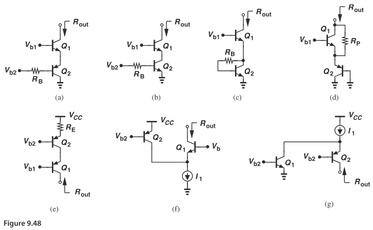

# 장말문제 9.11 — 일곱 가지 바이폴라 회로의 출력 임피던스와 캐스코드 판별

## 원문
Determine the output impedance of each circuit shown in Fig. 9.48. Assume $\beta \gg 1$. Explain which ones are considered cascode stages.

## 조건
- 회로: Fig 9.48 (a)–(g)
- $\beta \gg 1$로 가정
- 소자 값은 주어지지 않음. 답은 소신호 파라미터와 $R_B$, $R_P$, $R_E$ 기호로 나타냄 (원문에 없음)
- 전류원 $I_1$은 이상적 전류원으로 봄 (원문에 없음)

## 구할 것
- (a)–(g) 각 회로의 출력 임피던스 $R_{out}$
- 그중 어느 것을 캐스코드 단으로 볼 수 있는지 설명

## 회로 — Fig 9.48(a)
```spice
Q1  out  Vb1  n1  npn
Q2  0    n2   n1  pnp    ; 이미터 = n1(Q1 이미터), 컬렉터 = 접지
RB  Vb2  n2   {R_B}
```
- 단자: Vb1, Vb2 = 이상적 DC 바이어스, 값 미지정 (점 단자) / out = 출력, R_out 측정 단자 (개방 원)
- 표시: 노드 라벨 Vb1, Vb2 (각 점 단자 왼쪽) / 소자 라벨 Q1, Q2 (각 트랜지스터 오른쪽), R_B (가로 저항 아래) / 부호 없음 / 화살표 "R_out": out 노드를 회로 쪽(아래)으로 들여다봄, 아래 방향, 도선 옆 별도 화살표 (┌ 꺾임: out 도선 오른쪽에 세로선, 위 끝에서 짧은 가로선이 오른쪽 R_out 글자 쪽으로, 화살촉은 아래 끝, Q1 컬렉터 대각선 바로 위 높이) / 수치·면적 라벨 없음
- 배치: 한 세로줄 위→아래 out 원, Q1, Q2, 접지 / Q1 npn 보통 방향(베이스 왼쪽, 컬렉터 위, 이미터 아래·화살표 바깥) / Q2 pnp, 베이스 왼쪽, 이미터가 위(화살표가 막대 쪽으로 들어감), 컬렉터가 아래 / Q1 이미터에서 곧은 세로선이 Q2 이미터로 (n1, 라벨 없음) / Q2 컬렉터 아래 접지 / Vb2 점 단자 → 가로선 → 가로 저항 R_B → Q2 베이스 (Vb2 점 단자는 Vb1보다 왼쪽) / Vb1 점 단자 → 가로선 → Q1 베이스 / 접속점: 없음 / 교차: 없음

## 회로 — Fig 9.48(b)
```spice
Q1  out  Vb1  n1  npn
Q2  n1   n2   0   npn
RB  Vb2  n2   {R_B}
```
- 단자: Vb1, Vb2 = 이상적 DC 바이어스, 값 미지정 (점 단자) / out = 출력, R_out 측정 단자 (개방 원)
- 표시: 노드 라벨 Vb1, Vb2 (각 점 단자 왼쪽) / 소자 라벨 Q1, Q2 (각 트랜지스터 오른쪽, 이미터 옆), R_B (가로 저항 아래) / 부호 없음 / 화살표 "R_out": out 노드를 회로 쪽(아래)으로 들여다봄, 아래 방향, 도선 옆 별도 화살표 (┌ 꺾임: out 도선 오른쪽에 세로선, 위 끝에서 짧은 가로선이 오른쪽 R_out 글자 쪽으로, 화살촉은 아래 끝, Q1 컬렉터 대각선 바로 위 높이) / 수치·면적 라벨 없음
- 배치: 한 세로줄 위→아래 out 원, Q1, Q2, 접지 / Q1, Q2 모두 npn 보통 방향 / Q1 이미터에서 곧은 세로선이 Q2 컬렉터로 (n1, 라벨 없음) / Q2 이미터 아래 접지 / Vb2 점 단자 → 가로선 → 가로 저항 R_B → Q2 베이스 (Vb2 점 단자는 Vb1보다 왼쪽) / Vb1 점 단자 → 가로선 → Q1 베이스 / 접속점: 없음 / 교차: 없음

## 회로 — Fig 9.48(c)
```spice
Q1  out  Vb1  n1  npn
Q2  n1   n2   0   npn
RB  n2   n1   {R_B}      ; Q2 베이스 ↔ Q2 컬렉터(n1)
```
- 단자: Vb1 = 이상적 DC 바이어스, 값 미지정 (점 단자) / out = 출력, R_out 측정 단자 (개방 원)
- 표시: 노드 라벨 Vb1 (점 단자 왼쪽) / 소자 라벨 Q1, Q2 (각 트랜지스터 오른쪽, 이미터 옆), R_B (가로 저항 위) / 부호 없음 / 화살표 "R_out": out 노드를 회로 쪽(아래)으로 들여다봄, 아래 방향, 도선 옆 별도 화살표 (┌ 꺾임: out 도선 오른쪽에 세로선, 위 끝에서 짧은 가로선이 오른쪽 R_out 글자 쪽으로, 화살촉은 아래 끝, Q1 컬렉터 대각선 바로 위 높이) / 수치·면적 라벨 없음
- 배치: 한 세로줄 위→아래 out 원, Q1, n1 접속점, Q2, 접지 / Q1, Q2 모두 npn 보통 방향 / Q1 이미터 → 세로선 → n1 접속점 → Q2 컬렉터 / n1 접속점에서 가로선이 왼쪽으로 나가 가로 저항 R_B(n1 높이, Q2 바로 위)를 지나 왼쪽 모서리에서 아래로 꺾이고, Q2 베이스 높이에서 오른쪽으로 꺾여 Q2 베이스 / Vb1 점 단자 → 가로선 → Q1 베이스 / Q2 이미터 아래 접지 / 접속점 (세 갈래 이상, 1곳): n1 = 위 Q1 이미터 + 아래 Q2 컬렉터 + 왼쪽 R_B (점) / 교차: 없음

## 회로 — Fig 9.48(d)
```spice
Q1  out  Vb1  n1  npn
RP  out  n1   {R_P}      ; Q1 컬렉터 ↔ Q1 이미터
Q2  0    0    n1  pnp    ; 이미터 = n1, 베이스 = 접지, 컬렉터 = 접지
```
- 단자: Vb1 = 이상적 DC 바이어스, 값 미지정 (점 단자) / out = 출력, R_out 측정 단자 (개방 원)
- 표시: 노드 라벨 Vb1 (점 단자 왼쪽) / 소자 라벨 Q1 (Q1 왼쪽 위, 베이스 선 위), Q2 (Q2 왼쪽), R_P (세로 저항 오른쪽) / 부호 없음 / 화살표 "R_out": out 노드를 회로 쪽(아래)으로 들여다봄, 아래 방향, 도선 옆 별도 화살표 (┌ 꺾임: out 원 오른쪽, out 도선과 R_P 가지 사이에 세로선, 위 끝에서 가로선이 오른쪽 R_out 글자 쪽으로, 화살촉은 out 원 높이 부근) / 수치·면적 라벨 없음
- 배치: 위→아래 out 원, 그 바로 아래 out 접속점, Q1, n1 접속점, Q2, 접지 / Q1 npn 보통 방향 / out 접속점에서 가로선이 오른쪽으로 나가 모서리에서 아래로 꺾여 Q1 오른쪽에 세로로 놓인 R_P(Q1 높이)를 지나 아래 모서리에서 왼쪽으로 꺾여 n1 접속점 / Q1 이미터 → 세로선 → n1 접속점 → Q2 이미터 / Q2 pnp, 좌우 반전(베이스 막대가 오른쪽, 이미터 왼쪽 위·화살표가 막대 쪽으로 들어감, 컬렉터 왼쪽 아래) / Q2 베이스에서 가로선이 오른쪽으로 나가 모서리에서 아래로 꺾여 따로 그린 접지 기호 / Q2 컬렉터 아래 접지 / 두 접지 기호(Q2 컬렉터용, Q2 베이스용)는 같은 높이에 나란히, 베이스 쪽이 오른쪽 / 접속점 (세 갈래 이상, 2곳): out 원 바로 아래 = 위 out 원 + 아래 Q1 컬렉터 + 오른쪽 R_P 가지 (점), n1 = 위 Q1 이미터 + 아래 Q2 이미터 + 오른쪽 R_P 가지 (점) / 교차: 없음

## 회로 — Fig 9.48(e)
```spice
RE  VCC  n2   {R_E}
Q2  n1   Vb2  n2  pnp
Q1  out  Vb1  n1  pnp
```
- 단자: VCC = 전원, 값 미지정 (T 전원 기호) / Vb2, Vb1 = 이상적 DC 바이어스, 값 미지정 (점 단자) / out = 출력, R_out 측정 단자 (개방 원)
- 표시: 노드 라벨 VCC (T 기호 오른쪽), Vb2, Vb1 (각 점 단자 왼쪽) / 소자 라벨 R_E (세로 저항 오른쪽), Q2, Q1 (각 트랜지스터 오른쪽) / 부호 없음 / 화살표 "R_out": out 노드를 회로 쪽(위)으로 들여다봄, 위 방향, 도선 옆 별도 화살표 (L자: out 도선 오른쪽에 세로선, 아래 끝에서 짧은 가로선이 오른쪽 R_out 글자 쪽으로, 화살촉은 위 끝, out 원 높이 부근) / 수치·면적 라벨 없음
- 배치: 한 세로줄 위→아래 VCC T 기호, 세로 저항 R_E, Q2, Q1, out 원 / Q2, Q1 모두 pnp (베이스 왼쪽, 이미터가 위·화살표가 막대 쪽으로 들어감, 컬렉터 아래) / R_E 아래 끝 → Q2 이미터 (n2, 라벨 없음) / Q2 컬렉터에서 곧은 세로선이 Q1 이미터로 (n1, 라벨 없음) / Q1 컬렉터 → 세로선 아래로 out 원 / Vb2, Vb1 점 단자 → 가로선 → 각 베이스 / 접속점: 없음 / 교차: 없음

## 회로 — Fig 9.48(f)
```spice
Q2  n1   Vb2  VCC  pnp
Q1  out  Vb   n1   npn    ; 좌우 반전, 이미터 = n1
I1  n1   0
```
- 단자: VCC = 전원, 값 미지정 (T 전원 기호) / Vb2, Vb = 이상적 DC 바이어스, 값 미지정 (점 단자) / out = 출력, R_out 측정 단자 (개방 원)
- 표시: 노드 라벨 VCC (T 기호 오른쪽), Vb2 (점 단자 왼쪽), V_b (첨자 숫자 없음, 점 단자 오른쪽) / 소자 라벨 Q2 (Q2 오른쪽), Q1 (Q1 왼쪽), I_1 (전류원 오른쪽) / 부호 없음 / 화살표 "R_out": out 노드를 회로 쪽(아래)으로 들여다봄, 아래 방향, 도선 옆 별도 화살표 (┌ 꺾임: out 도선 오른쪽에 세로선, 위 끝에서 짧은 가로선이 오른쪽 R_out 글자 쪽으로, 화살촉은 아래 끝, Q1 컬렉터 대각선 바로 위 높이) / 수치·면적 라벨 없음
- 배치: 왼쪽 위에 Q2 (위로 VCC T 기호), 오른쪽에 세로줄 위→아래 out 원, Q1, n1 접속점, I_1 전류원, 접지 / Q2 pnp 보통 방향(베이스 왼쪽, 이미터 위·화살표가 막대 쪽으로 들어감, 컬렉터 아래) / Q1 npn, 좌우 반전(베이스 막대가 오른쪽, 컬렉터 왼쪽 위, 이미터 왼쪽 아래·화살표 바깥), 베이스에서 가로선이 오른쪽으로 V_b 점 단자 / Vb2 점 단자 → 가로선 → Q2 베이스 / Q2 컬렉터에서 세로선이 n1 높이까지 내려가 모서리에서 오른쪽으로 꺾여 가로선으로 n1 접속점 / Q1 컬렉터 → 세로선 위로 out 원 / Q1 이미터 → 세로선 → n1 접속점 → I_1 → 접지 / 접속점 (세 갈래 이상, 1곳): n1 = 위 Q1 이미터 + 왼쪽 Q2 컬렉터 가로선 + 아래 I_1 (점) / 교차: 없음

## 회로 — Fig 9.48(g)
```spice
I1  VCC  n1
Q1  n1   Vb2  0   npn
Q2  out  Vb2  n1  pnp
```
- 단자: VCC = 전원, 값 미지정 (T 전원 기호) / Vb2 = 이상적 DC 바이어스, 값 미지정 (점 단자 2개, 둘 다 V_b2로 인쇄) / out = 출력, R_out 측정 단자 (개방 원)
- 표시: 노드 라벨 VCC (T 기호 오른쪽), V_b2 (Q1 쪽 점 단자 왼쪽), V_b2 (Q2 쪽 점 단자 왼쪽) / 소자 라벨 I_1 (전류원 오른쪽), Q1, Q2 (각 트랜지스터 오른쪽) / 부호 없음 / 화살표 "R_out": out 노드를 회로 쪽(위)으로 들여다봄, 위 방향, 도선 옆 별도 화살표 (L자: out 도선 오른쪽에 세로선, 아래 끝에서 짧은 가로선이 오른쪽 R_out 글자 쪽으로, 화살촉은 위 끝, out 원 높이 부근) / 수치·면적 라벨 없음
- 배치: 오른쪽 세로줄 위→아래 VCC T 기호, I_1 전류원, n1 접속점, Q2, out 원 / 왼쪽 아래에 Q1 (Q2보다 조금 낮게) / Q1 npn 보통 방향(베이스 왼쪽), 이미터 아래 접지 / Q2 pnp (베이스 왼쪽, 이미터 위·화살표가 막대 쪽으로 들어감, 컬렉터 아래) / n1 접속점에서 가로선이 왼쪽으로 뻗어 Q1 컬렉터 x에서 아래로 꺾여 Q1 컬렉터 / n1 접속점 → 세로선 → Q2 이미터 / Q2 컬렉터 → 세로선 아래로 out 원 / 각 V_b2 점 단자 → 가로선 → 각 베이스 (두 점 단자는 따로 그려져 있고 서로 선으로 이어져 있지 않음) / 접속점 (세 갈래 이상, 1곳): n1 = 위 I_1 + 아래 Q2 이미터 + 왼쪽 Q1 컬렉터로 가는 가로선 (점) / 교차: 없음


> 참고: (g)의 두 베이스 라벨은 원본에서 모두 V_b2로 인쇄됨 (넷리스트는 같은 노드 Vb2로 둠)

## 힌트
### 출력 소자 이미터에 달린 저항
- 출력에 컬렉터가 붙은 트랜지스터의 이미터 노드에 다른 트랜지스터의 컬렉터만 달려 있으면(이상적 $I_1$은 개방) 그 저항이 $r_O$급이라 $r_O$가 크게 곱해지는 캐스코드가 된다
- 그 노드에 다른 트랜지스터의 이미터나 다이오드처럼 연결된 소자가 달려 있으면 $1/g_m$급이라 곱해지는 배수가 작다. pnp나 접힌 모양도 같은 기준으로 가른다

## 풀이
### (a)(c)(d) 이미터 노드가 $1/g_m$급
- (a) $Q_2$는 pnp 폴로어, (c) $R_B$에 베이스 전류만 흘러 다이오드 연결과 같다. $Q_1$ 이미터에서 $Q_2$ 쪽으로 본 저항 $R_X \approx 1/g_{m2} + R_B/\beta$. (d)는 다이오드 연결이라 $1/g_{m2}$
- 축퇴 저항이 작아 1을 남긴다: $R_{out} \approx [1 + g_{m1}(R_X \parallel r_{\pi 1})]\, r_{O1}$
### (d) $R_P$가 있을 때
- $Q_1$ 이미터에서 아래로 본 저항 $R_{e1} = g_{m2}^{-1} \parallel r_{\pi 1}$에 시험 전류 $i_X$가 모두 흘러 $v_e = i_X R_{e1}$, $i_X = -g_{m1} v_e + (v_X - v_e)/(r_{O1} \parallel R_P)$ → $R_{out} \approx (1 + g_{m1} R_{e1})(r_{O1} \parallel R_P)$
### (b)(e)(f)(g) 이미터 노드가 $r_O$급
- (b)(f) $Q_2$ 베이스가 AC 접지, $I_1$은 개방이라 이미터 노드에 $r_{O2}$만 보인다: $R_{out} \approx g_{m1} r_{O1}(r_{O2} \parallel r_{\pi 1})$
- (e) $Q_2$가 $R_E$로 축퇴되어 $R_2 = [1 + g_{m2}(R_E \parallel r_{\pi 2})]\, r_{O2}$ → $R_{out} \approx g_{m1} r_{O1}(R_2 \parallel r_{\pi 1})$
- (g) 출력 소자 $Q_2$의 이미터 노드에 $r_{O1}$ → $R_{out} \approx g_{m2} r_{O2}(r_{O1} \parallel r_{\pi 2})$
### 캐스코드 판별
- 출력 소자 이미터에 $r_O$급 저항이 달려 $r_O$가 $g_m r_O$배쯤 커지는 (b)(e)(f)(g)가 캐스코드다. (a)(c)(d)는 몇 배밖에 늘지 않는다
### 답
- (a) $[1 + g_{m1}(R_X \parallel r_{\pi 1})]\, r_{O1}$, $R_X = 1/g_{m2} + R_B/\beta$
- (b) $g_{m1} r_{O1}(r_{O2} \parallel r_{\pi 1})$
- (c) (a)와 같음
- (d) $[1 + g_{m1}(g_{m2}^{-1} \parallel r_{\pi 1})](r_{O1} \parallel R_P)$
- (e) $g_{m1} r_{O1}\{[1 + g_{m2}(R_E \parallel r_{\pi 2})]\, r_{O2} \parallel r_{\pi 1}\}$
- (f) (b)와 같음
- (g) $g_{m2} r_{O2}(r_{O1} \parallel r_{\pi 2})$
- 캐스코드: (b), (e), (f), (g)
