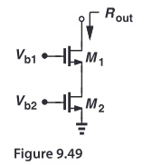

# 장말문제 9.12 — MOS 캐스코드 전류원에 허용되는 최대 λ

## 원문
The MOS cascode of Fig. 9.49 must provide a bias current of $0.5\ \text{mA}$ with an output impedance of at least $50\ \text{k}\Omega$. If $\mu_n C_{ox} = 100\ \mu\text{A/V}^2$ and $W/L = 20/0.18$ for both transistors, compute the maximum tolerable value of $\lambda$.

## 조건
- 회로: Fig 9.49 MOS 캐스코드
- 바이어스 전류 $0.5\ \text{mA}$를 공급하면서 출력 임피던스가 $50\ \text{k}\Omega$ 이상이어야 함
- $\mu_n C_{ox} = 100\ \mu\text{A/V}^2$
- 두 트랜지스터 모두 $W/L = 20/0.18$
- $\lambda$는 두 트랜지스터가 같음 (원문에 없음)

## 구할 것
- 허용되는 $\lambda$의 최댓값

## 상속·참조
- 식 (9.23): MOS 캐스코드 $R_{out} \approx g_{m1} r_{O1} r_{O2}$ (식 9.22 $R_{out} = (1 + g_{m1} r_{O2}) r_{O1} + r_{O2}$의 근사), $g_m = \sqrt{2 \mu_n C_{ox} (W/L) I_D}$, $r_O = 1/(\lambda I_D)$

## 회로 — Fig 9.49
```spice
M1  out  Vb1  n1  nmos  W/L=20/0.18
M2  n1   Vb2  0   nmos  W/L=20/0.18
```
- 단자: Vb1, Vb2 = 이상적 DC 바이어스, 값 미지정 (점 단자) / out = 출력, R_out 측정 단자 (개방 원)
- 표시: 노드 라벨 Vb1, Vb2 (각 점 단자 왼쪽) / 소자 라벨 M1, M2 (각 트랜지스터 오른쪽, 소스 옆) / 부호 없음 / 화살표 "R_out": out 노드를 회로 쪽(아래)으로 들여다봄, 아래 방향, 도선 옆 별도 화살표 (┌ 꺾임: out 도선 오른쪽에 세로선, 위 끝에서 짧은 가로선이 오른쪽 R_out 글자 쪽으로, 화살촉은 아래 끝, M1 드레인 바로 위 높이) / 수치·면적 라벨 없음 (W/L 값은 문제 글에만 있음)
- 배치: 한 세로줄 위→아래 out 원, M1, M2, 접지 / M1, M2 모두 NMOS 보통 방향(게이트 왼쪽, 드레인 위, 소스 아래·소스 화살표 바깥) / Vb1, Vb2 점 단자 → 가로선 → 각 게이트 / M1 드레인 → 세로선 위로 out 원 / M1 소스에서 곧은 세로선이 M2 드레인으로 (n1, 라벨 없음) / M2 소스 아래 접지 / 접속점: 없음 / 교차: 없음



## 풀이
### 소신호 파라미터
- 두 트랜지스터의 $g_m = \sqrt{2 \mu_n C_{ox} (W/L) I_D} = \sqrt{2 \cdot 100\ \mu\text{A/V}^2 \cdot (20/0.18) \cdot 0.5\ \text{mA}} = 3.33\ \text{mS}$
- $r_{O1} = r_{O2} = r_O = 1/(\lambda I_D)$
### 출력 저항 식
- $M_1$은 $r_{O2}$로 소스 축퇴된 캐스코드라 $R_{out} \approx g_{m1} r_{O1} r_{O2} = g_m/(\lambda I_D)^2$
### $\lambda$의 최댓값
- $R_{out} \ge 50\ \text{k}\Omega$ → $\lambda \le \sqrt{g_m/(R_{out} I_D^2)} = \sqrt{3.33\ \text{mS}/(50\ \text{k}\Omega \cdot (0.5\ \text{mA})^2)} = 0.516\ \text{V}^{-1}$
- 이때 $r_O = 3.87\ \text{k}\Omega$, $g_m r_O = 12.9 \gg 1$이라 근사가 성립한다
### 답
- $\lambda_{max} \approx 0.516\ \text{V}^{-1}$
