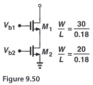

# 장말문제 9.14 — MOS 캐스코드 전류원의 바이어스 설계와 출력 임피던스

## 원문
The cascode current source shown in Fig. 9.50 must be designed for a bias current of $0.5\ \text{mA}$. Assume $\mu_n C_{ox} = 100\ \mu\text{A/V}^2$ and $V_{TH} = 0.4\ \text{V}$.

(a) Neglecting channel-length modulation, compute the required value of $V_{b2}$. What is the minimum tolerable value of $V_{b1}$ if $M_2$ must remain in saturation?

(b) Assuming $\lambda = 0.1\ \text{V}^{-1}$, calculate the output impedance of the circuit.

## 조건
- 회로: Fig 9.50 캐스코드 전류원, 바이어스 전류 $0.5\ \text{mA}$로 설계
- $\mu_n C_{ox} = 100\ \mu\text{A/V}^2$, $V_{TH} = 0.4\ \text{V}$
- $M_1$: $W/L = 30/0.18$, $M_2$: $W/L = 20/0.18$ (그림에 표시)

## 구할 것
- (a) 채널 길이 변조를 무시할 때 필요한 $V_{b2}$. 그리고 $M_2$가 포화 영역에 머물러야 할 때 $V_{b1}$의 최솟값
- (b) $\lambda = 0.1\ \text{V}^{-1}$일 때 회로의 출력 임피던스

## 회로 — Fig 9.50
```spice
M1  out  Vb1  n1  nmos  W/L=30/0.18
M2  n1   Vb2  0   nmos  W/L=20/0.18
```
- 단자: Vb1, Vb2 = 이상적 DC 바이어스, 구할 값 (점 단자) / out = 출력 (개방 원, 라벨 없음)
- 표시: 노드 라벨 Vb1, Vb2 (각 점 단자 왼쪽) / 소자 라벨 M1, M2 (각 트랜지스터 오른쪽, 소스 옆) / 부호 없음 / 화살표 없음 (R_out 화살표도 없음) / 수치·면적 라벨 "W/L = 30/0.18" (M1 라벨 오른쪽, 분수 꼴), "W/L = 20/0.18" (M2 라벨 오른쪽, 분수 꼴)
- 배치: 한 세로줄 위→아래 out 원, M1, M2, 접지 / M1, M2 모두 NMOS 보통 방향(게이트 왼쪽, 드레인 위, 소스 아래·소스 화살표 바깥) / Vb1, Vb2 점 단자 → 가로선 → 각 게이트 / M1 드레인 → 세로선 위로 out 원 / M1 소스에서 곧은 세로선이 M2 드레인으로 (n1, 라벨 없음) / M2 소스 아래 접지 / 접속점: 없음 / 교차: 없음


