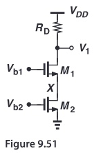

# 장말문제 9.15 — 저항 부하 MOS 캐스코드의 V_b1 상한과 V_X

## 조건
- 회로: Fig 9.51
- $V_{DD} = 1.8\ \text{V}$
- $(W/L)_1 = 20/0.18$, $(W/L)_2 = 40/0.18$
- $\mu_n C_{ox} = 100\ \mu\text{A/V}^2$, $V_{TH} = 0.4\ \text{V}$
- (a)에서: 바이어스 전류 $1\ \text{mA}$, $R_D = 500\ \Omega$

## 구할 것
- (a) 바이어스 전류 $1\ \text{mA}$, $R_D = 500\ \Omega$일 때 허용되는 $V_{b1}$의 최댓값
- (b) (a)에서 고른 $V_{b1}$일 때 $V_X$ 값

## 회로 — Fig 9.51
```spice
RD  VDD  V1   {R_D}
M1  V1   Vb1  X  nmos  W/L=20/0.18
M2  X    Vb2  0  nmos  W/L=40/0.18
```
- 단자: VDD = 1.8 V 전원, 그림에는 값 없이 VDD 라벨만 (T 전원 기호) / Vb1, Vb2 = 이상적 DC 바이어스 (점 단자) / V1 = 출력 (개방 원)
- 표시: 노드 라벨 VDD (T 기호 오른쪽), V1 (개방 원 오른쪽), Vb1, Vb2 (각 점 단자 왼쪽), X (M1–M2 연결선 왼쪽, 두 트랜지스터 사이) / 소자 라벨 R_D (저항 왼쪽), M1, M2 (각 트랜지스터 오른쪽, 소스 옆) / 부호 없음 / 화살표 없음 / 수치·면적 라벨 없음 (W/L, R_D 값은 문제 글에만 있음)
- 배치: 한 세로줄 위→아래 VDD T 기호, 세로 저항 R_D, V1 접속점, M1, X, M2, 접지 / M1, M2 모두 NMOS 보통 방향(게이트 왼쪽, 드레인 위, 소스 아래·소스 화살표 바깥) / V1 접속점에서 짧은 가로선이 오른쪽으로 뻗어 V1 개방 원 / Vb1, Vb2 점 단자 → 가로선 → 각 게이트 / M1 소스에서 곧은 세로선이 M2 드레인으로 = X / M2 소스 아래 접지 / 접속점 (세 갈래 이상, 1곳): V1 = 위 R_D + 아래 M1 드레인 + 오른쪽 V1 원으로 가는 선 (점) / 교차: 없음


