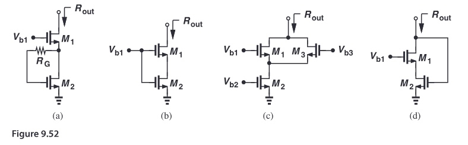

# 장말문제 9.16 — 네 가지 MOS 캐스코드 변형의 출력 저항

## 원문
Compute the output resistance of the circuits depicted in Fig. 9.52. Assume all of the transistors operate in saturation and $g_m r_O \gg 1$.

## 조건
- 회로: Fig 9.52 (a)–(d)
- 모든 트랜지스터는 포화 영역에서 동작
- $g_m r_O \gg 1$로 가정
- 소자 값은 주어지지 않음. 답은 $g_m$, $r_O$, $R_G$ 기호로 나타냄 (원문에 없음)

## 구할 것
- (a)–(d) 각 회로의 출력 저항 $R_{out}$

## 회로 — Fig 9.52(a)
```spice
M1  out  Vb1  n1  nmos
M2  n1   n2   0   nmos
RG  n1   n2   {R_G}     ; M1 소스 ↔ M2 게이트
```
- 단자: Vb1 = 이상적 DC 바이어스, 값 미지정 (점 단자) / out = 출력, R_out 측정 단자 (개방 원)
- 표시: 노드 라벨 V_b1 (점 단자 왼쪽) / 소자 라벨 M1, M2 (각 트랜지스터 오른쪽, 소스 옆), R_G (가로 저항 바로 아래) / 부호 없음 / 화살표 "R_out": out 노드를 회로 쪽(아래)으로 들여다봄, 아래 방향, 도선 옆 별도 화살표 (┌ 꺾임: out 도선 오른쪽에 세로선, 위 끝에서 짧은 가로선이 오른쪽 R_out 글자 쪽으로, 화살촉은 아래 끝, M1 드레인 바로 위 높이) / 수치·면적 라벨 없음
- 배치: 한 세로줄 위→아래 out 원, M1, n1 접속점, M2, 접지 / M1, M2 모두 NMOS 보통 방향(게이트 왼쪽, 드레인 위, 소스 아래·소스 화살표 바깥) / V_b1 점 단자 → 가로선 → M1 게이트 / M1 드레인 → 세로선 위로 out 원 / n1 접속점(M1 소스 바로 아래)에서 가로선이 왼쪽으로 가로 저항 R_G를 지나 M2 게이트보다 왼쪽의 모서리에서 아래로 꺾이고, M2 게이트 높이의 모서리에서 오른쪽으로 꺾여 M2 게이트에 닿음 / M2 소스 아래 접지 / 접속점 (세 갈래 이상, 1곳): n1 = 위 M1 소스 + 아래 M2 드레인 + 왼쪽 R_G 가지 (점) / 교차: 없음

## 회로 — Fig 9.52(b)
```spice
M1  out  Vb1  n1  nmos
M2  n1   Vb1  0   nmos    ; M2 게이트도 V_b1에 연결
```
- 단자: Vb1 = 이상적 DC 바이어스, 값 미지정, 두 게이트 공통 (점 단자) / out = 출력, R_out 측정 단자 (개방 원)
- 표시: 노드 라벨 V_b1 (점 단자 왼쪽) / 소자 라벨 M1, M2 (각 트랜지스터 오른쪽, 소스 옆) / 부호 없음 / 화살표 "R_out": out 노드를 회로 쪽(아래)으로 들여다봄, 아래 방향, 도선 옆 별도 화살표 (┌ 꺾임: out 도선 오른쪽에 세로선, 위 끝에서 짧은 가로선이 오른쪽 R_out 글자 쪽으로, 화살촉은 아래 끝, M1 드레인 바로 위 높이) / 수치·면적 라벨 없음
- 배치: 한 세로줄 위→아래 out 원, M1, M2, 접지 / M1, M2 모두 NMOS 보통 방향 / V_b1 점 단자에서 가로선이 오른쪽으로 가다 중간 접속점을 지나 M1 게이트 / 그 접속점에서 세로선이 아래로 내려가 M2 게이트 높이의 모서리에서 오른쪽으로 꺾여 M2 게이트 / M1 드레인 → 세로선 위로 out 원 / M1 소스에서 곧은 세로선이 M2 드레인으로 (n1, 라벨 없음) / M2 소스 아래 접지 / 접속점 (세 갈래 이상, 1곳): V_b1 가로선 중간 = 왼쪽 V_b1 + 오른쪽 M1 게이트 + 아래 M2 게이트 가지 (점) / 교차: 없음

## 회로 — Fig 9.52(c)
```spice
M1  out  Vb1  n1  nmos
M3  out  Vb3  n1  nmos    ; M1과 병렬, 좌우 반전
M2  n1   Vb2  0   nmos
```
- 단자: Vb1, Vb2, Vb3 = 이상적 DC 바이어스, 값 미지정 (점 단자) / out = 출력, R_out 측정 단자 (개방 원)
- 표시: 노드 라벨 V_b1, V_b2 (각 점 단자 왼쪽), V_b3 (점 단자 오른쪽) / 소자 라벨 M1 (M1 오른쪽), M3 (M3 왼쪽, M1 라벨과 마주 봄), M2 (M2 오른쪽) / 부호 없음 / 화살표 "R_out": out 노드를 회로 쪽(아래)으로 들여다봄, 아래 방향, 도선 옆 별도 화살표 (┌ 꺾임: out 도선 오른쪽에 세로선, 위 끝에서 짧은 가로선이 오른쪽 R_out 글자 쪽으로, 화살촉은 아래 끝, 윗 가로선 바로 위 높이) / 수치·면적 라벨 없음
- 배치: 왼쪽 세로줄 위→아래 M1, n1 접속점, M2, 접지 / 오른쪽에 M3가 M1과 같은 높이 / M1, M2 NMOS 보통 방향(게이트 왼쪽) / M3 NMOS 좌우 반전(게이트 오른쪽, 드레인 왼쪽 위, 소스 왼쪽 아래·소스 화살표 바깥=왼쪽) / out 원은 M1과 M3 사이 가운데 위, 세로선이 내려와 윗 가로선의 접속점 / 윗 가로선: 접속점에서 왼쪽으로 가 모서리에서 아래로 M1 드레인, 오른쪽으로 가 모서리에서 아래로 M3 드레인 / 아래 가로선: n1 접속점(M1 소스 아래)에서 오른쪽으로 가 모서리에서 위로 꺾여 M3 소스 / V_b1, V_b2 점 단자 → 가로선 → 각 게이트, V_b3 점 단자(오른쪽) → 가로선 → M3 게이트 / M2 소스 아래 접지 / 접속점 (세 갈래 이상, 2곳): 윗 가로선 = 위 out 원 + 왼쪽 M1 드레인 가지 + 오른쪽 M3 드레인 가지 (점), n1 = 위 M1 소스 + 아래 M2 드레인 + 오른쪽 M3 소스 가지 (점) / 교차: 없음

## 회로 — Fig 9.52(d)
```spice
M1  out  Vb1  n1  nmos
M2  n1   out  0   nmos    ; 좌우 반전, 게이트 = out
```
- 단자: Vb1 = 이상적 DC 바이어스, 값 미지정 (점 단자) / out = 출력, R_out 측정 단자 (개방 원)
- 표시: 노드 라벨 V_b1 (점 단자 왼쪽) / 소자 라벨 M1 (M1 오른쪽, 소스 옆), M2 (M2 왼쪽, 소스 옆) / 부호 없음 / 화살표 "R_out": out 노드를 회로 쪽(아래)으로 들여다봄, 아래 방향, 도선 옆 별도 화살표 (┌ 꺾임: out 도선 오른쪽에 세로선, 위 끝에서 짧은 가로선이 오른쪽 R_out 글자 쪽으로, 화살촉은 아래 끝, out 접속점 바로 위 높이) / 수치·면적 라벨 없음
- 배치: 한 세로줄 위→아래 out 원, out 접속점, M1, M2, 접지 / M1 NMOS 보통 방향(게이트 왼쪽) / M2 NMOS 좌우 반전(게이트 오른쪽, 드레인 위, 소스 아래·소스 화살표 바깥=왼쪽) / out 원 아래 접속점에서 세로선이 M1 드레인으로 / 귀환 선: 그 접속점에서 가로선이 오른쪽으로 가 모서리에서 아래로 꺾여 M2 게이트 높이까지 내려간 뒤 모서리에서 왼쪽으로 꺾여 M2 게이트 / M1 소스에서 곧은 세로선이 M2 드레인으로 (n1, 라벨 없음) / V_b1 점 단자 → 가로선 → M1 게이트 / M2 소스 아래 접지 / 접속점 (세 갈래 이상, 1곳): out = 위 out 원 + 아래 M1 드레인 + 오른쪽 귀환 선 (점) / 교차: 없음



## 힌트
### (a) $R_G$에는 전류가 없다
- $M_2$ 게이트로는 전류가 흐르지 않으므로 $R_G$ 양 끝의 전압이 같고, $M_2$ 게이트가 제 드레인에 바로 붙은 것과 같다
### (d) 시험 전압이 곧 $M_2$의 $v_{GS}$
- 출력에 건 시험 전압이 $M_2$ 게이트에 그대로 걸려, 출력 전압이 $M_2$의 전류를 직접 조절한다
- $M_1$을 지나는 전류와 $M_2$ 전류가 같다는 것에 $g_m r_O \gg 1$을 함께 쓰면 어느 항이 남는지 보인다

## 풀이
### (a) 다이오드 연결 $M_2$로 축퇴
- $M_2$ 게이트로 전류가 흐르지 않아 $R_G$ 양 끝 전압이 같으므로, $M_2$는 게이트가 드레인에 붙은 다이오드 연결이다($M_i$의 트랜스컨덕턴스 $g_{mi}$, 출력 저항 $r_{Oi}$): $(1/g_{m2}) \parallel r_{O2} \approx 1/g_{m2}$
- $M_1$이 $1/g_{m2}$로 소스 축퇴되고 $g_{m1}/g_{m2}$가 1과 견줄 만하므로 1을 남긴다: $R_{out} \approx (1 + g_{m1}/g_{m2})\, r_{O1}$
### (b) 보통 캐스코드
- $M_2$ 게이트가 $V_{b1}$(AC 접지)이라 $M_2$는 $r_{O2}$로 보인다: $R_{out} \approx g_{m1} r_{O1} r_{O2}$
### (c) 병렬 $M_1$, $M_3$
- $M_1$, $M_3$는 드레인·소스가 같고 게이트가 모두 AC 접지라 한 트랜지스터($g_{m1} + g_{m3}$, $r_{O1} \parallel r_{O3}$)로 볼 수 있다
- 소스에 $r_{O2}$가 달린 캐스코드: $R_{out} \approx (g_{m1} + g_{m3})(r_{O1} \parallel r_{O3})\, r_{O2}$
### (d) 출력이 $M_2$ 게이트를 구동
- 시험 전압 $v_X$, 전류 $i_X$, $M_1$ 소스 전압 $v_1$: $M_2$에서 $i_X = g_{m2} v_X + v_1/r_{O2}$, $M_1$에서 $i_X = -g_{m1} v_1 + (v_X - v_1)/r_{O1}$
- 풀면 $R_{out} = \dfrac{r_{O1} + (1 + g_{m1} r_{O1}) r_{O2}}{1 + (1 + g_{m1} r_{O1}) g_{m2} r_{O2}}$
- $g_m r_O \gg 1$이면 분자 $\approx g_{m1} r_{O1} r_{O2}$, 분모 $\approx g_{m1} r_{O1} g_{m2} r_{O2}$라 $R_{out} \approx 1/g_{m2}$
### 답
- (a) $R_{out} \approx (1 + g_{m1}/g_{m2})\, r_{O1}$
- (b) $R_{out} \approx g_{m1} r_{O1} r_{O2}$
- (c) $R_{out} \approx (g_{m1} + g_{m3})(r_{O1} \parallel r_{O3})\, r_{O2}$
- (d) $R_{out} \approx 1/g_{m2}$
