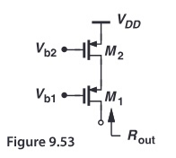

# 장말문제 9.18 — PMOS 캐스코드에서 폭을 N배로 늘릴 때의 출력 임피던스

## 원문
The PMOS cascode of Fig. 9.53 is designed for a given output impedance, $R_{out}$. Using Eq. (9.23), explain what happens if the widths of both transistors are increased by a factor of $N$ while the transistor lengths and bias currents remain unchanged. Assume $\lambda \propto L^{-1}$.

## 조건
- 회로: Fig 9.53 PMOS 캐스코드, 주어진 출력 임피던스 $R_{out}$에 맞게 설계되어 있음
- 두 트랜지스터의 폭을 모두 $N$배로 늘림
- 트랜지스터 길이와 바이어스 전류는 그대로
- $\lambda \propto L^{-1}$로 가정
- 문제는 교재 487쪽(PDF p.22)에서 시작해 488쪽(PDF p.23) 윗부분에서 끝남 (원문에 없음)

## 구할 것
- 식 (9.23)을 이용해 $R_{out}$이 어떻게 되는지 설명

## 상속·참조
- 식 (9.23): MOS 캐스코드 $R_{out} \approx g_{m1} r_{O1} r_{O2}$ (출력 쪽 트랜지스터가 $M_1$)
- $g_m = \sqrt{2 \mu_p C_{ox} (W/L) |I_D|}$, $r_O = 1/(\lambda |I_D|)$ (원문에 없음, PMOS에 맞춰 $\mu_p$로 씀)

## 회로 — Fig 9.53
```spice
M2  n1   Vb2  VDD  pmos
M1  out  Vb1  n1   pmos
```
- 단자: VDD = 전원, 값 미지정 (T 전원 기호) / Vb1, Vb2 = 이상적 DC 바이어스, 값 미지정 (점 단자) / out = 출력, R_out 측정 단자 (개방 원)
- 표시: 노드 라벨 VDD (T 기호 오른쪽), V_b2, V_b1 (각 점 단자 왼쪽) / 소자 라벨 M2, M1 (각 트랜지스터 오른쪽) / 부호 없음 / 화살표 "R_out": out 노드에서 회로 쪽(위)을 들여다봄, 위 방향, 도선 옆 별도 화살표 (L자: out 도선 오른쪽에 세로선, 화살촉은 위 끝으로 M1 드레인 바로 아래 높이, 아래 끝에서 짧은 가로선이 오른쪽 R_out 글자 쪽으로, 가로선은 out 원보다 아래) / 수치·면적 라벨 없음
- 배치: 한 세로줄 위→아래 VDD T 기호, M2, M1, out 원 / M2, M1 모두 PMOS 보통 방향(게이트 왼쪽, 소스 위·소스 화살표가 채널 쪽으로 들어감, 드레인 아래) / M2 소스 → 세로선 위로 VDD / M2 드레인에서 곧은 세로선이 M1 소스로 (n1, 라벨 없음) / M1 드레인 → 세로선 아래로 out 원(선 아래 끝) / V_b2, V_b1 점 단자 → 가로선 → 각 게이트 / 접속점: 없음 / 교차: 없음



## 풀이
### 폭을 $N$배로 할 때 $g_m$
- $g_m = \sqrt{2 \mu_p C_{ox} (W/L) |I_D|}$에서 $L$, $|I_D|$는 그대로이고 $W$만 $N$배 → $g_{m1}$이 $\sqrt{N}$배
### 폭을 $N$배로 할 때 $r_O$
- $\lambda \propto L^{-1}$이고 $L$이 그대로라 $\lambda$도 그대로다. $|I_D|$도 같으므로 $r_O = 1/(\lambda |I_D|)$는 변하지 않는다
### 출력 임피던스
- 식 (9.23) $R_{out} \approx g_{m1} r_{O1} r_{O2}$에서 $r_{O1}$, $r_{O2}$는 그대로, $g_{m1}$만 $\sqrt{N}$배 → $R_{out}$이 $\sqrt{N}$배
- 같은 전류에서 $|V_{GS}| - |V_{TH}|$는 $1/\sqrt{N}$배로 줄어 출력 전압 여유는 넓어진다
### 답
- $r_O$는 그대로이고 $g_m$만 $\sqrt{N}$배가 되므로 출력 임피던스는 $\sqrt{N}\, R_{out}$으로 커진다(전류가 같아 $\lambda$, $r_O$가 변하지 않기 때문).
