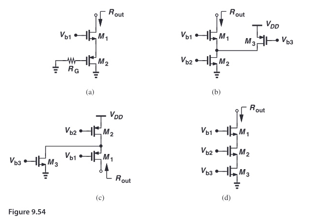

# 장말문제 9.19 — 네 가지 MOS 단의 출력 임피던스

## 원문
Determine the output impedance of the stages shown in Fig. 9.54. Assume all of the transistors operate in saturation and $g_m r_O \gg 1$.

## 조건
- 회로: Fig 9.54 (a)–(d)
- 모든 트랜지스터는 포화 영역에서 동작
- $g_m r_O \gg 1$로 가정
- 소자 값은 주어지지 않음. 답은 $g_m$, $r_O$, $R_G$ 기호로 나타냄 (원문에 없음)

## 구할 것
- (a)–(d) 각 단의 출력 임피던스 $R_{out}$

## 회로 — Fig 9.54(a)
```spice
M1  out  Vb1  n1  nmos
M2  0    n2   n1  pmos    ; 소스 = n1(위), 드레인 = 접지(아래)
RG  n2   0    {R_G}       ; M2 게이트 ↔ 접지
```
- 단자: Vb1 = 이상적 DC 바이어스, 값 미지정 (점 단자) / out = 출력, R_out 측정 단자 (개방 원)
- 표시: 노드 라벨 V_b1 (점 단자 왼쪽) / 소자 라벨 M1, M2 (각 트랜지스터 오른쪽), R_G (가로 저항 바로 아래) / 부호 없음 / 화살표 "R_out": out 노드를 회로 쪽(아래)으로 들여다봄, 아래 방향, 도선 옆 별도 화살표 (┌ 꺾임: out 도선 오른쪽에 세로선, 위 끝에서 짧은 가로선이 오른쪽 R_out 글자 쪽으로, 화살촉은 아래 끝, M1 드레인 바로 위 높이) / 수치·면적 라벨 없음
- 배치: 한 세로줄 위→아래 out 원, M1, M2, 접지 / M1 NMOS 보통 방향(게이트 왼쪽, 드레인 위, 소스 아래·소스 화살표 바깥) / M2 PMOS 보통 방향(게이트 왼쪽, 소스 위·소스 화살표가 채널 쪽으로 들어감, 드레인 아래) / M1 드레인 → 세로선 위로 out 원 / M1 소스에서 곧은 세로선이 M2 소스로 (n1, 라벨 없음) / M2 드레인 아래 접지 / M2 게이트에서 가로선이 왼쪽으로 가로 저항 R_G를 지나 모서리에서 아래로 꺾여 따로 그린 접지 기호 (M2 드레인 쪽 접지보다 조금 높음) / V_b1 점 단자 → 가로선 → M1 게이트 / 접속점: 없음 / 교차: 없음

## 회로 — Fig 9.54(b)
```spice
M1  out  Vb1  n1   nmos
M2  n1   Vb2  0    nmos
M3  n1   Vb3  VDD  pmos    ; 좌우 반전
```
- 단자: Vb1, Vb2, Vb3 = 이상적 DC 바이어스, 값 미지정 (점 단자) / VDD = 전원, 값 미지정 (T 전원 기호) / out = 출력, R_out 측정 단자 (개방 원)
- 표시: 노드 라벨 V_b1, V_b2 (각 점 단자 왼쪽), VDD (T 기호 오른쪽), V_b3 (점 단자 오른쪽) / 소자 라벨 M1, M2 (각 트랜지스터 오른쪽), M3 (M3 왼쪽 아래, 드레인 옆) / 부호 없음 / 화살표 "R_out": out 노드를 회로 쪽(아래)으로 들여다봄, 아래 방향, 도선 옆 별도 화살표 (┌ 꺾임: out 도선 오른쪽에 세로선, 위 끝에서 짧은 가로선이 오른쪽 R_out 글자 쪽으로, 화살촉은 아래 끝, M1 드레인 바로 위 높이) / 수치·면적 라벨 없음
- 배치: 왼쪽 세로줄 위→아래 out 원, M1, n1 접속점, M2, 접지 / M1, M2 NMOS 보통 방향 / 오른쪽 위에 M3: PMOS 좌우 반전(게이트 오른쪽, 소스 왼쪽 위·소스 화살표가 채널 쪽으로 들어감, 드레인 왼쪽 아래), 높이는 M1과 n1 사이 / M3 소스 → 세로선 위로 VDD T 기호 / M3 드레인 → 아래로 짧게 내려가 모서리에서 왼쪽으로 꺾여 긴 가로선이 n1 접속점에 닿음 / V_b1, V_b2 점 단자 → 가로선 → 각 게이트, V_b3 점 단자(오른쪽) → 가로선 → M3 게이트 / 접속점 (세 갈래 이상, 1곳): n1 = 위 M1 소스 + 아래 M2 드레인 + 오른쪽 M3 드레인 가지 (점) / 교차: 없음

## 회로 — Fig 9.54(c)
```spice
M2  n1   Vb2  VDD  pmos
M1  out  Vb1  n1   pmos
M3  n1   Vb3  0    nmos
```
- 단자: VDD = 전원, 값 미지정 (T 전원 기호) / Vb1, Vb2, Vb3 = 이상적 DC 바이어스, 값 미지정 (점 단자) / out = 출력, R_out 측정 단자 (개방 원)
- 표시: 노드 라벨 VDD (T 기호 오른쪽), V_b2, V_b1, V_b3 (각 점 단자 왼쪽) / 소자 라벨 M2, M1, M3 (각 트랜지스터 오른쪽) / 부호 없음 / 화살표 "R_out": out 노드에서 회로 쪽(위)을 들여다봄, 위 방향, 도선 옆 별도 화살표 (L자: out 도선 오른쪽에 세로선, 화살촉은 위 끝으로 M1 드레인 바로 아래 높이, 아래 끝에서 짧은 가로선이 오른쪽 R_out 글자 쪽으로) / 수치·면적 라벨 없음
- 배치: 오른쪽 세로줄 위→아래 VDD T 기호, M2, n1 접속점, M1, out 원 / M2, M1 PMOS 보통 방향(게이트 왼쪽, 소스 위·소스 화살표가 채널 쪽으로 들어감, 드레인 아래) / M2 소스 → 세로선 위로 VDD / M2 드레인 → n1 접속점 → M1 소스 / M1 드레인 → 세로선 아래로 out 원(선 아래 끝) / 왼쪽 아래에 M3: NMOS 보통 방향(게이트 왼쪽, 드레인 위, 소스 아래·소스 화살표 바깥), 높이는 M1보다 조금 아래 / M3 드레인에서 세로선이 위로 올라가 n1 높이의 모서리에서 오른쪽으로 꺾여 긴 가로선이 V_b1 단자 위를 지나 n1 접속점에 닿음 / M3 소스 아래 접지 / V_b2, V_b1, V_b3 점 단자 → 가로선 → 각 게이트 / 접속점 (세 갈래 이상, 1곳): n1 = 위 M2 드레인 + 아래 M1 소스 + 왼쪽 M3 드레인 가지 (점) / 교차: 없음

## 회로 — Fig 9.54(d)
```spice
M1  out  Vb1  n1  nmos
M2  n1   Vb2  n2  nmos
M3  n2   Vb3  0   nmos
```
- 단자: Vb1, Vb2, Vb3 = 이상적 DC 바이어스, 값 미지정 (점 단자) / out = 출력, R_out 측정 단자 (개방 원)
- 표시: 노드 라벨 V_b1, V_b2, V_b3 (각 점 단자 왼쪽) / 소자 라벨 M1, M2, M3 (각 트랜지스터 오른쪽) / 부호 없음 / 화살표 "R_out": out 노드를 회로 쪽(아래)으로 들여다봄, 아래 방향, 도선 옆 별도 화살표 (┌ 꺾임: out 도선 오른쪽에 세로선, 위 끝에서 짧은 가로선이 오른쪽 R_out 글자 쪽으로, 화살촉은 아래 끝, M1 드레인 바로 위 높이) / 수치·면적 라벨 없음
- 배치: 한 세로줄 위→아래 out 원, M1, M2, M3, 접지 / 세 트랜지스터 모두 NMOS 보통 방향(게이트 왼쪽, 드레인 위, 소스 아래·소스 화살표 바깥) / M1 드레인 → 세로선 위로 out 원 / M1 소스 → 곧은 세로선 → M2 드레인 (n1, 라벨 없음), M2 소스 → 곧은 세로선 → M3 드레인 (n2, 라벨 없음) / M3 소스 아래 접지 / V_b1, V_b2, V_b3 점 단자 → 가로선 → 각 게이트 / 접속점: 없음 / 교차: 없음


