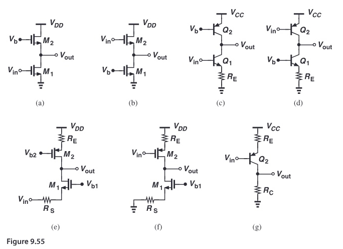

# 장말문제 9.20 — 일곱 가지 단의 단락 회로 트랜스컨덕턴스와 전압 이득

## 조건
- 회로: Fig 9.55 (a)–(g)
- $\lambda > 0$, $V_A < \infty$로 가정
- 소자 값은 주어지지 않음. 답은 소신호 파라미터와 $R_E$, $R_S$, $R_C$ 기호로 나타냄 (원문에 없음)

## 구할 것
- (a)–(g) 각 단의 단락 회로 트랜스컨덕턴스 $G_m$과 전압 이득 $A_v$

## 회로 — Fig 9.55(a)
```spice
M2  VDD   Vb   Vout  nmos
M1  Vout  Vin  0     nmos
```
- 단자: VDD = 전원, 값 미지정 (T 전원 기호) / Vb = 이상적 DC 바이어스, 값 미지정 (점 단자) / Vin = 신호 입력 (개방 원) / Vout = 출력 (개방 원)
- 표시: 노드 라벨 VDD (T 기호 오른쪽), V_b (점 단자 왼쪽), V_in (입력 원 왼쪽), V_out (출력 원 오른쪽) / 소자 라벨 M2, M1 (각 트랜지스터 오른쪽, 소스 옆) / 부호 없음 / 화살표 없음 / 수치·면적 라벨 없음
- 배치: 한 세로줄 위→아래 VDD T 기호, M2, Vout 접속점, M1, 접지 / M2, M1 모두 NMOS 보통 방향(게이트 왼쪽, 드레인 위, 소스 아래·소스 화살표 바깥) / M2 드레인 → 세로선 위로 VDD / M2 소스 → Vout 접속점 → M1 드레인 / Vout 접속점에서 가로선이 오른쪽으로 V_out 원 / V_b 점 단자 → 가로선 → M2 게이트, V_in 원 → 가로선 → M1 게이트 / M1 소스 아래 접지 / 접속점 (세 갈래 이상, 1곳): Vout = 위 M2 소스 + 아래 M1 드레인 + 오른쪽 V_out 선 (점) / 교차: 없음

## 회로 — Fig 9.55(b)
```spice
M2  VDD   Vin  Vout  nmos
M1  Vout  Vb   0     nmos
```
- 단자: VDD = 전원, 값 미지정 (T 전원 기호) / Vb = 이상적 DC 바이어스, 값 미지정 (점 단자) / Vin = 신호 입력 (개방 원) / Vout = 출력 (개방 원)
- 표시: 노드 라벨 VDD (T 기호 오른쪽), V_in (입력 원 왼쪽), V_b (점 단자 왼쪽), V_out (출력 원 오른쪽) / 소자 라벨 M2, M1 (각 트랜지스터 오른쪽, 소스 옆) / 부호 없음 / 화살표 없음 / 수치·면적 라벨 없음
- 배치: (a)와 같은 모양에서 두 게이트 단자만 바뀜 — 한 세로줄 위→아래 VDD T 기호, M2, Vout 접속점, M1, 접지 / M2, M1 NMOS 보통 방향 / V_in 원 → 가로선 → M2 게이트, V_b 점 단자 → 가로선 → M1 게이트 / Vout 접속점에서 가로선이 오른쪽으로 V_out 원 / 접속점 (세 갈래 이상, 1곳): Vout = 위 M2 소스 + 아래 M1 드레인 + 오른쪽 V_out 선 (점) / 교차: 없음

## 회로 — Fig 9.55(c)
```spice
Q2  Vout  Vb   VCC  pnp
Q1  Vout  Vin  n1   npn
RE  n1    0    {R_E}
```
- 단자: VCC = 전원, 값 미지정 (T 전원 기호) / Vb = 이상적 DC 바이어스, 값 미지정 (점 단자) / Vin = 신호 입력 (개방 원) / Vout = 출력 (개방 원)
- 표시: 노드 라벨 VCC (T 기호 오른쪽), V_b (점 단자 왼쪽), V_in (입력 원 왼쪽), V_out (출력 원 오른쪽) / 소자 라벨 Q2, Q1 (각 트랜지스터 오른쪽), R_E (저항 오른쪽) / 부호 없음 / 화살표 없음 / 수치·면적 라벨 없음
- 배치: 한 세로줄 위→아래 VCC T 기호, Q2, Vout 접속점, Q1, 세로 저항 R_E, 접지 / Q2 pnp 보통 방향(베이스 왼쪽, 이미터 위·화살표가 막대 쪽으로 들어감, 컬렉터 아래) / Q1 npn 보통 방향(베이스 왼쪽, 컬렉터 위, 이미터 아래·화살표 바깥) / Q2 이미터 → 세로선 위로 VCC / Q2 컬렉터 → Vout 접속점 → Q1 컬렉터 / Vout 접속점에서 가로선이 오른쪽으로 V_out 원 / Q1 이미터 → R_E → 접지 (n1, 라벨 없음) / V_b 점 단자 → 가로선 → Q2 베이스, V_in 원 → 가로선 → Q1 베이스 / 접속점 (세 갈래 이상, 1곳): Vout = 위 Q2 컬렉터 + 아래 Q1 컬렉터 + 오른쪽 V_out 선 (점) / 교차: 없음

## 회로 — Fig 9.55(d)
```spice
Q2  Vout  Vin  VCC  pnp
Q1  Vout  Vb   n1   npn
RE  n1    0    {R_E}
```
- 단자: VCC = 전원, 값 미지정 (T 전원 기호) / Vb = 이상적 DC 바이어스, 값 미지정 (점 단자) / Vin = 신호 입력 (개방 원) / Vout = 출력 (개방 원)
- 표시: 노드 라벨 VCC (T 기호 오른쪽), V_in (입력 원 왼쪽), V_b (점 단자 왼쪽), V_out (출력 원 오른쪽) / 소자 라벨 Q2, Q1 (각 트랜지스터 오른쪽), R_E (저항 오른쪽) / 부호 없음 / 화살표 없음 / 수치·면적 라벨 없음
- 배치: (c)와 같은 모양에서 두 베이스 단자만 바뀜 — 한 세로줄 위→아래 VCC T 기호, Q2(pnp 보통 방향), Vout 접속점, Q1(npn 보통 방향), 세로 저항 R_E, 접지 / V_in 원 → 가로선 → Q2 베이스, V_b 점 단자 → 가로선 → Q1 베이스 / Vout 접속점에서 가로선이 오른쪽으로 V_out 원 / 접속점 (세 갈래 이상, 1곳): Vout = 위 Q2 컬렉터 + 아래 Q1 컬렉터 + 오른쪽 V_out 선 (점) / 교차: 없음

## 회로 — Fig 9.55(e)
```spice
RE  VDD   n1   {R_E}
M2  Vout  Vb2  n1   pmos
M1  Vout  Vb1  n2   nmos    ; 좌우 반전 (공통 게이트)
RS  Vin   n2   {R_S}
```
- 단자: VDD = 전원, 값 미지정 (T 전원 기호) / Vb1, Vb2 = 이상적 DC 바이어스, 값 미지정 (점 단자) / Vin = 신호 입력 (개방 원) / Vout = 출력 (개방 원)
- 표시: 노드 라벨 VDD (T 기호 오른쪽), V_b2 (점 단자 왼쪽), V_out (출력 원 오른쪽), V_b1 (점 단자 오른쪽), V_in (입력 원 왼쪽) / 소자 라벨 R_E (저항 오른쪽), M2 (M2 오른쪽), M1 (M1 왼쪽), R_S (가로 저항 아래) / 부호 없음 / 화살표 없음 / 수치·면적 라벨 없음
- 배치: 한 세로줄 위→아래 VDD T 기호, 세로 저항 R_E, M2, Vout 접속점, M1 / M2 PMOS 보통 방향(게이트 왼쪽, 소스 위·소스 화살표가 채널 쪽으로 들어감, 드레인 아래) / M1 NMOS 좌우 반전(게이트 오른쪽, 드레인 위, 소스 아래·소스 화살표 바깥=왼쪽) / R_E 아래 끝 → M2 소스 (n1, 라벨 없음) / M2 드레인 → Vout 접속점 → M1 드레인 / Vout 접속점에서 가로선이 오른쪽으로 V_out 원 / V_b2 점 단자(왼쪽) → 가로선 → M2 게이트, V_b1 점 단자(오른쪽) → 가로선 → M1 게이트 / M1 소스에서 세로선이 아래로 내려가 모서리에서 왼쪽으로 꺾여 가로 저항 R_S를 지나 V_in 원 (n2, 라벨 없음) / 접지 없음 / 접속점 (세 갈래 이상, 1곳): Vout = 위 M2 드레인 + 아래 M1 드레인 + 오른쪽 V_out 선 (점) / 교차: 없음

## 회로 — Fig 9.55(f)
```spice
RE  VDD   n1   {R_E}
M2  Vout  Vin  n1   pmos
M1  Vout  Vb1  n2   nmos    ; 좌우 반전 (공통 게이트)
RS  0     n2   {R_S}
```
- 단자: VDD = 전원, 값 미지정 (T 전원 기호) / Vb1 = 이상적 DC 바이어스, 값 미지정 (점 단자) / Vin = 신호 입력 (개방 원) / Vout = 출력 (개방 원)
- 표시: 노드 라벨 VDD (T 기호 오른쪽), V_in (입력 원 왼쪽), V_out (출력 원 오른쪽), V_b1 (점 단자 오른쪽) / 소자 라벨 R_E (저항 오른쪽), M2 (M2 오른쪽), M1 (M1 왼쪽), R_S (가로 저항 아래) / 부호 없음 / 화살표 없음 / 수치·면적 라벨 없음
- 배치: (e)와 같은 모양에서 M2 게이트가 V_in 원이고 R_S 왼쪽 끝이 접지 — 한 세로줄 위→아래 VDD T 기호, R_E, M2(PMOS 보통 방향), Vout 접속점, M1(NMOS 좌우 반전, 게이트 오른쪽) / V_in 원 → 가로선 → M2 게이트, V_b1 점 단자(오른쪽) → 가로선 → M1 게이트 / M1 소스에서 세로선이 아래로 내려가 모서리에서 왼쪽으로 꺾여 가로 저항 R_S를 지나 왼쪽 끝 모서리에서 아래로 꺾여 접지 / Vout 접속점에서 가로선이 오른쪽으로 V_out 원 / 접속점 (세 갈래 이상, 1곳): Vout = 위 M2 드레인 + 아래 M1 드레인 + 오른쪽 V_out 선 (점) / 교차: 없음

## 회로 — Fig 9.55(g)
```spice
RE  VCC   n1   {R_E}
Q2  Vout  Vin  n1   pnp
RC  Vout  0    {R_C}
```
- 단자: VCC = 전원, 값 미지정 (T 전원 기호) / Vin = 신호 입력 (개방 원) / Vout = 출력 (개방 원)
- 표시: 노드 라벨 VCC (T 기호 오른쪽), V_in (입력 원 왼쪽), V_out (출력 원 오른쪽) / 소자 라벨 R_E (저항 오른쪽), Q2 (트랜지스터 오른쪽), R_C (저항 오른쪽) / 부호 없음 / 화살표 없음 / 수치·면적 라벨 없음
- 배치: 한 세로줄 위→아래 VCC T 기호, 세로 저항 R_E, Q2, Vout 접속점, 세로 저항 R_C, 접지 / Q2 pnp 보통 방향(베이스 왼쪽, 이미터 위·화살표가 막대 쪽으로 들어감, 컬렉터 아래) / R_E 아래 끝 → Q2 이미터 (n1, 라벨 없음) / Q2 컬렉터 → Vout 접속점 → R_C → 접지 / Vout 접속점에서 가로선이 오른쪽으로 V_out 원 / V_in 원 → 가로선 → Q2 베이스 / 트랜지스터는 Q2 하나뿐 (라벨이 Q1이 아닌 Q2로 인쇄됨) / 접속점 (세 갈래 이상, 1곳): Vout = 위 Q2 컬렉터 + 아래 R_C + 오른쪽 V_out 선 (점) / 교차: 없음


