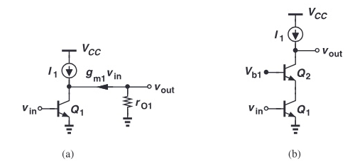

# 장말문제 9.22 — 이득 500을 위한 바이폴라 캐스코드의 최소 Early 전압

## 원문
The cascode stage of Fig. 9.16(b) must be designed for a voltage gain of 500. If $\beta_1 = \beta_2 = 100$, determine the minimum required value of $V_{A1} = V_{A2}$. Assume $I_1 = 1\ \text{mA}$.

## 조건
- 회로: Fig 9.16(b) 바이폴라 캐스코드 단 ($Q_1$ 입력, $Q_2$ 캐스코드, 부하 $I_1$)
- 목표 전압 이득 500
- $\beta_1 = \beta_2 = 100$
- $V_{A1} = V_{A2}$
- $I_1 = 1\ \text{mA}$
- 부하 $I_1$은 이상적인 전류원 (원문에 없음)
- 상온 $V_T \approx 26\ \text{mV}$ (원문에 없음)

## 구할 것
- 필요한 $V_{A1} = V_{A2}$의 최솟값

## 상속·참조
- 식 (9.53): $Q_1$, $Q_2$가 같은 바이어스 전류를 흘려 $g_{m1} \approx g_{m2}$, $r_{O1} \approx r_{O2}$일 때 $A_v \approx -g_{m1} r_{O1}\, g_{m1} (r_{O1} \parallel r_{\pi 2})$
- 소신호 파라미터: $g_m = I_C/V_T$, $r_O = V_A/I_C$, $r_\pi = \beta V_T/I_C$

## 회로 — Fig 9.16(b)
```spice
I1  VCC   vout
Q2  vout  Vb1  n1  npn
Q1  n1    vin  0   npn
```
- 단자: VCC = 전원, 값 미지정 (T 전원 기호) / Vb1 = 이상적 DC 바이어스, 값 미지정 (점 단자) / vin = 소신호 입력 (개방 원) / vout = 출력 (개방 원)
- 표시: 노드 라벨 VCC (T 기호 오른쪽), v_out (출력 원 오른쪽), V_b1 (점 단자 왼쪽), v_in (입력 원 왼쪽) / 소자 라벨 I_1 (전류원 왼쪽), Q2, Q1 (각 트랜지스터 오른쪽, 이미터 옆) / 부호 없음 / 화살표 없음 / 수치·면적 라벨 없음
- 배치: 한 세로줄 위→아래 VCC T 기호, I_1 전류원, 컬렉터 접속점, Q2, Q1, 접지 / Q2, Q1 npn 보통 방향(베이스 왼쪽, 컬렉터 오른쪽 위, 이미터 오른쪽 아래) / 접속점에서 가로선이 오른쪽으로 뻗어 v_out 원 / V_b1 점 단자 → 가로선 → Q2 베이스, v_in 원 → 가로선 → Q1 베이스 / Q2 이미터에서 곧은 세로선이 Q1 컬렉터로 (n1, 라벨 없음) / Q1 이미터 아래 접지 / 접속점 (세 갈래 이상, 1곳): Q2 컬렉터 위 = 위 I_1 + 아래 Q2 컬렉터 + 오른쪽 v_out 선 (점) / 교차: 없음


> 참고: 크롭 이미지 왼쪽의 (a)는 본문 그림(CE 단에서 r_O1으로 흐르는 출력 전류)이라 이 문제와 무관. Fig 9.16은 본문 그림(교재 461쪽, PDF p.7)
