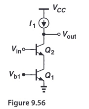

# 장말문제 9.23 — 입력을 위쪽 트랜지스터 Q2의 베이스에 넣은 회로

## 원문
Having learned about the high voltage gain of the cascode stage, a student adventurously constructs the circuit depicted in Fig. 9.56, where the input is applied to the base of $Q_2$ rather than to the base of $Q_1$.

(a) Replacing $Q_1$ with $r_{O1}$, explain intuitively why the voltage gain of this stage cannot be as high as that of the cascode.

(b) Assuming $g_m r_O \gg 1$, compute the short-circuit transconductance and the voltage gain.

## 조건
- 캐스코드 단의 높은 전압 이득을 배운 학생이 Fig 9.56 회로를 만듦
- 입력을 $Q_1$의 베이스가 아니라 $Q_2$의 베이스에 인가
- (b)에서: $g_m r_O \gg 1$
- 부하 $I_1$은 이상적인 전류원 (원문에 없음)

## 구할 것
- (a) $Q_1$을 $r_{O1}$으로 바꿔 놓고, 이 단의 전압 이득이 캐스코드만큼 높을 수 없는 이유를 직관적으로 설명
- (b) $g_m r_O \gg 1$로 가정하고 단락 회로 트랜스컨덕턴스와 전압 이득 계산

## 회로 — Fig 9.56
```spice
I1  VCC   Vout
Q2  Vout  Vin  n1  npn
Q1  n1    Vb1  0   npn
```
- 단자: VCC = 전원, 값 미지정 (T 전원 기호) / Vin = 신호 입력 (개방 원) / Vb1 = 이상적 DC 바이어스, 값 미지정 (점 단자) / Vout = 출력 (개방 원)
- 표시: 노드 라벨 VCC (T 기호 오른쪽), V_out (출력 원 오른쪽), V_in (입력 원 왼쪽), V_b1 (점 단자 왼쪽) / 소자 라벨 I_1 (전류원 왼쪽), Q2, Q1 (각 트랜지스터 오른쪽, 이미터 옆) / 부호 없음 / 화살표 없음 / 수치·면적 라벨 없음
- 배치: 한 세로줄 위→아래 VCC T 기호, I_1 전류원(원 안 화살표 아래), Vout 접속점, Q2, Q1, 접지 / Q2, Q1 npn 보통 방향(베이스 왼쪽, 컬렉터 오른쪽 위, 이미터 오른쪽 아래) / Vout 접속점에서 가로선이 오른쪽으로 V_out 원 / V_in 원 → 가로선 → Q2 베이스, V_b1 점 단자 → 가로선 → Q1 베이스 / Q2 이미터에서 곧은 세로선이 Q1 컬렉터로 (n1, 라벨 없음) / Q1 이미터 아래 접지 / 접속점 (세 갈래 이상, 1곳): Vout = 위 I_1 + 아래 Q2 컬렉터 + 오른쪽 V_out 선 (점) / 교차: 없음



## 풀이
### (a) 입력 위치와 축퇴
- $Q_1$은 베이스·이미터가 AC 접지라 $r_{o1}$로 보인다. 큰 β, 큰 $g_mr_o$, $r_{o1}\ll\beta r_{o2}$의 $G_m$ 주항용 축약에서는 $v_e\approx i_or_{o1}$다.
- $i_o\approx g_{m2}(v_{in}-i_or_{o1})$다 ($r_{o2}$ 가지 생략이 실제 전류 0을 뜻하지 않음).
- $G_m\approx1/(1/g_{m2}+r_{o1})\approx1/r_{o1}\ll g_{m2}$이므로 전류 생성 능력과 이득이 보통 캐스코드보다 작다 ($g_{m2}r_{o1}\gg1$).
### (b) 유한 β의 단락 전류
- $g_1=1/r_{o1}$로 둔다.
- $g_2=1/r_{o2}$로 둔다.
- $g_\pi=1/r_{\pi2}$로 둔다.
- $D=g_{m2}+g_\pi+g_1+g_2$로 둔다.
- 출력 단락에서 $Dv_e=(g_{m2}+g_\pi)v_{in}$이다.
- $i_o=g_{m2}(v_{in}-v_e)-g_2v_e$다.
- $G_m=i_o/v_{in}=(g_{m2}g_1-g_2g_\pi)/D$; 위 큰 β·큰 내부 이득 조건에서 $G_m\approx1/r_{o1}$.
### (b) 저항과 이득
- 입력 영점에서 $R_E=r_{o1}\parallel r_{\pi2}$, $g_{m2}R_E,g_{m2}r_{o2}\gg1$이면 $R_{out}\approx g_{m2}r_{o2}R_E$다.
- 위 주항 조건에서 $A_v=-G_mR_{out}\approx-g_{m2}r_{o2}/(1+r_{o1}/r_{\pi2})$. 추가로 $r_{o1}\ll r_{\pi2}$일 때만 $A_v\approx-g_{m2}r_{o2}$다.
- 유한 β의 무부하 직접 검산: $i_o=0$이면 $(g_1+g_\pi)v_e=g_\pi v_{in}$이므로 $A_v=-(g_{m2}r_{o2}-r_{o1}/r_{\pi2})/(1+r_{o1}/r_{\pi2})$다.
### 답
- (a) 큰 이미터 축퇴가 $v_{\pi2}$와 입력 전류 생성 능력을 줄여 캐스코드보다 이득이 작다.
- (b) 유한 β에서 $G_m=(g_{m2}g_1-g_2g_\pi)/D$, $A_v=-(g_{m2}r_{o2}-r_{o1}/r_{\pi2})/(1+r_{o1}/r_{\pi2})$. 명시한 큰 β·큰 내부 이득 주항에서는 각각 $1/r_{o1}$, $-g_{m2}r_{o2}/(1+r_{o1}/r_{\pi2})$로 근사한다.
