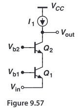

# 장말문제 9.24 — 입력을 Q1 이미터에 넣은 캐스코드의 G_m과 이득

## 원문
Determine the short-circuit transconductance and the voltage gain of the circuit shown in Fig. 9.57.

## 조건
- 회로: Fig 9.57 (입력 $V_{in}$이 $Q_1$의 이미터에 연결됨)
- 소자 값은 주어지지 않음. 답은 소신호 파라미터로 나타냄 (원문에 없음)
- 부하 $I_1$은 이상적인 전류원 (원문에 없음)

## 구할 것
- 단락 회로 트랜스컨덕턴스 $G_m$
- 전압 이득 $A_v$

## 회로 — Fig 9.57
```spice
I1  VCC   Vout
Q2  Vout  Vb2  n1   npn
Q1  n1    Vb1  Vin  npn
```
- 단자: VCC = 전원, 값 미지정 (T 전원 기호) / Vb1, Vb2 = 이상적 DC 바이어스, 값 미지정 (점 단자) / Vin = 신호 입력 (개방 원) / Vout = 출력 (개방 원)
- 표시: 노드 라벨 VCC (T 기호 오른쪽), V_out (출력 원 오른쪽), V_b2, V_b1 (각 점 단자 왼쪽), V_in (입력 원 왼쪽 위) / 소자 라벨 I_1 (전류원 왼쪽), Q2, Q1 (각 트랜지스터 오른쪽, 이미터 옆) / 부호 없음 / 화살표 없음 / 수치·면적 라벨 없음
- 배치: 한 세로줄 위→아래 VCC T 기호, I_1 전류원(원 안 화살표 아래), Vout 접속점, Q2, Q1 / Q2, Q1 npn 보통 방향(베이스 왼쪽, 컬렉터 오른쪽 위, 이미터 오른쪽 아래) / Vout 접속점에서 가로선이 오른쪽으로 V_out 원 / V_b2, V_b1 점 단자 → 가로선 → 각 베이스 / Q2 이미터에서 곧은 세로선이 Q1 컬렉터로 (n1, 라벨 없음) / Q1 이미터에서 세로선이 아래로 내려가 모서리에서 왼쪽으로 꺾여 가로선이 V_in 원(점 단자들과 비슷한 x)에 닿음 / 접지 없음 / 접속점 (세 갈래 이상, 1곳): Vout = 위 I_1 + 아래 Q2 컬렉터 + 오른쪽 V_out 선 (점) / 교차: 없음


