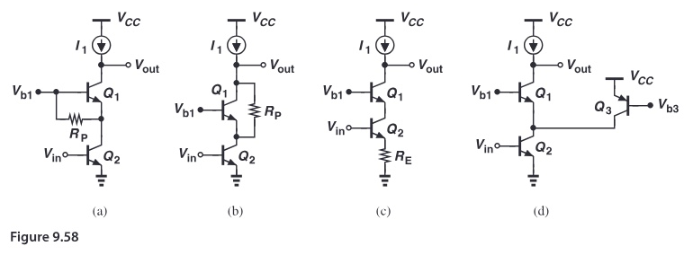

# 장말문제 9.25 — 네 가지 바이폴라 캐스코드 변형의 전압 이득

## 원문
Calculate the voltage gain of each stage illustrated in Fig. 9.58.

## 조건
- 회로: Fig 9.58 (a)–(d)
- 소자 값은 주어지지 않음. 답은 소신호 파라미터와 $R_P$, $R_E$ 기호로 나타냄 (원문에 없음)
- 부하 $I_1$은 이상적인 전류원 (원문에 없음)

## 구할 것
- (a)–(d) 각 단의 전압 이득 $A_v$

## 회로 — Fig 9.58(a)
```spice
I1  VCC   Vout
Q1  Vout  Vb1  n1  npn
RP  Vb1   n1   {R_P}     ; Q1 베이스 ↔ Q1 이미터
Q2  n1    Vin  0   npn
```
- 단자: VCC = 전원, 값 미지정 (T 전원 기호) / Vb1 = 이상적 DC 바이어스, 값 미지정 (점 단자) / Vin = 신호 입력 (개방 원) / Vout = 출력 (개방 원)
- 표시: 노드 라벨 VCC (T 기호 오른쪽), V_out (출력 원 오른쪽), V_b1 (점 단자 왼쪽), V_in (입력 원 왼쪽) / 소자 라벨 I_1 (전류원 왼쪽), Q1, Q2 (각 트랜지스터 오른쪽, 이미터 옆), R_P (가로 저항 바로 아래) / 부호 없음 / 화살표 없음 / 수치·면적 라벨 없음
- 배치: 한 세로줄 위→아래 VCC T 기호, I_1 전류원(원 안 화살표 아래), Vout 접속점, Q1, n1 접속점, Q2, 접지 / Q1, Q2 npn 보통 방향(베이스 왼쪽, 컬렉터 오른쪽 위, 이미터 오른쪽 아래) / Vout 접속점에서 가로선이 오른쪽으로 V_out 원 / V_b1 점 단자에서 가로선이 오른쪽으로 가다 중간 접속점을 지나 Q1 베이스 / 그 접속점에서 세로선이 아래로 내려가 Q1과 Q2 사이 높이의 모서리에서 오른쪽으로 꺾여 가로 저항 R_P를 지나 Q1 이미터–Q2 컬렉터 세로선의 n1 접속점에 닿음 / V_in 원 → 가로선 → Q2 베이스 / Q2 이미터 아래 접지 / 접속점 (세 갈래 이상, 3곳): Vout = 위 I_1 + 아래 Q1 컬렉터 + 오른쪽 V_out 선 (점), V_b1 가로선 중간 = 왼쪽 V_b1 + 오른쪽 Q1 베이스 + 아래 R_P 가지 (점), n1 = 위 Q1 이미터 + 아래 Q2 컬렉터 + 왼쪽 R_P (점) / 교차: 없음

## 회로 — Fig 9.58(b)
```spice
I1  VCC   Vout
Q1  Vout  Vb1  n1  npn
RP  Vout  n1   {R_P}     ; Q1 컬렉터 ↔ Q1 이미터
Q2  n1    Vin  0   npn
```
- 단자: VCC = 전원, 값 미지정 (T 전원 기호) / Vb1 = 이상적 DC 바이어스, 값 미지정 (점 단자) / Vin = 신호 입력 (개방 원) / Vout = 출력 (개방 원)
- 표시: 노드 라벨 VCC (T 기호 오른쪽), V_out (출력 원 오른쪽), V_b1 (점 단자 왼쪽), V_in (입력 원 왼쪽) / 소자 라벨 I_1 (전류원 왼쪽), Q1 (Q1 막대 위 왼쪽, 컬렉터 선 왼쪽), Q2 (Q2 오른쪽), R_P (세로 저항 오른쪽) / 부호 없음 / 화살표 없음 / 수치·면적 라벨 없음
- 배치: 한 세로줄 위→아래 VCC T 기호, I_1 전류원, Vout 접속점, 그 바로 아래 두 번째 접속점, Q1, n1 접속점, Q2, 접지 / Q1, Q2 npn 보통 방향 / Vout 접속점에서 가로선이 오른쪽으로 V_out 원 / 두 번째 접속점에서 가로선이 오른쪽으로 나가 모서리에서 아래로 꺾여 Q1 오른쪽에 세로로 놓인 R_P(Q1 높이)를 지나 아래 모서리에서 왼쪽으로 꺾여 n1 접속점(Q2 바로 위)에 닿음 / V_b1 점 단자 → 가로선 → Q1 베이스, V_in 원 → 가로선 → Q2 베이스 / Q2 이미터 아래 접지 / 접속점 (세 갈래 이상, 3곳): Vout = 위 I_1 + 아래 세로선 + 오른쪽 V_out 선 (점), 두 번째 접속점 = 위 세로선 + 아래 Q1 컬렉터 + 오른쪽 R_P 가지 (점), n1 = 위 Q1 이미터 + 아래 Q2 컬렉터 + 오른쪽 R_P 가지 (점) / 교차: 없음

## 회로 — Fig 9.58(c)
```spice
I1  VCC   Vout
Q1  Vout  Vb1  n1  npn
Q2  n1    Vin  n2  npn
RE  n2    0    {R_E}
```
- 단자: VCC = 전원, 값 미지정 (T 전원 기호) / Vb1 = 이상적 DC 바이어스, 값 미지정 (점 단자) / Vin = 신호 입력 (개방 원) / Vout = 출력 (개방 원)
- 표시: 노드 라벨 VCC (T 기호 오른쪽), V_out (출력 원 오른쪽), V_b1 (점 단자 왼쪽), V_in (입력 원 왼쪽) / 소자 라벨 I_1 (전류원 왼쪽), Q1, Q2 (각 트랜지스터 오른쪽, 이미터 옆), R_E (저항 오른쪽) / 부호 없음 / 화살표 없음 / 수치·면적 라벨 없음
- 배치: 한 세로줄 위→아래 VCC T 기호, I_1 전류원, Vout 접속점, Q1, Q2, 세로 저항 R_E, 접지 / Q1, Q2 npn 보통 방향 / Vout 접속점에서 가로선이 오른쪽으로 V_out 원 / V_b1 점 단자 → 가로선 → Q1 베이스, V_in 원 → 가로선 → Q2 베이스 / Q1 이미터에서 곧은 세로선이 Q2 컬렉터로 (n1, 라벨 없음) / Q2 이미터 → R_E → 접지 (n2, 라벨 없음) / 접속점 (세 갈래 이상, 1곳): Vout = 위 I_1 + 아래 Q1 컬렉터 + 오른쪽 V_out 선 (점) / 교차: 없음

## 회로 — Fig 9.58(d)
```spice
I1  VCC   Vout
Q1  Vout  Vb1  n1   npn
Q2  n1    Vin  0    npn
Q3  n1    Vb3  VCC  pnp    ; 좌우 반전, 자체 VCC T 기호
```
- 단자: VCC = 전원, 값 미지정 (T 전원 기호, 두 곳: 전류원 위, Q3 위) / Vb1, Vb3 = 이상적 DC 바이어스, 값 미지정 (점 단자) / Vin = 신호 입력 (개방 원) / Vout = 출력 (개방 원)
- 표시: 노드 라벨 VCC (두 T 기호 각각 오른쪽), V_out (출력 원 오른쪽), V_b1 (점 단자 왼쪽), V_in (입력 원 왼쪽), V_b3 (점 단자 오른쪽) / 소자 라벨 I_1 (전류원 왼쪽), Q1, Q2 (각 트랜지스터 오른쪽, 이미터 옆), Q3 (Q3 왼쪽 아래, 컬렉터 옆) / 부호 없음 / 화살표 없음 / 수치·면적 라벨 없음
- 배치: 왼쪽 세로줄 위→아래 VCC T 기호, I_1 전류원, Vout 접속점, Q1, n1 접속점, Q2, 접지 / Q1, Q2 npn 보통 방향 / 오른쪽에 Q3: pnp 좌우 반전(베이스 오른쪽, 이미터 왼쪽 위·화살표가 막대 쪽으로 들어감, 컬렉터 왼쪽 아래), 높이는 Q1보다 조금 아래, 이미터 위로 따로 그린 VCC T 기호(I_1 쪽 VCC보다 낮음) / Q3 컬렉터 → 아래로 내려가 모서리에서 왼쪽으로 꺾여 긴 가로선이 n1 접속점에 닿음 / Vout 접속점에서 가로선이 오른쪽으로 V_out 원 / V_b1 점 단자 → 가로선 → Q1 베이스, V_in 원 → 가로선 → Q2 베이스, V_b3 점 단자(오른쪽) → 가로선 → Q3 베이스 / Q2 이미터 아래 접지 / 접속점 (세 갈래 이상, 2곳): Vout = 위 I_1 + 아래 Q1 컬렉터 + 오른쪽 V_out 선 (점), n1 = 위 Q1 이미터 + 아래 Q2 컬렉터 + 오른쪽 Q3 컬렉터 가지 (점) / 교차: 없음


