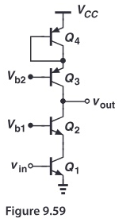

# 장말문제 9.27 — 부하 쪽 Q4가 다이오드 연결된 바이폴라 캐스코드 증폭기의 이득

## 원문
Due to a manufacturing error, a bipolar cascode amplifier has been configured as shown in Fig. 9.59. Determine the voltage gain of the circuit.

## 조건
- 제조 오류로 바이폴라 캐스코드 증폭기가 Fig 9.59처럼 구성됨 ($Q_4$가 다이오드 연결)
- 소자 값은 주어지지 않음. 답은 소신호 파라미터로 나타냄 (원문에 없음)

## 구할 것
- 회로의 전압 이득 $A_v$

## 회로 — Fig 9.59
```spice
Q4  n2    n2   VCC  pnp    ; 다이오드 연결 (베이스 = 컬렉터)
Q3  vout  Vb2  n2   pnp
Q2  vout  Vb1  n1   npn
Q1  n1    vin  0    npn
```
- 단자: VCC = 전원, 값 미지정 (T 전원 기호) / Vb2, Vb1 = 이상적 DC 바이어스, 값 미지정 (점 단자) / vin = 소신호 입력 (개방 원) / vout = 출력 (개방 원)
- 표시: 노드 라벨 VCC (T 기호 오른쪽), V_b2, V_b1 (각 점 단자 왼쪽), v_out (출력 원 오른쪽, 소문자 v), v_in (입력 원 왼쪽, 소문자 v) / 소자 라벨 Q4, Q3, Q2, Q1 (각 트랜지스터 오른쪽) / 부호 없음 / 화살표 없음 / 수치·면적 라벨 없음
- 배치: 한 세로줄 위→아래 VCC T 기호, Q4, n2 접속점, Q3, vout 접속점, Q2, Q1, 접지 / Q4, Q3 pnp 보통 방향(베이스 왼쪽, 이미터 위·화살표가 막대 쪽으로 들어감, 컬렉터 아래) / Q2, Q1 npn 보통 방향(베이스 왼쪽, 컬렉터 위, 이미터 아래·화살표 바깥) / Q4 이미터 → 세로선 위로 VCC / Q4 베이스에서 가로선이 왼쪽으로 나가 모서리에서 아래로 꺾여 n2 높이의 모서리에서 오른쪽으로 꺾여 긴 가로선이 n2 접속점에 닿음 (사각형 고리) / Q4 컬렉터 → n2 접속점 → Q3 이미터 / Q3 컬렉터 → vout 접속점 → Q2 컬렉터 / vout 접속점에서 가로선이 오른쪽으로 v_out 원 / Q2 이미터에서 곧은 세로선이 Q1 컬렉터로 (n1, 라벨 없음) / Q1 이미터 아래 접지 / V_b2, V_b1 점 단자와 v_in 원 → 가로선 → 각 베이스 / 접속점 (세 갈래 이상, 2곳): n2 = 위 Q4 컬렉터 + 아래 Q3 이미터 + 왼쪽 Q4 베이스 고리 선 (점), vout = 위 Q3 컬렉터 + 아래 Q2 컬렉터 + 오른쪽 v_out 선 (점) / 교차: 없음



## 풀이
### 다이오드 연결된 $Q_4$
- $V_{b1}$, $V_{b2}$, $V_{CC}$는 AC 접지다. $Q_k$의 소신호 파라미터를 $g_{mk}$, $r_{Ok}$, $r_{\pi k}$로 쓴다
- $Q_4$는 베이스와 컬렉터가 묶여 $Q_3$ 이미터 노드에서 $1/g_{m4} \parallel r_{\pi 4} \parallel r_{O4} \approx 1/g_{m4}$로 보인다
### 위아래 출력 저항
- 위: $Q_3$은 $1/g_{m4} \parallel r_{\pi 3} \approx 1/g_{m4}$로 축퇴된다. 축퇴 저항이 $1/g_m$ 수준이라 1을 남긴다: $R_{op} \approx (1 + g_{m3}/g_{m4})\, r_{O3} = 2 r_{O3}$ (직렬이라 전류가 같아 $g_{m3} = g_{m4}$)
- 아래: 보통 캐스코드 $R_{on} \approx g_{m2} r_{O2} (r_{O1} \parallel r_{\pi 2})$
### 이득
- $Q_2$ 이미터가 낮은 임피던스라 $G_m \approx g_{m1}$
- $A_v \approx -g_{m1} (R_{on} \parallel 2 r_{O3})$. $R_{on} \gg 2 r_{O3}$이므로 $A_v \approx -2 g_{m1} r_{O3}$
- 부하 쪽 부스팅이 사라져 이득이 공통 이미터 단의 약 2배 수준으로 떨어진다
### 답
- $A_v \approx -g_{m1} [g_{m2} r_{O2} (r_{O1} \parallel r_{\pi 2}) \parallel 2 r_{O3}] \approx -2 g_{m1} r_{O3}$
