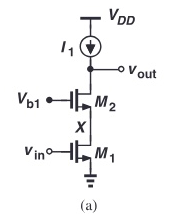

# 장말문제 9.29 — 이득 200을 위한 MOS 캐스코드 증폭기의 W/L

## 원문
The MOS cascode of Fig. 9.20(a) must provide a voltage gain of 200 with a bias current of $1\ \text{mA}$. If $\mu_n C_{ox} = 100\ \mu\text{A/V}^2$ and $\lambda = 0.1\ \text{V}^{-1}$ for both transistors, determine the required value of $(W/L)_1 = (W/L)_2$.

## 조건
- 회로: Fig 9.20(a) MOS 캐스코드 증폭기
- 목표 전압 이득 200, 바이어스 전류 $1\ \text{mA}$
- 두 트랜지스터 모두 $\mu_n C_{ox} = 100\ \mu\text{A/V}^2$, $\lambda = 0.1\ \text{V}^{-1}$
- $(W/L)_1 = (W/L)_2$
- 부하 $I_1$은 이상적인 전류원 (원문에 없음)

## 구할 것
- 필요한 $(W/L)_1 = (W/L)_2$ 값

## 상속·참조
- 식 (9.67)–(9.69) (본문 Fig 9.20(a), 교재 465쪽): $1/g_{m2} \ll r_{O1}$이면 $G_m \approx g_{m1}$이고 $A_v = -G_m R_{out} \approx -g_{m1}[(1 + g_{m2} r_{O2}) r_{O1} + r_{O2}] \approx -g_{m1} r_{O1} g_{m2} r_{O2}$
- $g_m = \sqrt{2 \mu_n C_{ox} (W/L) I_D}$, $r_O = 1/(\lambda I_D)$

## 회로 — Fig 9.20(a)
```spice
I1  VDD   vout
M2  vout  Vb1  X  nmos
M1  X     vin  0  nmos
```
- 단자: VDD = 전원, 값 미지정 (T 전원 기호) / Vb1 = 이상적 DC 바이어스, 값 미지정 (점 단자) / vin = 소신호 입력 (개방 원) / vout = 출력 (개방 원)
- 표시: 노드 라벨 VDD (T 기호 오른쪽), v_out (출력 원 오른쪽, 소문자 v), V_b1 (점 단자 왼쪽), X (M2–M1 연결선 왼쪽, 두 트랜지스터 사이), v_in (입력 원 왼쪽, 소문자 v) / 소자 라벨 I_1 (전류원 왼쪽), M2, M1 (각 트랜지스터 오른쪽, 소스 옆) / 부호 없음 / 화살표 없음 / 수치·면적 라벨 없음
- 배치: 한 세로줄 위→아래 VDD T 기호, I_1 전류원(원 안 화살표 아래), vout 접속점, M2, X, M1, 접지 / M2, M1 NMOS 보통 방향(게이트 왼쪽, 드레인 위, 소스 아래·소스 화살표 바깥) / vout 접속점에서 가로선이 오른쪽으로 v_out 원 / V_b1 점 단자 → 가로선 → M2 게이트, v_in 원 → 가로선 → M1 게이트 / M2 소스에서 곧은 세로선이 M1 드레인으로 = X / M1 소스 아래 접지 / 접속점 (세 갈래 이상, 1곳): vout = 위 I_1 + 아래 M2 드레인 + 오른쪽 v_out 선 (점) / 교차: 없음


> 참고: Fig 9.20은 본문 그림(교재 465쪽, PDF p.9)

## 풀이
### 소신호 파라미터
- 두 트랜지스터의 $r_O = 1/(\lambda I_D) = 1/(0.1\ \text{V}^{-1} \cdot 1\ \text{mA}) = 10.0\ \text{k}\Omega$, $g_m = \sqrt{2 \mu_n C_{ox} (W/L) I_D}$
### 필요한 $g_m$
- $I_1$이 이상적이면 $G_m \approx g_{m1}$, $R_{out} \approx g_{m2} r_{O2} r_{O1}$ ($M_2$가 $r_{O1}$로 소스 축퇴)이라 $|A_v| \approx g_{m1} r_{O1} g_{m2} r_{O2} = (g_m r_O)^2$
- $g_m r_O = \sqrt{200} = 14.1$ → $g_m = 14.1/10\ \text{k}\Omega = 1.41\ \text{mS}$
### $W/L$
- $W/L = g_m^2/(2 \mu_n C_{ox} I_D) = (1.41\ \text{mS})^2/(2 \cdot 100\ \mu\text{A/V}^2 \cdot 1\ \text{mA}) = 10.0$
- 정확식으로는 $9.32$ ($g_m r_O = 14.1$이 아주 크지 않아, 이상적 부하의 정확한 이득 $|A_v| = g_m r_O (1 + g_m r_O)$로 풀면 $g_m r_O = 13.7$)
### 답
- $(W/L)_1 = (W/L)_2 \approx 10.0$
