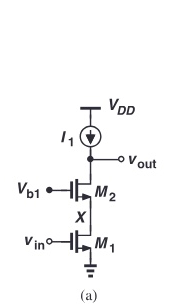

# 장말문제 9.31 — MOS 캐스코드 증폭기에서 길이를 N배로 늘릴 때의 전압 이득

## 원문
Repeat Problem 9.30 if the lengths of both transistors are increased by a factor of $N$ while the transistor widths and bias currents remain unchanged.

## 조건
- 문제 9.30을 다시 풂: 이번에는 두 트랜지스터의 길이를 모두 $N$배로 늘림
- 트랜지스터 폭과 바이어스 전류는 그대로
- 문제 9.30의 조건을 이어받음: Fig 9.20(a) MOS 캐스코드가 주어진 전압 이득 $A_v$에 맞게 설계되어 있음, 식 (9.79)와 문제 9.28의 결과를 이용
- $\lambda$와 $L$의 관계는 원문에 명시 없음. 문제 9.18은 $\lambda \propto L^{-1}$을 가정함 (원문에 없음)

## 구할 것
- 이득 $A_v$가 어떻게 되는지 설명

## 상속·참조
- 문제 9.30 (P9.30): Fig 9.20(a) MOS 캐스코드가 주어진 $A_v$에 맞게 설계되어 있을 때, 길이·바이어스 전류는 그대로 두고 두 트랜지스터의 폭을 $N$배로 늘리면 어떻게 되는지 식 (9.79)와 문제 9.28의 결과로 설명
- 원문이 가리키는 식 (9.79)는 이 교재 번호로는 예제 9.11의 수치 결과 $R_{on} \approx 693\ \text{k}\Omega$(교재 467쪽)라 문맥과 맞지 않음(오식으로 보임). Fig 9.20(a)의 이득 식은 이 교재의 식 (9.69) (원문에 없음)
- 식 (9.67)–(9.69) (본문 Fig 9.20(a), 교재 465쪽): $1/g_{m2} \ll r_{O1}$이면 $G_m \approx g_{m1}$이고 $A_v = -G_m R_{out} \approx -g_{m1}[(1 + g_{m2} r_{O2}) r_{O1} + r_{O2}] \approx -g_{m1} r_{O1} g_{m2} r_{O2}$
- 문제 9.28 (P9.28): $g_m = \sqrt{2 \mu_n C_{ox} (W/L) I_D}$, $r_O = 1/(\lambda I_D)$로 써서 CMOS 캐스코드 이득 식 (9.72) $A_v \approx -g_{m1} \left[ (g_{m2} r_{O2} r_{O1}) \parallel (g_{m3} r_{O3} r_{O4}) \right]$를 소자 파라미터로 표현하고 $I_D$의 함수로 그리는 문제

## 회로 — Fig 9.20(a)
```spice
I1  VDD   vout
M2  vout  Vb1  X  nmos
M1  X     vin  0  nmos
```
- 단자: VDD = 전원, 값 미지정 (T 전원 기호) / Vb1 = 이상적 DC 바이어스, 값 미지정 (점 단자) / vin = 소신호 입력 (개방 원) / vout = 출력 (개방 원)
- 표시: 노드 라벨 VDD (T 기호 오른쪽), v_out (출력 원 오른쪽, 소문자 v), V_b1 (점 단자 왼쪽), X (M2–M1 연결선 왼쪽, 두 트랜지스터 사이), v_in (입력 원 왼쪽, 소문자 v) / 소자 라벨 I_1 (전류원 왼쪽), M2, M1 (각 트랜지스터 오른쪽, 소스 옆) / 부호 없음 / 화살표 없음 / 수치·면적 라벨 없음
- 배치: 한 세로줄 위→아래 VDD T 기호, I_1 전류원(원 안 화살표 아래), vout 접속점, M2, X, M1, 접지 / M2, M1 NMOS 보통 방향(게이트 왼쪽, 드레인 위, 소스 아래·소스 화살표 바깥) / vout 접속점에서 가로선이 오른쪽으로 v_out 원 / V_b1 점 단자 → 가로선 → M2 게이트, v_in 원 → 가로선 → M1 게이트 / M2 소스에서 곧은 세로선이 M1 드레인으로 = X / M1 소스 아래 접지 / 접속점 (세 갈래 이상, 1곳): vout = 위 I_1 + 아래 M2 드레인 + 오른쪽 v_out 선 (점) / 교차: 없음


> 참고: Fig 9.20은 본문 그림(교재 465쪽, PDF p.9)
