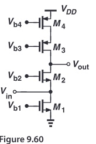

# 장말문제 9.32 — 입력이 M2 소스에 들어간 CMOS 캐스코드 증폭기의 이득

## 원문
Due to a manufacturing error, a CMOS cascode amplifier has been configured as shown in Fig. 9.60. Calculate the voltage gain of the circuit.

## 조건
- 제조 오류로 CMOS 캐스코드 증폭기가 Fig 9.60처럼 구성됨 (입력 $V_{in}$이 $M_2$ 소스–$M_1$ 드레인 노드에 연결)
- 소자 값은 주어지지 않음. 답은 소신호 파라미터로 나타냄 (원문에 없음)

## 구할 것
- 회로의 전압 이득 $A_v$

## 회로 — Fig 9.60
```spice
M4  n2    Vb4  VDD   pmos
M3  Vout  Vb3  n2    pmos
M2  Vout  Vb2  Vin   nmos
M1  Vin   Vb1  0     nmos
```
- 단자: VDD = 전원, 값 미지정 (T 전원 기호) / Vb4, Vb3, Vb2, Vb1 = 이상적 DC 바이어스, 값 미지정 (점 단자) / Vin = 신호 입력 (개방 원) / Vout = 출력 (개방 원)
- 표시: 노드 라벨 VDD (T 기호 오른쪽), V_b4, V_b3, V_b2, V_b1 (각 점 단자 왼쪽), V_out (출력 원 오른쪽), V_in (입력 원 왼쪽 위, V와 첨자 in이 위아래로 벌어져 인쇄되어 V는 원 왼쪽 위, in은 원 아래) / 소자 라벨 M4, M3, M2, M1 (각 트랜지스터 오른쪽) / 부호 없음 / 화살표 없음 / 수치·면적 라벨 없음
- 배치: 한 세로줄 위→아래 VDD T 기호, M4, M3, Vout 접속점, M2, Vin 접속점, M1, 접지 / M4, M3 PMOS 보통 방향(게이트 왼쪽, 소스 위·소스 화살표가 채널 쪽으로 들어감, 드레인 아래) / M2, M1 NMOS 보통 방향(게이트 왼쪽, 드레인 위, 소스 아래·소스 화살표 바깥) / M4 소스 → 세로선 위로 VDD / M4 드레인에서 곧은 세로선이 M3 소스로 (n2, 라벨 없음) / M3 드레인 → Vout 접속점 → M2 드레인 / Vout 접속점에서 가로선이 오른쪽으로 V_out 원 / M2 소스 → Vin 접속점 → M1 드레인 / Vin 접속점에서 긴 가로선이 왼쪽으로 V_in 원(점 단자들과 비슷한 x) / V_b4, V_b3, V_b2, V_b1 점 단자 → 가로선 → 각 게이트 / M1 소스 아래 접지 / 접속점 (세 갈래 이상, 2곳): Vout = 위 M3 드레인 + 아래 M2 드레인 + 오른쪽 V_out 선 (점), Vin = 위 M2 소스 + 아래 M1 드레인 + 왼쪽 V_in 선 (점) / 교차: 없음



## 풀이
### 회로 보기
- $M_i$의 트랜스컨덕턴스 $g_{mi}$, 출력 저항 $r_{Oi}$
- $V_{in}$이 $M_2$ 소스에 바로 걸리고 게이트는 $V_{b2}$(AC 접지)라 $M_2$는 공통 게이트 단이다. $M_1$은 이상적인 입력 전압원에 병렬로 달려 이득에 영향이 없다
- 위에서 본 부하는 $M_3$가 $r_{O4}$로 소스 축퇴된 캐스코드: $R_{op} \approx g_{m3} r_{O3} r_{O4}$
### 이득 식
- $M_2$ 드레인에서 소스로 흐르는 전류 $i = -g_{m2} v_{in} + (v_{out} - v_{in})/r_{O2}$, 출력 노드에서 $i = -v_{out}/R_{op}$
- 풀면 $A_v = \dfrac{(1 + g_{m2} r_{O2}) R_{op}}{R_{op} + r_{O2}}$
### 근사
- $R_{op} \approx g_{m3} r_{O3} r_{O4} \gg r_{O2}$이므로 $A_v \approx 1 + g_{m2} r_{O2} \approx g_{m2} r_{O2}$
- 비반전이고, 정상 캐스코드의 $(g_m r_O)^2$급 이득이 아니라 한 트랜지스터의 고유 이득 정도다
### 답
- $A_v = \dfrac{(1 + g_{m2} r_{O2}) R_{op}}{R_{op} + r_{O2}} \approx g_{m2} r_{O2}$ (비반전, $R_{op} \approx g_{m3} r_{O3} r_{O4}$)
