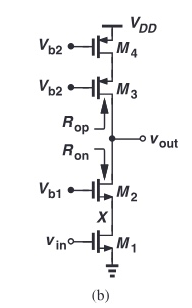

# 장말문제 9.33 — 이득 500을 위한 CMOS 캐스코드 증폭기의 바이어스 전류

## 원문
In the cascode stage of Fig. 9.20(b), $(W/L)_1 = \cdots = (W/L)_4 = 20/0.18$. If $\mu_n C_{ox} = 100\ \mu\text{A/V}^2$, and $\mu_p C_{ox} = 50\ \mu\text{A/V}^2$, $\lambda_n = 0.1\ \text{V}^{-1}$, and $\lambda_p = 0.15\ \text{V}^{-1}$, calculate the bias current such that the circuit achieves a voltage gain of 500.

## 조건
- 회로: Fig 9.20(b) CMOS 캐스코드 단 (NMOS $M_1$, $M_2$ 캐스코드 + PMOS $M_3$, $M_4$ 캐스코드 부하)
- $(W/L)_1 = \cdots = (W/L)_4 = 20/0.18$
- $\mu_n C_{ox} = 100\ \mu\text{A/V}^2$, $\mu_p C_{ox} = 50\ \mu\text{A/V}^2$
- $\lambda_n = 0.1\ \text{V}^{-1}$, $\lambda_p = 0.15\ \text{V}^{-1}$
- 목표 전압 이득 500
- 네 트랜지스터는 같은 바이어스 전류를 흘림 (원문에 없음, 직렬 연결)

## 구할 것
- 전압 이득 500을 얻는 바이어스 전류

## 상속·참조
- 식 (9.70)–(9.71): $R_{on} \approx g_{m2} r_{O2} r_{O1}$, $\quad R_{op} \approx g_{m3} r_{O3} r_{O4}$
- 식 (9.72): $1/g_{m2} \ll r_{O1}$이면 $G_m \approx g_{m1}$이므로 $A_v \approx -g_{m1} \left[ (g_{m2} r_{O2} r_{O1}) \parallel (g_{m3} r_{O3} r_{O4}) \right]$
- $g_m = \sqrt{2 \mu C_{ox} (W/L) I_D}$, $r_O = (\lambda I_D)^{-1}$

## 회로 — Fig 9.20(b)
```spice
M4  n2    Vb2  VDD  pmos  W/L=20/0.18
M3  vout  Vb2  n2   pmos  W/L=20/0.18    ; M4, M3 게이트 라벨이 둘 다 V_b2로 인쇄됨 (점 단자 두 개, 그림에서 서로 이어져 있지 않음)
M2  vout  Vb1  X    nmos  W/L=20/0.18
M1  X     vin  0    nmos  W/L=20/0.18
```
- 단자: VDD = 전원, 값 미지정 (T 전원 기호) / Vb2 = 이상적 DC 바이어스, 값 미지정 (점 단자, M4 게이트와 M3 게이트에 하나씩 모두 V_b2로 인쇄) / Vb1 = 이상적 DC 바이어스, 값 미지정 (점 단자) / vin = 소신호 입력 (개방 원) / vout = 출력 (개방 원)
- 표시: 노드 라벨 VDD (T 기호 오른쪽), V_b2 (M4 게이트 점 단자 왼쪽), V_b2 (M3 게이트 점 단자 왼쪽), V_b1 (점 단자 왼쪽), X (M2–M1 연결선 왼쪽, 두 트랜지스터 사이), v_in (입력 원 왼쪽), v_out (출력 원 오른쪽) / 소자 라벨 M4, M3, M2, M1 (각 트랜지스터 오른쪽) / 부호 없음 / 화살표 "R_op": vout 노드에서 위(M3, M4 쪽)를 들여다봄, 위 방향, 도선 옆 별도 화살표 (L자를 좌우 반전: M3 게이트 판과 드레인 세로선 사이(드레인선 바로 왼쪽, M3 채널 바로 아래 x)에 세로선, 아래 끝에서 짧은 가로선이 왼쪽 R_op 글자 쪽으로, 가로선은 vout 접속점보다 약간 위, 화살촉은 위 끝, M3 드레인 바로 아래 높이); "R_on": vout 노드에서 아래(M2, M1 쪽)를 들여다봄, 아래 방향, 도선 옆 별도 화살표 (┌ 꺾임을 좌우 반전: M2 게이트 판과 드레인 세로선 사이(드레인선 바로 왼쪽, M2 채널 바로 위 x)에 세로선, 위 끝에서 짧은 가로선이 왼쪽 R_on 글자 쪽으로, 화살촉은 아래 끝, M2 드레인 바로 위 높이) / 수치·면적 라벨 없음 (W/L 값은 문제 글에만 있음)
- 배치: 한 세로줄 위→아래 VDD T 기호, M4, M3, vout 접속점, M2, X, M1, 접지 / M4, M3 PMOS (게이트 왼쪽, 소스가 위·소스 화살표가 채널 쪽으로 들어감, 드레인 아래) / M2, M1 NMOS 보통 방향(게이트 왼쪽, 드레인 위, 소스 아래·화살표 바깥) / M4 소스에서 세로선이 위로 VDD T 기호 / M4 드레인에서 곧은 세로선이 M3 소스로 (n2, 라벨 없음) / M3 드레인 → 세로선 → vout 접속점 → 세로선 → M2 드레인 / vout 접속점에서 가로선이 오른쪽으로 뻗어 v_out 원 / M2 소스에서 곧은 세로선이 M1 드레인으로 = X / M1 소스 아래 접지 / 점 단자들과 v_in 원 → 가로선 → 각 게이트 / R_op, R_on 화살표의 세로선은 게이트 판과 드레인 세로선 사이(드레인선 바로 왼쪽), R_op·R_on 글자는 그 왼쪽(R_op는 M3 게이트 선 아래, R_on은 M2 게이트 선 위), R_op는 vout 접속점 위, R_on은 그 아래 / 접속점 (세 갈래 이상, 1곳): vout = 위 M3 드레인 + 아래 M2 드레인 + 오른쪽 v_out 선 (점) / 교차: 없음


> 참고: (b)의 두 V_b2 라벨 중 하나(M4 쪽)는 원문 오식일 수 있으나 인쇄된 대로 적음. Fig 9.20은 본문 그림(교재 465쪽, PDF p.9)

## 풀이
### 시험값 $I_D = 1\ \text{mA}$에서의 소신호 파라미터
- 네 트랜지스터는 직렬이라 같은 $I_D$가 흐른다. $M_1$, $M_2$는 $g_{mn} = \sqrt{2 \mu_n C_{ox} (W/L) I_D}$, $r_{On} = 1/(\lambda_n I_D)$, $M_3$, $M_4$는 $g_{mp}$, $r_{Op}$도 같은 꼴
- $I_D = 1\ \text{mA}$이면 $g_{mn} = 4.71\ \text{mS}$, $g_{mp} = 3.33\ \text{mS}$, $r_{On} = 10.0\ \text{k}\Omega$, $r_{Op} = 6.67\ \text{k}\Omega$
### 이득과 $I_D$의 관계
- $R_{on} \approx g_{mn} r_{On}^2 = 471\ \text{k}\Omega$, $R_{op} \approx g_{mp} r_{Op}^2 = 148\ \text{k}\Omega$
- $|A_v| \approx g_{mn} (R_{on} \parallel R_{op}) = 4.71\ \text{mS} \cdot 113\ \text{k}\Omega = 531$
- $g_m \propto I_D^{1/2}$, $r_O \propto I_D^{-1}$이라 $R_{on}, R_{op} \propto I_D^{-3/2}$, 따라서 $|A_v| \propto I_D^{-1}$
### 바이어스 전류
- $I_D = 1\ \text{mA} \cdot 531/500 = 1.06\ \text{mA}$
- 이때 $g_{mn} r_{On} = 45.7$, $g_{mp} r_{Op} = 21.6$
- 정확식으로는 $1.13\ \text{mA}$ ($g_{mp} r_{Op} \approx 22$라 근사식이 이득을 약 6% 작게 준다)
### 답
- $I_D \approx 1.06\ \text{mA}$
