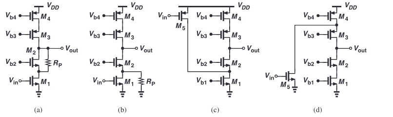

# 장말문제 9.34 — 변형된 CMOS 캐스코드 증폭기 네 개의 전압 이득

## 원문
Determine the voltage gain of each circuit in Fig. 9.61. Assume $g_m r_O \gg 1$.

## 조건
- 회로: Fig 9.61 (a)–(d) 네 CMOS 캐스코드 증폭기
- $g_m r_O \gg 1$로 가정
- 소자 값은 주어지지 않음. 답은 소신호 파라미터($g_m$, $r_O$, $R_P$)로 나타냄 (원문에 없음)

## 구할 것
- (a)–(d) 각 회로의 전압 이득

## 회로 — Fig 9.61(a)
```spice
M4  n3    Vb4  VDD  pmos
M3  Vout  Vb3  n3   pmos
M2  Vout  Vb2  n1   nmos
M1  n1    Vin  0    nmos
RP  Vout  n1   {R_P}     ; M2 드레인 ↔ M2 소스 (M2와 병렬)
```
- 단자: VDD = 전원, 값 미지정 (T 전원 기호) / Vb4, Vb3, Vb2 = 이상적 DC 바이어스, 값 미지정 (점 단자) / Vin = 신호 입력 (개방 원) / Vout = 출력 (개방 원)
- 표시: 노드 라벨 VDD (T 기호 오른쪽), V_b4, V_b3, V_b2 (각 점 단자 왼쪽), V_in (입력 원 왼쪽), V_out (출력 원 오른쪽) / 소자 라벨 M4, M3, M1 (각 트랜지스터 오른쪽), M2 (M2 오른쪽이 아니라 M2 드레인 선 왼쪽, V_b2 선보다 위 — Vout 접속점 왼쪽 아래), R_P (저항 오른쪽) / 부호 없음 / 화살표 없음 / 수치·면적 라벨 없음
- 배치: 한 세로줄 위→아래 VDD T 기호, M4, M3, Vout 접속점, M2, n1 접속점, M1, 접지 / M4, M3 PMOS 보통 방향(게이트 왼쪽, 소스 위), M2, M1 NMOS 보통 방향(게이트 왼쪽, 드레인 위) / 점 단자와 입력 원 → 가로선 → 각 게이트 / Vout 접속점에서 가로선이 오른쪽으로 가다 둘째 접속점을 지나 V_out 원 / 둘째 접속점에서 세로선이 아래로 R_P를 지나 n1 높이에서 왼쪽으로 꺾여 n1 접속점 / M1 소스 아래 접지 / 접속점 (세 갈래 이상, 3곳): ① Vout = 위 M3 드레인 + 아래 M2 드레인 + 오른쪽 가로선 (점) ② 둘째 접속점 = 왼쪽 가로선 + 오른쪽 V_out 선 + 아래 R_P (점) ③ n1 = 위 M2 소스 + 아래 M1 드레인 + 오른쪽 R_P 선 (점) / 교차: 없음

## 회로 — Fig 9.61(b)
```spice
M4  n3    Vb4  VDD  pmos
M3  Vout  Vb3  n3   pmos
M2  Vout  Vb2  n1   nmos
M1  n1    Vin  0    nmos
RP  n1    0    {R_P}     ; M2 소스(= M1 드레인) ↔ 접지
```
- 단자: VDD = 전원, 값 미지정 (T 전원 기호) / Vb4, Vb3, Vb2 = 이상적 DC 바이어스, 값 미지정 (점 단자) / Vin = 신호 입력 (개방 원) / Vout = 출력 (개방 원)
- 표시: 노드 라벨 VDD (T 기호 오른쪽), V_b4, V_b3, V_b2 (각 점 단자 왼쪽), V_in (입력 원 왼쪽), V_out (출력 원 오른쪽) / 소자 라벨 M4, M3, M2, M1 (각 트랜지스터 오른쪽), R_P (저항 오른쪽) / 부호 없음 / 화살표 없음 / 수치·면적 라벨 없음
- 배치: 한 세로줄 위→아래 VDD T 기호, M4, M3, Vout 접속점, M2, n1 접속점, M1, 접지 / 트랜지스터 방향은 (a)와 같음 / Vout 접속점 → 가로선 → 오른쪽 V_out 원 / n1 접속점에서 가로선이 오른쪽으로 가 모서리에서 아래로 꺾여 R_P → 접지 (R_P는 M1 오른쪽, 접지 두 개가 거의 같은 높이) / 접속점 (세 갈래 이상, 2곳): Vout = 위 M3 드레인 + 아래 M2 드레인 + 오른쪽 V_out 선 (점), n1 = 위 M2 소스 + 아래 M1 드레인 + 오른쪽 R_P 선 (점) / 교차: 없음

## 회로 — Fig 9.61(c)
```spice
M5  n1    Vin  VDD  pmos
M4  n3    Vb4  VDD  pmos
M3  Vout  Vb3  n3   pmos
M2  Vout  Vb2  n1   nmos
M1  n1    Vb1  0    nmos
```
- 단자: VDD = 전원, 값 미지정 (가로 레일) / Vb4, Vb3, Vb2, Vb1 = 이상적 DC 바이어스, 값 미지정 (점 단자) / Vin = 신호 입력 (개방 원) / Vout = 출력 (개방 원)
- 표시: 노드 라벨 VDD (레일 오른쪽 끝), V_in (M5 입력 원 왼쪽), V_b4, V_b3, V_b2, V_b1 (각 점 단자 왼쪽), V_out (출력 원 오른쪽) / 소자 라벨 M5 (M5 왼쪽 아래, 게이트 선 밑), M4, M3, M2, M1 (각 트랜지스터 오른쪽) / 부호 없음 / 화살표 없음 / 수치·면적 라벨 없음
- 배치: 맨 위 굵은 가로 레일 VDD, 왼쪽 끝 근처에 M5 소스, 오른쪽 끝 근처에 M4 소스가 매달림 / 오른쪽 세로줄 위→아래 M4, M3, Vout 접속점, M2, n1 접속점, M1, 접지 (방향은 (a)와 같음, M1 게이트는 V_b1 점 단자) / M5: 레일 바로 아래 왼쪽, PMOS 보통 방향(게이트 왼쪽, 소스 위로 레일) / M5 드레인에서 긴 세로선이 V_b4–V_b2 라벨보다 왼쪽으로 내려가 M2와 M1 사이 높이에서 오른쪽으로 꺾여 n1 접속점 / Vout 접속점 → 오른쪽 V_out 원 / 접속점 (세 갈래 이상, 2곳): Vout = 위 M3 드레인 + 아래 M2 드레인 + 오른쪽 V_out 선 (점), n1 = 위 M2 소스 + 아래 M1 드레인 + 왼쪽 M5 드레인 선 (점) / 교차: 없음 (M5 드레인 선은 V_b 게이트선들의 왼쪽 끝보다 더 왼쪽을 지남)

## 회로 — Fig 9.61(d)
```spice
M5  n3    Vin  0    nmos
M4  n3    Vb4  VDD  pmos
M3  Vout  Vb3  n3   pmos
M2  Vout  Vb2  n1   nmos
M1  n1    Vb1  0    nmos
```
- 단자: VDD = 전원, 값 미지정 (T 전원 기호) / Vb4, Vb3, Vb2, Vb1 = 이상적 DC 바이어스, 값 미지정 (점 단자) / Vin = 신호 입력 (개방 원) / Vout = 출력 (개방 원)
- 표시: 노드 라벨 VDD (T 기호 오른쪽), V_b4, V_b3, V_b2, V_b1 (각 점 단자 왼쪽), V_in (M5 입력 원 왼쪽), V_out (출력 원 오른쪽) / 소자 라벨 M5 (M5 왼쪽 아래, 소스 접지 왼쪽), M4, M3, M2, M1 (각 트랜지스터 오른쪽) / 부호 없음 / 화살표 없음 / 수치·면적 라벨 없음
- 배치: 오른쪽 세로줄 위→아래 VDD T 기호, M4, n3 접속점, M3, Vout 접속점, M2, M1, 접지 (방향은 (a)와 같음, M1 게이트는 V_b1 점 단자) / M5: 왼쪽 아래(M1 높이), NMOS 보통 방향(게이트 왼쪽 V_in 원, 소스 아래 접지) / M5 드레인에서 긴 세로선이 위로 올라가 M4와 M3 사이 높이에서 오른쪽으로 꺾여 V_b3·V_b4 라벨 사이를 가로질러 n3 접속점 / Vout 접속점 → 오른쪽 V_out 원 / 접속점 (세 갈래 이상, 2곳): n3 = 위 M4 드레인 + 아래 M3 소스 + 왼쪽 M5 드레인 선 (점), Vout = 위 M3 드레인 + 아래 M2 드레인 + 오른쪽 V_out 선 (점) / 교차: 없음



## 힌트
### (c)(d) $M_5$ 전류는 공통 게이트가 전달
- $M_5$는 소스가 AC 접지인 공통 소스 소자라서 입력을 전류로 바꿔, 드레인이 닿은 캐스코드 안쪽 노드((c)는 $M_1$–$M_2$ 사이, (d)는 $M_3$–$M_4$ 사이)에 넣는다
- 출력을 단락하면 그 노드에서 공통 게이트 소자의 소스 쪽($1/g_m$급)이 $r_O$급인 다른 길보다 훨씬 작아 전류가 거의 다 출력으로 가고, $R_{out}$을 볼 때는 $M_5$가 그 노드에 $r_{O5}$로 더 달린다

## 풀이
### (a) $M_2$에 병렬인 $R_P$
- $M_i$의 $g_{mi}$, $r_{Oi}$. (a)–(c)의 위쪽 캐스코드는 $R_{op} \approx g_{m3} r_{O3} r_{O4}$
- $R_P \parallel r_{O2}$가 $M_2$의 $r_O$ 구실: $R_{on} \approx [1 + g_{m2}(r_{O2} \parallel R_P)]\, r_{O1}$ ($R_P$ 값이 없어 1을 남김), $G_m \approx g_{m1}$
### (b) $M_1$에 병렬인 $R_P$
- 축퇴 저항 $R_S' = r_{O1} \parallel R_P$ (작을 수 있어 1을 남김): $R_{on} \approx (1 + g_{m2} R_S')\, r_{O2}$
- $M_1$ 전류가 $R_S'$와 $1/g_{m2}$로 나뉘어 $G_m \approx g_{m1} g_{m2} R_S'/(1 + g_{m2} R_S')$
### (c)(d) $M_5$ 전류는 공통 게이트가 전달
- 공통 소스 $M_5$의 전류 $g_{m5} v_{in}$은 안쪽 노드에서 공통 게이트 소스 쪽($1/g_m$급)이 $r_O$급 길보다 훨씬 작아 거의 다 출력으로 간다: $G_m \approx g_{m5}$ (반전)
- $M_5$가 그 노드에 $r_{O5}$로 더 달려 (c) $R_{on} \approx g_{m2} r_{O2}(r_{O1} \parallel r_{O5})$, (d) $R_{op} \approx g_{m3} r_{O3}(r_{O4} \parallel r_{O5})$
### 답
- (a) $A_v \approx -g_{m1}\{[1 + g_{m2}(r_{O2} \parallel R_P)]\, r_{O1} \parallel R_{op}\}$
- (b) $A_v \approx -\frac{g_{m1} g_{m2} R_S'}{1 + g_{m2} R_S'} [(1 + g_{m2} R_S')\, r_{O2} \parallel R_{op}]$
- (c) $A_v \approx -g_{m5}[g_{m2} r_{O2}(r_{O1} \parallel r_{O5}) \parallel R_{op}]$
- (d) $A_v \approx -g_{m5}[g_{m2} r_{O2} r_{O1} \parallel g_{m3} r_{O3}(r_{O4} \parallel r_{O5})]$
