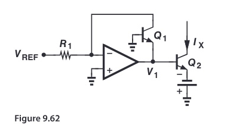

# 장말문제 9.38 — 로그 증폭기로 만든 전류 거울?

## 원문
Having learned about the logarithmic function of the circuit in Fig. 9.24(b), a student remembers the logarithmic amplifier studied in Chapter 8 and constructs the circuit depicted in Fig. 9.62. Explain what happens.

## 조건
- 한 학생이 Fig 9.24(b) 회로가 로그 함수를 만든다는 점을 배운 뒤, 8장의 로그 증폭기를 떠올려 Fig 9.62 회로를 만듦
- 참고 회로 (본문 Fig 9.24(b)): 전류원 $I_{REF}$가 다이오드 연결 트랜지스터 $Q_{REF}$에 흘러 $V_1 = V_T \ln (I_{REF}/I_{S,REF})$를 만드는 회로 (원문에 없음)
- 8장 로그 증폭기: 반전 연산증폭기의 귀환 경로에 BJT를 넣어 출력 전압이 입력 전압의 로그에 비례하게 만든 회로 (원문에 없음)

## 구할 것
- Fig 9.62 회로에서 무슨 일이 일어나는지 설명

## 상속·참조
- 본문 Fig 9.24(b) (교재 470쪽, 이 파일의 그림 목록에는 넣지 않음, 크롭은 fig9-24.png): 전류의 자연 대수에 비례하는 전압 $V_1$을 만드는 다이오드 연결 회로
  - `I_REF: VCC → V1`
  - `Q_REF: C = V1, B = V1, E = 0`
- 식 (9.88): $V_1 = V_T \ln \dfrac{I_{REF}}{I_{S,REF}}$
- 8장 로그 증폭기 (이 PDF에는 없음): 반전 연산증폭기의 귀환 경로에 BJT를 넣어, 출력 전압이 입력 전압의 로그에 비례하게 만든 회로 (원문에 없음)

## 회로 — Fig 9.62
```spice
R1  VREF  n1  {R_1}
X1  0     n1  V1  opamp     ; in+ = 접지, in- = n1
Q1  n1    0   V1  npn       ; 컬렉터 = n1(귀환 선), 베이스 = 접지, 이미터 = V1
Q2  out   V1  n2  npn
VB  0     n2                ; 배터리: + 단자 = 접지, − 단자 = Q2 이미터
```
- 단자: VREF = 입력 전압, 값 미지정 (점 단자) / out = Q2 컬렉터, I_X가 들어가는 단자 (선 끝)
- 표시: 노드 라벨 VREF (점 단자 왼쪽), V1 (V1 접속점 아래) / 소자 라벨 R1 (저항 위), Q1 (Q1 오른쪽), Q2 (Q2 오른쪽), X1 연산증폭기 (라벨 없음), VB 배터리 (라벨 없음) / 부호 연산증폭기 입력 "−" (위 입력, 삼각형 안), "+" (아래 입력, 삼각형 안); 배터리 "−" (도선 왼쪽, Q2 이미터와 위 짧은 판 사이 높이), "+" (도선 왼쪽, 아래 긴 판과 접지 사이 높이) / 화살표 "I_X": out, 아래 방향(Q2 컬렉터로 들어감), 도선 위, 글자는 화살표 오른쪽 / 수치·면적 라벨 없음 (배터리 전압 값도 인쇄 안 됨)
- 배치: 왼쪽→오른쪽 VREF 점 단자, 가로 R1, n1 접속점, 연산증폭기(오른쪽을 향한 삼각형), V1 접속점, Q2 / VREF·R1·n1·연산증폭기 − 입력이 한 가로선 높이 / 연산증폭기 + 입력에서 왼쪽으로 짧게 나가 모서리에서 아래로 꺾여 접지 / 귀환 선: n1 접속점에서 세로로 올라가 그림 맨 위 높이에서 오른쪽으로 꺾여 연산증폭기와 Q1 위를 가로지른 뒤 모서리에서 아래로 꺾여 Q1 컬렉터 / Q1: 연산증폭기 출력 쪽(오른쪽) 위에 놓임, 보통 방향(베이스 왼쪽), 베이스에서 왼쪽으로 짧게 나가 모서리에서 아래로 꺾여 접지 기호(연산증폭기 윗변보다 위) / Q1 이미터 → 세로로 내려가 V1 접속점 / 연산증폭기 출력 가로선이 V1 접속점을 지나 오른쪽 Q2 베이스로 / Q2: 보통 방향, V1 높이, 컬렉터에서 세로선이 위로 올라가 선 끝, 이미터 → 세로로 배터리(짧은 판 위, 긴 판 아래) → 접지 / 접속점 (세 갈래 이상, 2곳): n1 = 왼쪽 R1 + 오른쪽 연산증폭기 − 입력 + 위 귀환 선 (점), V1 = 왼쪽 연산증폭기 출력 + 위 Q1 이미터 + 오른쪽 Q2 베이스 (점) / 교차: 없음



## 힌트
### $V_1$이 두 $V_{BE}$에 들어가는 부호
- 가상 접지 때문에 $Q_1$은 베이스와 컬렉터가 0 V이고 이미터만 $V_1$이라, $Q_1$의 $V_{BE}$가 $V_1$로 정해지고 $Q_1$ 전류는 $R_1$에 흐르는 전류다
- $Q_2$는 베이스가 $V_1$이고 이미터가 배터리만큼 접지 아래에 있다. 두 $V_{BE}$에 $V_1$이 어떻게 들어가는지 비교하면 $I_X$가 $V_{REF}$에 어떻게 반응하는지 나온다

## 풀이
### $Q_1$ 전류와 $V_1$
- 연산증폭기의 − 입력은 가상 접지(0 V)이고 입력 전류가 없으므로, $R_1$ 전류 $V_{REF}/R_1$이 모두 $Q_1$ 컬렉터로 들어간다
- $Q_1$은 베이스·컬렉터가 0 V이고 이미터만 $V_1$이라 $V_{BE1} = -V_1$: $V_1 = -V_T \ln \dfrac{V_{REF}}{R_1 I_{S1}}$ ($V_{REF} > 0$, $I_{S1}$은 $Q_1$의 포화 전류)
### $Q_2$의 $V_{BE}$
- $Q_2$ 베이스는 $V_1$이고, 이미터는 배터리 전압 $V_B$만큼 접지 아래(− 단자가 이미터)라 $V_{BE2} = V_1 + V_B$
- $V_1$이 $V_{BE1}$에는 $-V_1$로, $V_{BE2}$에는 $+V_1$로 들어가 $V_{BE1} + V_{BE2} = V_B$로 합이 일정하다
### $I_X$
- $I_X = I_{S2} \exp \dfrac{V_1 + V_B}{V_T} = \dfrac{I_{S1} I_{S2} R_1\, e^{V_B/V_T}}{V_{REF}}$ ($I_{S2}$는 $Q_2$의 포화 전류)
- $V_{BE1}$이 커지면 $V_{BE2}$가 그만큼 작아지므로, $I_X$는 입력 전류 $V_{REF}/R_1$에 반비례한다
### 해석
- 전류 거울은 $V_{BE2} = V_{BE1}$로 전류를 복사하는데, 여기서는 로그 증폭기 출력 $V_1$의 부호가 뒤집혀 있어 역수를 만든다
- $I_X$는 $I_{S1} I_{S2}$와 $e^{V_B/V_T}$에 비례해 공정·온도·배터리 전압에 지수적으로 민감하다
### 답
- $I_X = I_{S1} I_{S2} R_1 e^{V_B/V_T}/V_{REF}$로, 전류를 복사하지 않고 입력 전류의 역수에 비례한다($V_{REF}$가 커지면 $I_X$는 준다). 게다가 $I_S$·온도·$V_B$에 지수적으로 민감해 전류 거울로 쓸 수 없다.
