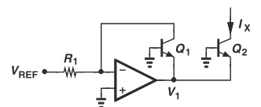

# 장말문제 9.39 — 로그 증폭기 + 베이스 접지 BJT 토폴로지

## 조건
- 문제 9.38을 Fig 9.63 토폴로지에 대해 다시 풂

## 구할 것
- Fig 9.63 회로에서 무슨 일이 일어나는지 설명

## 상속·참조
- 문제 9.38: 한 학생이 Fig 9.24(b) 회로가 로그 함수를 만든다는 점을 배운 뒤, 8장의 로그 증폭기를 떠올려 회로(Fig 9.62)를 만듦. 무슨 일이 일어나는지 설명하는 문제
  - Fig 9.62 (비교용): 연산증폭기 로그 증폭기($R_1$, 귀환 BJT $Q_1$: 컬렉터 = − 입력, 베이스 = 접지, 이미터 = 출력 $V_1$) 뒤에 $Q_2$(베이스 = $V_1$, 이미터 = 배터리 − 단자, 배터리 + 단자 = 접지, 컬렉터로 $I_X$ 유입)
- 본문 Fig 9.24(b) (교재 470쪽, 크롭 안 함): 전류의 자연 대수에 비례하는 전압 $V_1$을 만드는 다이오드 연결 회로
  - `I_REF: VCC → V1`
  - `Q_REF: C = V1, B = V1, E = 0`
- 식 (9.88): $V_1 = V_T \ln \dfrac{I_{REF}}{I_{S,REF}}$
- 8장 로그 증폭기 (이 PDF에는 없음): 반전 연산증폭기의 귀환 경로에 BJT를 넣어, 출력 전압이 입력 전압의 로그에 비례하게 만든 회로 (원문에 없음)

## 회로 — Fig 9.63
```spice
R1  VREF  n1  {R_1}
X1  0     n1  V1  opamp     ; in+ = 접지, in- = n1
Q1  n1    0   V1  npn       ; 컬렉터 = n1(귀환 선), 베이스 = 접지, 이미터 = V1
Q2  out   0   V1  npn       ; 베이스 = 접지, 이미터 = V1
```
- 단자: VREF = 입력 전압, 값 미지정 (점 단자) / out = Q2 컬렉터, I_X가 들어가는 단자 (선 끝)
- 표시: 노드 라벨 V_REF (점 단자 왼쪽), V_1 (V1 접속점 아래) / 소자 라벨 R_1 (저항 위), Q_1 (Q1 오른쪽), Q_2 (Q2 오른쪽), X1 연산증폭기 (라벨 없음) / 부호 연산증폭기 입력 "−" (위 입력, 삼각형 안), "+" (아래 입력, 삼각형 안) / 화살표 "I_X": out, 아래 방향(Q2 컬렉터로 들어감), 도선 위, 글자는 화살표 오른쪽 / 수치·면적 라벨 없음
- 배치: 왼쪽→오른쪽 V_REF 점 단자, 가로 R_1, n1 접속점, 연산증폭기(오른쪽을 향한 삼각형), V1 접속점 / V_REF·R_1·n1·연산증폭기 − 입력이 한 가로선 높이 / + 입력에서 왼쪽으로 짧게 나가 모서리에서 아래로 꺾여 접지 / 귀환 선: n1 접속점에서 세로로 올라가 그림 맨 위 높이에서 오른쪽으로 꺾여 연산증폭기 위를 지나 모서리에서 아래로 꺾여 Q1 컬렉터 / Q1: 연산증폭기 오른쪽 위, 보통 방향(베이스 왼쪽), 베이스에서 왼쪽으로 짧은 가로선 끝에 접지 기호 / Q1 이미터 → 세로로 내려가 V1 접속점 / 연산증폭기 출력 가로선이 V1 접속점을 지나 오른쪽으로 가 Q2 이미터 x에서 위로 꺾여 Q2 이미터 / Q2: Q1 오른쪽 같은 높이, 보통 방향, 베이스에서 왼쪽으로 짧은 가로선 끝에 접지 기호, 컬렉터에서 세로선이 위로 올라가 선 끝 / Fig 9.62와 달리 배터리가 없고 Q2 베이스가 접지, 이미터가 V1 / 접속점 (세 갈래 이상, 2곳): n1 = 왼쪽 R_1 + 오른쪽 연산증폭기 − 입력 + 위 귀환 선 (점), V1 = 왼쪽 연산증폭기 출력 + 위 Q1 이미터 + 오른쪽 Q2로 가는 선 (점) / 교차: 없음


