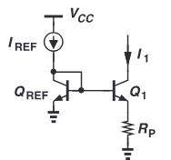

# 장말문제 9.40 — Q1 이미터에 생긴 R_P로 I1이 절반이 될 때 R_P

## 원문
Due to a manufacturing error, resistor $R_P$ has appeared in series with the emitter of $Q_1$ in Fig. 9.64. If $I_1$ is half of its nominal value, express the value of $R_P$ in terms of other circuit parameters. Assume $Q_{REF}$ and $Q_1$ are identical and $\beta \gg 1$.

## 조건
- 제조 오류로 Fig 9.64의 $Q_1$ 이미터에 저항 $R_P$가 직렬로 생김
- $I_1$이 공칭값의 절반
- $Q_{REF}$와 $Q_1$은 동일, $\beta \gg 1$
- 공칭값은 $R_P = 0$일 때의 $I_1 = I_{REF}$ (원문에 없음)

## 구할 것
- $R_P$를 다른 회로 파라미터로 나타냄

## 회로 — Fig 9.64
```spice
IREF  VCC  n1
QREF  n1   n1  0   npn
Q1    out  n1  n2  npn
RP    n2   0   {R_P}
```
- 단자: VCC = 전원, 값 미지정 (T 전원 기호) / out = Q1 컬렉터, I_1이 들어가는 단자 (선 끝)
- 표시: 노드 라벨 V_CC (T 기호 오른쪽) / 소자 라벨 I_REF (전류원 왼쪽), Q_REF (Q_REF 왼쪽), Q_1 (Q1 오른쪽), R_P (저항 오른쪽) / 부호 없음 / 화살표 "I_1": out, 아래 방향(Q1 컬렉터로 들어감), 도선 위, 글자는 화살표 오른쪽 / 수치·면적 라벨 없음
- 배치: 왼쪽 세로줄 위→아래 V_CC T 기호, I_REF 전류원(화살표 아래), n1 접속점, Q_REF, 접지 / Q_REF 좌우 반전(베이스 막대가 오른쪽, 컬렉터 왼쪽 위, 이미터 왼쪽 아래로 접지) / 다이오드 연결: n1 접속점에서 가로선이 오른쪽으로 가 모서리에서 아래로 꺾여 베이스 높이의 베이스 접속점 / 베이스 공통선: Q_REF 베이스에서 베이스 접속점을 지나 오른쪽 Q1 베이스까지 한 직선 / Q1 보통 방향(베이스 왼쪽), 컬렉터에서 세로선이 위로 I_1 화살표를 지나 선 끝, 이미터 → 세로로 R_P → 접지 / 접속점 (세 갈래 이상, 2곳): n1 = 위 I_REF + 아래 Q_REF 컬렉터 + 오른쪽 다이오드 연결 선 (점), 베이스 접속점 = 왼쪽 Q_REF 베이스 + 위 다이오드 연결 선 + 오른쪽 Q1 베이스 (점) / 교차: 없음


