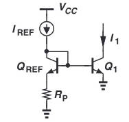

# 장말문제 9.41 — Q_REF 이미터에 생긴 R_P로 I1이 두 배가 될 때 R_P

## 원문
Repeat Problem 9.40 for the circuit shown in Fig. 9.65, but assuming that $I_1$ is twice its nominal value.

## 조건
- 문제 9.40을 Fig 9.65 회로에 대해 다시 풂: $R_P$가 $Q_{REF}$ 이미터에 직렬로 생김
- 문제 9.40에서 이어받는 가정: 제조 오류로 생긴 기생 저항 $R_P$, $Q_{REF}$와 $Q_1$은 동일, $\beta \gg 1$ (원문에 없음)
- 공칭값은 $R_P = 0$일 때의 $I_1 = I_{REF}$ (원문에 없음)
- $I_1$이 공칭값의 두 배

## 구할 것
- $R_P$를 다른 회로 파라미터로 나타냄

## 상속·참조
- 문제 9.40에서 이어받는 가정: 제조 오류로 생긴 기생 저항 $R_P$, $Q_{REF}$와 $Q_1$은 동일, $\beta \gg 1$
- 공칭값은 $R_P = 0$일 때의 $I_1 = I_{REF}$ (원문에 없음)

## 회로 — Fig 9.65
```spice
IREF  VCC  n1
QREF  n1   n1  n2  npn
RP    n2   0   {R_P}
Q1    out  n1  0   npn
```
- 단자: VCC = 전원, 값 미지정 (T 전원 기호) / out = Q1 컬렉터, I_1이 들어가는 단자 (선 끝)
- 표시: 노드 라벨 V_CC (T 기호 오른쪽) / 소자 라벨 I_REF (전류원 왼쪽), Q_REF (Q_REF 왼쪽), Q_1 (Q1 오른쪽), R_P (저항 오른쪽) / 부호 없음 / 화살표 "I_1": out, 아래 방향(Q1 컬렉터로 들어감), 도선 위, 글자는 화살표 오른쪽 / 수치·면적 라벨 없음
- 배치: 왼쪽 세로줄 위→아래 V_CC T 기호, I_REF 전류원(화살표 아래), n1 접속점, Q_REF, R_P, 접지 / Q_REF 좌우 반전(베이스 막대가 오른쪽, 이미터 왼쪽 아래 → 세로로 R_P → 접지) / 다이오드 연결: n1 접속점에서 가로선이 오른쪽으로 가 모서리에서 아래로 꺾여 베이스 접속점 / 베이스 공통선: Q_REF 베이스에서 베이스 접속점을 지나 오른쪽 Q1 베이스까지 한 직선 / Q1 보통 방향, 컬렉터에서 세로선이 위로 I_1 화살표를 지나 선 끝, 이미터 아래 바로 접지 (Q_REF 쪽 접지보다 높음) / 접속점 (세 갈래 이상, 2곳): n1 = 위 I_REF + 아래 Q_REF 컬렉터 + 오른쪽 다이오드 연결 선 (점), 베이스 접속점 = 왼쪽 Q_REF 베이스 + 위 다이오드 연결 선 + 오른쪽 Q1 베이스 (점) / 교차: 없음



## 풀이
### 공칭 전류와 베이스 전압
- $\beta \gg 1$이라 베이스 전류를 무시하면 $Q_{REF}$ 컬렉터·이미터 전류는 $I_{REF}$이다. $R_P = 0$이면 $I_1 = I_{REF}$가 공칭값이다
- 공통 베이스 전압은 $Q_{REF}$의 $V_{BE}$에 $R_P$ 전압을 더한 값: $V_B = V_T \ln (I_{REF}/I_S) + I_{REF} R_P$ ($I_S$는 두 트랜지스터의 같은 포화 전류)
### $Q_1$ 전류
- $Q_1$ 이미터는 바로 접지라 $V_{BE1} = V_B$: $I_1 = I_S e^{V_B/V_T} = I_{REF}\, e^{I_{REF} R_P / V_T}$
- $R_P$가 베이스 전압을 올려 $I_1$이 공칭값보다 커진다
### $I_1 = 2 I_{REF}$ 대입
- $e^{I_{REF} R_P/V_T} = 2$ → $R_P = \dfrac{V_T \ln 2}{I_{REF}} \approx 0.693\, V_T/I_{REF}$
### 답
- $R_P = V_T \ln 2 / I_{REF} \approx 0.693\, V_T / I_{REF}$
