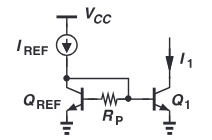

# 장말문제 9.44 — Q_REF 베이스에 생긴 R_P로 I1이 10% 커질 때 R_P

## 원문
Due to a manufacturing error, resistor $R_P$ has appeared in series with the base of $Q_{REF}$ in Fig. 9.66. If $I_1$ is 10% greater than its nominal value, express the value of $R_P$ in terms of other circuit parameters. Assume $Q_{REF}$ and $Q_1$ are identical.

## 조건
- 제조 오류로 Fig 9.66의 $Q_{REF}$ 베이스에 저항 $R_P$가 직렬로 생김
- $I_1$이 공칭값보다 $10\%$ 큼
- $Q_{REF}$와 $Q_1$은 동일 ($\beta \gg 1$ 가정은 없음)
- 공칭값은 $R_P = 0$일 때의 $I_1$ (원문에 없음)

## 구할 것
- $R_P$를 다른 회로 파라미터로 나타냄

## 회로 — Fig 9.66
```spice
IREF  VCC  n1
QREF  n1   n2  0  npn
RP    n2   n1  {R_P}     ; Q_REF 베이스 ↔ 다이오드 연결 선·Q1 베이스 노드
Q1    out  n1  0  npn
```
- 단자: VCC = 전원, 값 미지정 (T 전원 기호) / out = Q1 컬렉터, I_1이 들어가는 단자 (선 끝)
- 표시: 노드 라벨 V_CC (T 기호 오른쪽) / 소자 라벨 I_REF (전류원 왼쪽), Q_REF (Q_REF 왼쪽), Q_1 (Q1 오른쪽), R_P (저항 바로 아래) / 부호 없음 / 화살표 "I_1": out, 아래 방향(Q1 컬렉터로 들어감), 도선 위, 글자는 화살표 오른쪽 / 수치·면적 라벨 없음
- 배치: 왼쪽 세로줄 위→아래 V_CC T 기호, I_REF 전류원(화살표 아래), n1 접속점, Q_REF, 접지 / Q_REF 좌우 반전(베이스 막대가 오른쪽) / 베이스 높이 가로선: Q_REF 베이스 → 가로 R_P → 오른쪽 접속점 → Q1 베이스 / 다이오드 연결: n1 접속점에서 가로선이 오른쪽으로 R_P 오른쪽 끝 너머까지 가서 모서리에서 아래로 꺾여 R_P 오른쪽 접속점 (즉 다이오드 연결은 R_P의 Q1 쪽에 붙음) / Q1 보통 방향, 컬렉터에서 세로선이 위로 I_1 화살표를 지나 선 끝, 이미터 아래 접지 / 접속점 (세 갈래 이상, 2곳): n1 = 위 I_REF + 아래 Q_REF 컬렉터 + 오른쪽 다이오드 연결 선 (점), R_P 오른쪽 접속점 = 왼쪽 R_P + 위 다이오드 연결 선 + 오른쪽 Q1 베이스 (점) / 교차: 없음



## 풀이
### 공칭값
- $Q_{REF}$ 컬렉터·$Q_1$ 베이스·$R_P$ 한 끝이 한 노드다. $I_S$를 두 트랜지스터의 같은 포화 전류로 쓴다
- $R_P = 0$이면 두 컬렉터 전류가 같고 $I_{REF} = I_{nom}(1 + 2/\beta)$: $I_{nom} = \beta I_{REF}/(\beta + 2)$
### $R_P$가 있을 때의 식
- $R_P$에는 $Q_{REF}$ 베이스 전류 $I_{C,REF}/\beta$가 흘러 $V_{BE,REF} = V_{BE1} - I_{C,REF} R_P/\beta$: $I_1 = I_{C,REF}\, e^{I_{C,REF} R_P/(\beta V_T)}$
- 노드 KCL: $I_{REF} = I_{C,REF}(1 + 1/\beta) + I_1/\beta$
### $I_1 = 1.1 I_{nom}$ 대입
- KCL에서 $I_{C,REF}(1 + 1/\beta) = I_{nom}(1 + 2/\beta) - 1.1 I_{nom}/\beta$ → $I_{C,REF} = I_{nom} \dfrac{\beta + 0.9}{\beta + 1}$
- $R_P = \dfrac{\beta V_T}{I_{C,REF}} \ln \dfrac{I_1}{I_{C,REF}} = \dfrac{(\beta + 1)(\beta + 2) V_T}{(\beta + 0.9) I_{REF}} \ln \dfrac{1.1(\beta + 1)}{\beta + 0.9}$
- $\beta \gg 1$이면 $R_P \approx \beta V_T \ln 1.1 / I_{REF} \approx 0.0953\, \beta V_T/I_{REF}$ ($\beta = 100$이면 정확식 $0.0983\, \beta V_T/I_{REF}$)
### 답
- $R_P = \dfrac{(\beta + 1)(\beta + 2) V_T}{(\beta + 0.9) I_{REF}} \ln \dfrac{1.1(\beta + 1)}{\beta + 0.9} \approx 0.0953\, \beta V_T / I_{REF}$ ($\beta \gg 1$)
