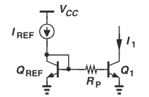

# 장말문제 9.45 — Q1 베이스에 생긴 R_P로 I1이 10% 작아질 때 R_P

## 원문
Repeat Problem 9.44 for the circuit shown in Fig. 9.67, but assuming $I_1$ is 10% less than its nominal value.

## 조건
- 문제 9.44를 Fig 9.67 회로에 대해 다시 풂: $R_P$가 $Q_1$ 베이스에 직렬로 생김 (다이오드 연결은 $Q_{REF}$ 쪽)
- $I_1$이 공칭값보다 $10\%$ 작음

## 구할 것
- $R_P$를 다른 회로 파라미터로 나타냄

## 상속·참조
- 문제 9.44에서 이어받는 가정: 제조 오류로 생긴 기생 저항 $R_P$, $Q_{REF}$와 $Q_1$은 동일 ($\beta \gg 1$ 가정은 없음)
- 공칭값은 $R_P = 0$일 때의 $I_1$ (원문에 없음)

## 회로 — Fig 9.67
```spice
IREF  VCC  n1
QREF  n1   n1  0  npn
RP    n1   n2  {R_P}     ; 다이오드 연결 노드 ↔ Q1 베이스
Q1    out  n2  0  npn
```
- 단자: VCC = 전원, 값 미지정 (T 전원 기호) / out = Q1 컬렉터, I_1이 들어가는 단자 (선 끝)
- 표시: 노드 라벨 V_CC (T 기호 오른쪽) / 소자 라벨 I_REF (전류원 왼쪽), Q_REF (Q_REF 왼쪽), Q_1 (Q1 오른쪽), R_P (저항 바로 아래) / 부호 없음 / 화살표 "I_1": out, 아래 방향(Q1 컬렉터로 들어감), 도선 위, 글자는 화살표 오른쪽 / 수치·면적 라벨 없음
- 배치: 왼쪽 세로줄 위→아래 V_CC T 기호, I_REF 전류원(화살표 아래), n1 접속점, Q_REF, 접지 / Q_REF 좌우 반전(베이스 막대가 오른쪽) / 다이오드 연결: n1 접속점에서 가로선이 오른쪽으로 짧게 가 모서리에서 아래로 꺾여 Q_REF 베이스 바로 오른쪽의 베이스 접속점 / 베이스 높이 가로선: Q_REF 베이스 → 베이스 접속점 → 가로 R_P → Q1 베이스 / Q1 보통 방향, 컬렉터에서 세로선이 위로 I_1 화살표를 지나 선 끝, 이미터 아래 접지 / 접속점 (세 갈래 이상, 2곳): n1 = 위 I_REF + 아래 Q_REF 컬렉터 + 오른쪽 다이오드 연결 선 (점), 베이스 접속점 = 왼쪽 Q_REF 베이스 + 위 다이오드 연결 선 + 오른쪽 R_P (점) / 교차: 없음


