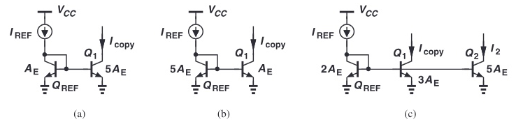

# 장말문제 9.46 — 베이스 전류를 고려한 면적비 전류 거울의 I_copy와 오차

## 조건
- 회로: Fig 9.68 (a)–(c) 바이폴라 전류 거울 (이미터 면적이 그림에 표시됨)
- 베이스 전류를 고려함
- $I_{REF}$, $\beta$ 값은 주어지지 않음. 답은 $I_{REF}$, $\beta$로 나타냄 (원문에 없음)

## 구할 것
- (a)–(c) 각 회로의 $I_{copy}$
- 오차를 $I_{copy}$의 공칭값으로 정규화

## 회로 — Fig 9.68(a)
```spice
IREF  VCC  n1
QREF  n1   n1  0  npn  area=1
Q1    out  n1  0  npn  area=5
```
- 단자: VCC = 전원, 값 미지정 (T 전원 기호) / out = Q1 컬렉터, I_copy가 들어가는 단자 (선 끝)
- 표시: 노드 라벨 V_CC (T 기호 오른쪽) / 소자 라벨 I_REF (전류원 왼쪽), Q_REF (Q_REF 접지 기호 오른쪽), Q_1 (Q1 위, 컬렉터 선 왼쪽) / 부호 없음 / 화살표 "I_copy": out, 아래 방향(Q1 컬렉터로 들어감), 도선 위, 글자는 화살표 오른쪽 / 수치·면적 라벨 "A_E" (Q_REF 왼쪽), "5A_E" (Q1 오른쪽, 베이스 높이)
- 배치: 왼쪽 세로줄 위→아래 V_CC T 기호, I_REF 전류원(화살표 아래), n1 접속점, Q_REF, 접지 / Q_REF 좌우 반전(베이스 막대 오른쪽, 이미터 왼쪽 아래로 접지) / 다이오드 연결: n1 접속점에서 가로선이 오른쪽으로 가 모서리에서 아래로 꺾여 베이스 접속점 / 베이스 공통선: Q_REF 베이스 → 베이스 접속점 → Q1 베이스 한 직선 / Q1 보통 방향, 컬렉터에서 세로선이 위로 I_copy 화살표를 지나 선 끝, 이미터 아래 접지 (두 접지 같은 높이) / 접속점 (세 갈래 이상, 2곳): n1 = 위 I_REF + 아래 Q_REF 컬렉터 + 오른쪽 다이오드 연결 선 (점), 베이스 접속점 = 왼쪽 Q_REF 베이스 + 위 다이오드 연결 선 + 오른쪽 Q1 베이스 (점) / 교차: 없음

## 회로 — Fig 9.68(b)
```spice
IREF  VCC  n1
QREF  n1   n1  0  npn  area=5
Q1    out  n1  0  npn  area=1
```
- 단자: VCC = 전원, 값 미지정 (T 전원 기호) / out = Q1 컬렉터, I_copy가 들어가는 단자 (선 끝)
- 표시: 노드 라벨 V_CC (T 기호 오른쪽) / 소자 라벨 I_REF (전류원 왼쪽), Q_REF (Q_REF 접지 기호 오른쪽), Q_1 (Q1 위, 컬렉터 선 왼쪽) / 부호 없음 / 화살표 "I_copy": out, 아래 방향(Q1 컬렉터로 들어감), 도선 위, 글자는 화살표 오른쪽 / 수치·면적 라벨 "5A_E" (Q_REF 왼쪽), "A_E" (Q1 오른쪽, 베이스 높이)
- 배치: (a)와 같음 (면적 라벨만 바뀜) / 접속점 (세 갈래 이상, 2곳): n1 = 위 I_REF + 아래 Q_REF 컬렉터 + 오른쪽 다이오드 연결 선 (점), 베이스 접속점 = 왼쪽 Q_REF 베이스 + 위 다이오드 연결 선 + 오른쪽 Q1 베이스 (점) / 교차: 없음

## 회로 — Fig 9.68(c)
```spice
IREF  VCC   n1
QREF  n1    n1  0  npn  area=2
Q1    out1  n1  0  npn  area=3
Q2    out2  n1  0  npn  area=5
```
- 단자: VCC = 전원, 값 미지정 (T 전원 기호) / out1 = Q1 컬렉터, I_copy가 들어가는 단자 (선 끝) / out2 = Q2 컬렉터, I_2가 들어가는 단자 (선 끝)
- 표시: 노드 라벨 V_CC (T 기호 오른쪽) / 소자 라벨 I_REF (전류원 왼쪽), Q_REF (Q_REF 접지 기호 오른쪽), Q_1 (Q1 위, 컬렉터 선 왼쪽), Q_2 (Q2 위, 컬렉터 선 왼쪽) / 부호 없음 / 화살표 "I_copy": out1, 아래 방향(Q1 컬렉터로 들어감), 도선 위, 글자는 화살표 오른쪽; "I_2": out2, 아래 방향(Q2 컬렉터로 들어감), 도선 위, 글자는 화살표 오른쪽 / 수치·면적 라벨 "2A_E" (Q_REF 왼쪽), "3A_E" (Q1 오른쪽 아래, 이미터 옆), "5A_E" (Q2 오른쪽, 베이스 높이)
- 배치: 왼쪽 기준부는 (a)와 같음 / 베이스 공통선: Q_REF 베이스 → 베이스 접속점 → Q1 베이스에 닿은 뒤 그대로 Q1 기호(베이스 막대 높이, 컬렉터·이미터 인출선 사이)를 가로질러 오른쪽 Q2 베이스까지 한 직선 / Q1, Q2 보통 방향, 같은 높이, 컬렉터에서 세로선이 위로 각 화살표를 지나 선 끝, 이미터 아래 각자 접지 (세 접지 같은 높이) / 접속점 (세 갈래 이상, 3곳): ① n1 = 위 I_REF + 아래 Q_REF 컬렉터 + 오른쪽 다이오드 연결 선 (점) ② 베이스 접속점 = 왼쪽 Q_REF 베이스 + 위 다이오드 연결 선 + 오른쪽 베이스 공통선 (점) ③ Q1 베이스 = 왼쪽 베이스 공통선 + 오른쪽으로 계속되는 베이스 공통선 + Q1 베이스 (점 없음) / 교차: 없음


