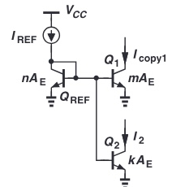

# 장말문제 9.47 — 두 출력을 가진 면적비 전류 거울의 I_copy 오차

## 원문
Calculate the error in $I_{copy}$ for the circuit shown in Fig. 9.69.

## 조건
- 회로: Fig 9.69 (기준 $nA_E$, 출력 $Q_1 = mA_E$, $Q_2 = kA_E$)
- 문제 글은 $I_{copy}$, 그림 화살표 라벨은 "I_copy1"로 인쇄됨 — 같은 전류($Q_1$ 컬렉터 전류)로 봄 (원문에 없음)
- 베이스 전류를 고려해 오차를 구함 (원문에 없음: 오차 원인이 베이스 전류라는 해석)
- 답은 $n$, $m$, $k$, $\beta$, $I_{REF}$로 나타냄 (원문에 없음)

## 구할 것
- 회로의 $I_{copy}$ 오차

## 회로 — Fig 9.69
```spice
IREF  VCC   n1
QREF  n1    n1  0  npn  area={n}
Q1    out1  n1  0  npn  area={m}
Q2    out2  n1  0  npn  area={k}
```
- 단자: VCC = 전원, 값 미지정 (T 전원 기호) / out1 = Q1 컬렉터, I_copy1이 들어가는 단자 (선 끝) / out2 = Q2 컬렉터, I_2가 들어가는 단자 (선 끝)
- 표시: 노드 라벨 V_CC (T 기호 오른쪽) / 소자 라벨 I_REF (전류원 왼쪽), Q_REF (Q_REF 접지 기호 오른쪽), Q_1 (Q1 위, 컬렉터 선 왼쪽), Q_2 (Q2 위, 컬렉터 선 왼쪽) / 부호 없음 / 화살표 "I_copy1": out1, 아래 방향(Q1 컬렉터로 들어감), 도선 위, 글자는 화살표 오른쪽; "I_2": out2, 아래 방향(Q2 컬렉터로 들어감), 도선 위, 글자는 화살표 오른쪽 / 수치·면적 라벨 "nA_E" (Q_REF 왼쪽), "mA_E" (Q1 오른쪽, 베이스 높이), "kA_E" (Q2 오른쪽, 베이스 높이)
- 배치: 왼쪽 세로줄 위→아래 V_CC T 기호, I_REF 전류원(화살표 아래), n1 접속점, Q_REF, 접지 / Q_REF 좌우 반전(베이스 막대 오른쪽) / 다이오드 연결: n1 접속점에서 가로선이 오른쪽으로 가 모서리에서 아래로 꺾여 베이스 접속점 / 베이스 공통선: Q_REF 베이스 → 베이스 접속점 → 둘째 접속점 → Q1 베이스 한 직선 / Q1 보통 방향, 컬렉터 위로 I_copy1 화살표를 지나 선 끝, 이미터 아래 접지 / 둘째 접속점에서 세로선이 아래로 길게 내려가 Q2 베이스 높이에서 오른쪽으로 꺾여 Q2 베이스 / Q2: Q1 바로 아래(같은 x), 보통 방향, 컬렉터 위로 I_2 화살표를 지나 선 끝, 이미터 아래 접지 / 접속점 (세 갈래 이상, 3곳): ① n1 = 위 I_REF + 아래 Q_REF 컬렉터 + 오른쪽 다이오드 연결 선 (점) ② 베이스 접속점 = 왼쪽 Q_REF 베이스 + 위 다이오드 연결 선 + 오른쪽 베이스 공통선 (점) ③ 둘째 접속점 = 왼쪽 베이스 공통선 + 오른쪽 Q1 베이스 + 아래 Q2로 가는 세로선 (점) / 교차: 없음



## 풀이
### 단위 면적당 전류
- $Q_{REF}$, $Q_1$, $Q_2$가 같은 $V_{BE}$를 받으므로 면적 $A_E$당 컬렉터 전류 $I_u$가 같다: $I_{C,REF} = n I_u$, $I_{copy} = m I_u$, $I_2 = k I_u$
### 기준 노드 KCL
- $I_{REF}$는 $Q_{REF}$ 컬렉터 전류와 세 베이스 전류로 나뉜다: $I_{REF} = n I_u + (n + m + k) I_u/\beta$
- $I_{copy} = \dfrac{m}{n} \cdot \dfrac{I_{REF}}{1 + \dfrac{n + m + k}{n\beta}}$
### 오차
- 공칭값 $(m/n) I_{REF}$에 대한 오차: $\dfrac{I_{copy}}{(m/n) I_{REF}} - 1 = -\dfrac{n + m + k}{n\beta + n + m + k}$
- $\beta \gg 1$이면 $\approx -\dfrac{n + m + k}{n\beta}$: 출력 면적이 클수록, 기준 면적이 작을수록 오차가 커진다
### 답
- $I_{copy} = \dfrac{m\beta}{n\beta + n + m + k} I_{REF}$, 공칭값 대비 오차 $-\dfrac{n + m + k}{n\beta + n + m + k} \approx -\dfrac{n + m + k}{n\beta}$ (절대 오차는 $-\dfrac{m(n + m + k)}{n(n\beta + n + m + k)} I_{REF}$)
