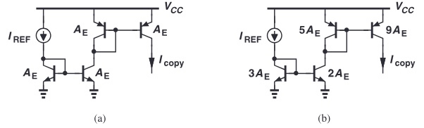

# 장말문제 9.48 — npn·pnp 두 단 전류 거울의 베이스 전류 오차

## 원문
Taking base currents into account, compute the error in $I_{copy}$ for each of the circuits illustrated in Fig. 9.70.

## 조건
- 회로: Fig 9.70 (a), (b) — npn 전류 거울 출력을 pnp 전류 거울로 다시 복사하는 회로 (이미터 면적이 그림에 표시됨)
- 베이스 전류를 고려함
- 답은 $I_{REF}$, $\beta$로 나타냄 (원문에 없음)

## 구할 것
- (a), (b) 각 회로의 $I_{copy}$ 오차

## 회로 — Fig 9.70(a)
```spice
IREF  VCC  n1
QREF  n1   n1  0    npn  area=1
Q1    n2   n1  0    npn  area=1
QP1   n2   n2  VCC  pnp  area=1
QP2   out  n2  VCC  pnp  area=1
```
- 단자: VCC = 전원, 값 미지정 (가로 레일) / out = QP2 컬렉터, I_copy가 흘러나오는 단자 (선 끝)
- 표시: 노드 라벨 V_CC (레일 오른쪽 끝) / 소자 라벨 I_REF (전류원 왼쪽), QREF·Q1·QP1·QP2 (라벨 없음) / 부호 없음 / 화살표 "I_copy": out, 아래 방향(QP2 컬렉터에서 흘러나옴), 도선 위, 글자는 화살표 오른쪽 / 수치·면적 라벨 "A_E" (QREF 왼쪽), "A_E" (Q1 오른쪽), "A_E" (QP1 왼쪽), "A_E" (QP2 오른쪽)
- 배치: 맨 위 굵은 가로 레일 V_CC, 왼쪽부터 I_REF, QP1 이미터, QP2 이미터가 매달림 / 왼쪽 세로줄 위→아래 레일, I_REF 전류원(화살표 아래), n1 접속점, QREF, 접지 / QREF npn 좌우 반전(베이스 막대 오른쪽) / 다이오드 연결: n1 접속점에서 가로선이 오른쪽으로 가 모서리에서 아래로 꺾여 npn 베이스 접속점 / npn 베이스 공통선: QREF 베이스 → 베이스 접속점 → Q1 베이스 / Q1 npn 보통 방향, 이미터 아래 접지 (두 접지 같은 높이), 컬렉터에서 세로선이 위로 n2 접속점을 지나 QP1 컬렉터 / QP1 pnp 좌우 반전(베이스 막대 오른쪽, 이미터 왼쪽 위로 레일, 컬렉터 왼쪽 아래) / pnp 베이스 공통선: QP1 베이스 → pnp 베이스 접속점 → 오른쪽 QP2 베이스 / pnp 다이오드 연결: pnp 베이스 접속점에서 세로선이 아래로 n2 높이까지 가 왼쪽으로 꺾여 n2 접속점 / QP2 pnp 보통 방향(베이스 왼쪽), 이미터 위로 레일, 컬렉터에서 세로선이 아래로 I_copy 화살표를 지나 선 끝 / 접속점 (세 갈래 이상, 4곳): ① n1 = 위 I_REF + 아래 QREF 컬렉터 + 오른쪽 다이오드 연결 선 (점) ② npn 베이스 접속점 = 왼쪽 QREF 베이스 + 위 다이오드 연결 선 + 오른쪽 Q1 베이스 (점) ③ n2 = 아래 Q1 컬렉터 + 위 QP1 컬렉터 + 오른쪽 pnp 다이오드 연결 선 (점) ④ pnp 베이스 접속점 = 왼쪽 QP1 베이스 + 오른쪽 QP2 베이스 + 아래 pnp 다이오드 연결 선 (점) / 교차: 없음

## 회로 — Fig 9.70(b)
```spice
IREF  VCC  n1
QREF  n1   n1  0    npn  area=3
Q1    n2   n1  0    npn  area=2
QP1   n2   n2  VCC  pnp  area=5
QP2   out  n2  VCC  pnp  area=9
```
- 단자: VCC = 전원, 값 미지정 (가로 레일) / out = QP2 컬렉터, I_copy가 흘러나오는 단자 (선 끝)
- 표시: 노드 라벨 V_CC (레일 오른쪽 끝) / 소자 라벨 I_REF (전류원 왼쪽), QREF·Q1·QP1·QP2 (라벨 없음) / 부호 없음 / 화살표 "I_copy": out, 아래 방향(QP2 컬렉터에서 흘러나옴), 도선 위, 글자는 화살표 오른쪽 / 수치·면적 라벨 "3A_E" (QREF 왼쪽), "2A_E" (Q1 오른쪽), "5A_E" (QP1 왼쪽), "9A_E" (QP2 오른쪽)
- 배치: (a)와 같음 (면적 라벨만 바뀜) / 접속점 (세 갈래 이상, 4곳): ① n1 (점) ② npn 베이스 접속점 (점) ③ n2 (점) ④ pnp 베이스 접속점 (점) — 구성은 (a)와 같음 / 교차: 없음


