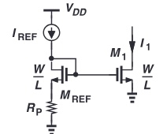

# 장말문제 9.50 — M_REF 소스 저항 R_P로 I1 = 2I_REF 만들기

## 원문
Determine the value of $R_P$ in the circuit of Fig. 9.72 such that $I_1 = 2I_{REF}$. With this choice of $R_P$, does $I_1$ change if the threshold voltage of both transistors increases by $\Delta V$?

## 조건
- 회로: Fig 9.72 ($M_{REF}$ 소스에 $R_P$, $M_{REF}$와 $M_1$ 모두 크기 $W/L$)
- 목표: $I_1 = 2 I_{REF}$
- 두 트랜지스터의 문턱 전압이 모두 $\Delta V$만큼 증가하는 경우를 따짐
- 채널 길이 변조 무시, 포화 영역 동작 (원문에 없음)

## 구할 것
- $I_1 = 2 I_{REF}$가 되는 $R_P$
- 이 $R_P$에서 두 트랜지스터의 문턱 전압이 $\Delta V$만큼 증가하면 $I_1$이 변하는가?

## 회로 — Fig 9.72
```spice
IREF  VDD  n1
MREF  n1   n1  n2  nmos  W/L={W/L}
RP    n2   0   {R_P}
M1    out  n1  0   nmos  W/L={W/L}
```
- 단자: VDD = 전원, 값 미지정 (T 전원 기호) / out = M1 드레인, I_1이 들어가는 단자 (선 끝)
- 표시: 노드 라벨 V_DD (T 기호 오른쪽) / 소자 라벨 I_REF (전류원 왼쪽), M_REF (M_REF 오른쪽 아래, 소스 옆), M_1 (M1 위, 드레인 선 왼쪽), R_P (저항 왼쪽) / 부호 없음 / 화살표 "I_1": out, 아래 방향(M1 드레인으로 들어감), 도선 위, 글자는 화살표 오른쪽 / 수치·면적 라벨 "W/L" 분수 (M_REF 왼쪽), "W/L" 분수 (M1 오른쪽)
- 배치: 왼쪽 세로줄 위→아래 V_DD T 기호, I_REF 전류원(화살표 아래), n1 접속점, M_REF, R_P, 접지 / M_REF 좌우 반전(게이트가 오른쪽) / 다이오드 연결: n1 접속점에서 가로선이 오른쪽으로 가 모서리에서 아래로 꺾여 게이트 접속점 / 게이트 공통선: 게이트 접속점에서 게이트 높이로 오른쪽 M1 게이트까지 한 직선 / M1 보통 방향, 드레인에서 세로선이 위로 I_1 화살표를 지나 선 끝, 소스 아래 바로 접지 (M_REF 쪽 접지보다 높음) / 접속점 (세 갈래 이상, 2곳): n1 = 위 I_REF + 아래 M_REF 드레인 + 오른쪽 다이오드 연결 선 (점), 게이트 접속점 = 왼쪽 M_REF 게이트 + 위 다이오드 연결 선 + 오른쪽 M1 게이트 (점) / 교차: 없음



## 풀이
### $M_1$ 쪽 과구동 전압
- 두 소자는 같은 $W/L$이고 게이트를 공유한다. $M_1$ 소스는 접지라 $I_1 = \tfrac{1}{2}\mu_n C_{ox}\tfrac{W}{L}(V_G - V_{TH})^2$ ($V_G$: 공통 게이트 전압)
- $I_1 = 2 I_{REF}$: $V_G - V_{TH} = \sqrt{2}\, V_0$, 여기서 $V_0 = \sqrt{\dfrac{2 I_{REF}}{\mu_n C_{ox}(W/L)}}$
### $M_{REF}$의 조건
- $M_{REF}$의 게이트–소스 전압은 $V_G - I_{REF} R_P$: $I_{REF} = \tfrac{1}{2}\mu_n C_{ox}\tfrac{W}{L}(V_G - I_{REF} R_P - V_{TH})^2$
- 따라서 $V_G - I_{REF} R_P - V_{TH} = V_0$
### $R_P$
- 두 식을 빼면 $I_{REF} R_P = (\sqrt{2} - 1)\, V_0$
- $R_P = (\sqrt{2} - 1)\sqrt{\dfrac{2}{\mu_n C_{ox}(W/L)\, I_{REF}}}$
### 문턱 전압이 $\Delta V$ 오를 때
- $I_{REF}$가 고정이라 $M_{REF}$의 과구동 전압 $V_0$과 $I_{REF} R_P$는 그대로이고, $V_G$만 $\Delta V$ 오른다
- $M_1$의 $V_G - V_{TH}$도 그대로 $V_0 + I_{REF} R_P$ → $I_1$은 그대로
### 답
- $R_P = (\sqrt{2} - 1)\sqrt{\dfrac{2}{\mu_n C_{ox}(W/L)\, I_{REF}}} \approx 0.414\sqrt{\dfrac{2}{\mu_n C_{ox}(W/L)\, I_{REF}}}$
- 변하지 않는다. 게이트 전압이 $\Delta V$만큼 따라 올라 $M_1$의 과구동 전압이 그대로이기 때문이다.
