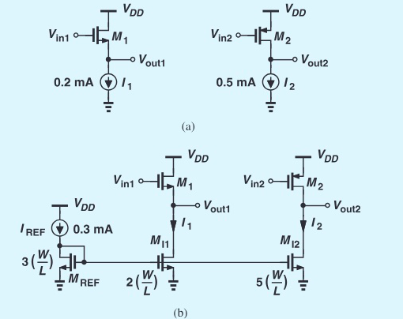

# 장말문제 9.51 — 기준 전류 0.35 mA로 예제 9.21 다시 설계

## 조건
- 예제 9.21을 기준 전류 $0.35\ \text{mA}$로 바꿔 다시 풂

## 구할 것
- $0.35\ \text{mA}$ 기준으로부터 $I_1 = 0.2\ \text{mA}$와 $I_2 = 0.5\ \text{mA}$를 만드는 전류 거울 설계

## 상속·참조
- 예제 9.21 (교재 482쪽): 집적 회로가 Fig 9.38(a)의 소스 폴로어($M_1$)와 공통 소스 단($M_2$)을 사용하고, 필요한 바이어스 전류는 $I_1 = 0.2\ \text{mA}$, $I_2 = 0.5\ \text{mA}$. 기준 전류 $0.3\ \text{mA}$로부터 두 전류를 만드는 전류 거울 설계
  - 예제 풀이: 다이오드 연결 NMOS $M_{REF}$에 $3(W/L)$, $I_1$용 NMOS에 $2(W/L)$, $I_2$용 NMOS에 $5(W/L)$
- 식 (9.129) (문턱 전압이 같고 채널 길이 변조 무시): $I_{copy} = \dfrac{(W/L)_1}{(W/L)_{REF}} I_{REF}$

## 회로 — Fig 9.38(a)
```spice
M1  VDD    Vin1  Vout1  nmos
I1  Vout1  0     0.2mA
M2  Vout2  Vin2  VDD    pmos
I2  Vout2  0     0.5mA
```
- 단자: VDD = 전원, 값 미지정 (T 전원 기호, 두 회로에 각각) / Vin1, Vin2 = 입력 (개방 원) / Vout1, Vout2 = 출력 (개방 원)
- 표시: 노드 라벨 VDD (각 T 기호 오른쪽), V_in1, V_in2 (각 입력 원 왼쪽), V_out1, V_out2 (각 출력 원 오른쪽) / 소자 라벨 M1 (M1 오른쪽, 소스 옆), M2 (M2 오른쪽, 드레인 옆), I_1 (왼쪽 전류원 오른쪽), I_2 (오른쪽 전류원 오른쪽) / 부호 없음 / 화살표 없음 / 수치·면적 라벨 "0.2 mA" (I_1 전류원 왼쪽), "0.5 mA" (I_2 전류원 왼쪽)
- 배치: 두 회로가 좌우로 나란히, 같은 높이 / 왼쪽(소스 폴로어): 세로줄 위→아래 VDD T 기호, M1, 출력 접속점, I_1 전류원(화살표 아래), 접지 / M1 NMOS 보통 방향(게이트 왼쪽, 드레인 위로 VDD, 소스 아래) / V_in1 원 → 가로선 → M1 게이트 / 오른쪽(공통 소스 단): 세로줄 위→아래 VDD T 기호, M2, 출력 접속점, I_2 전류원(화살표 아래), 접지 / M2 PMOS 보통 방향(게이트 왼쪽, 소스 위로 VDD, 드레인 아래) / V_in2 원 → 가로선 → M2 게이트 / 각 출력 접속점에서 가로선이 오른쪽 V_out 원 / 접속점 (세 갈래 이상, 2곳): ① Vout1 = 위 M1 소스 + 아래 I_1 + 오른쪽 V_out1 선 (점) ② Vout2 = 위 M2 드레인 + 아래 I_2 + 오른쪽 V_out2 선 (점) / 교차: 없음


> 참고: 크롭 이미지 아래의 (b)는 예제 9.21 풀이 그림(기준 0.3 mA의 설계 결과)이라 이 문제의 문제 그림이 아님. Fig 9.38은 본문 그림(교재 482쪽, PDF p.18)
