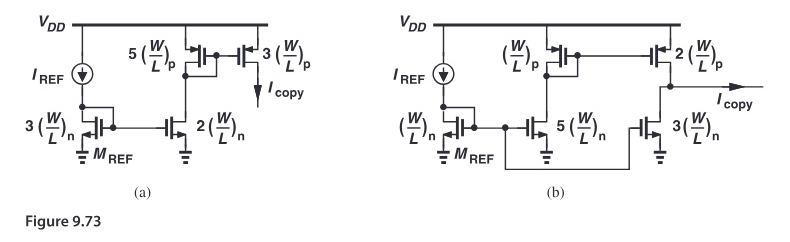

# 장말문제 9.52 — 기호 크기 W/L로 주어진 MOS 전류 거울의 복사 전류

## 원문
Calculate $I_{copy}$ in each of the circuits shown in Fig. 9.73. Assume all of the transistors operate in saturation.

## 조건
- 회로: Fig 9.73 (a), (b) 두 MOS 전류 거울
- 모든 트랜지스터가 포화 영역에서 동작한다고 가정
- $I_{REF}$ 값은 주어지지 않음. 트랜지스터 크기는 그림에 $(W/L)_n$, $(W/L)_p$의 배수로만 표시됨
- 답은 $I_{REF}$로 나타냄 (원문에 없음)

## 구할 것
- (a), (b) 각 회로의 $I_{copy}$

## 상속·참조
- 식 (9.129) (9.2.3절, 문턱 전압이 같고 채널 길이 변조를 무시한 경우): $I_{copy} = \dfrac{(W/L)_1}{(W/L)_{REF}}\, I_{REF}$

## 회로 — Fig 9.73(a)
```spice
IREF  VDD  n1
MREF  n1   n1  0    nmos  W/L={(W/L)_n} m=3
MN1   n2   n1  0    nmos  W/L={(W/L)_n} m=2
MP1   n2   n2  VDD  pmos  W/L={(W/L)_p} m=5
MP2   out  n2  VDD  pmos  W/L={(W/L)_p} m=3
```
- 단자: VDD = 전원, 값 미지정 (가로 레일) / out = MP2 드레인, I_copy가 흘러나오는 단자 (선 끝)
- 표시: 노드 라벨 VDD (레일 왼쪽 끝) / 소자 라벨 I_REF (전류원 왼쪽), M_REF (M_REF 접지 기호 오른쪽), MN1·MP1·MP2 (라벨 없음) / 부호 없음 / 화살표 "I_copy": out, 아래 방향(MP2 드레인에서 흘러나옴), 도선 위, 글자는 화살표 오른쪽 / 수치·면적 라벨 "3(W/L)_n" (M_REF 왼쪽), "2(W/L)_n" (MN1 오른쪽), "5(W/L)_p" (MP1 왼쪽), "3(W/L)_p" (MP2 오른쪽)
- 배치: 맨 위 굵은 가로 레일 VDD가 왼쪽 VDD 라벨에서 MP2 소스 선보다 조금 오른쪽까지 뻗음, 왼쪽 끝 근처에 I_REF, 가운데에 MP1 소스 선, 오른쪽 끝 근처에 MP2 소스 선이 매달림 / 왼쪽 세로줄 위→아래 I_REF 전류원, n1 접속점, M_REF, 접지 / M_REF와 MP1은 좌우 반전(게이트가 오른쪽, 드레인·소스 인출선은 왼쪽), MN1과 MP2는 보통 방향(게이트 왼쪽) / 다이오드 연결: n1 접속점에서 가로선이 오른쪽으로 나가 모서리에서 아래로 꺾여 M_REF 게이트 오른쪽 접속점 / NMOS 게이트 공통선: M_REF 게이트 접속점에서 게이트 높이로 오른쪽 MN1 게이트까지 한 직선 / MN1 드레인 → 세로선 위로 n2 접속점 → MP1 드레인, MN1 소스 → 접지 (M_REF 접지와 같은 높이) / PMOS 게이트 공통선: MP1 게이트 오른쪽 접속점에서 게이트 높이로 오른쪽 MP2 게이트까지 한 직선 / MP1 다이오드 연결: PMOS 게이트 접속점에서 세로선이 아래로 내려가 n2 높이에서 왼쪽으로 꺾여 n2 접속점 / MP2 드레인 → 세로선 아래로 I_copy 화살표를 지나 선 끝 / 접속점 (세 갈래 이상, 4곳): ① n1 = 위 I_REF + 아래 M_REF 드레인 + 오른쪽 다이오드 연결 선 (점) ② M_REF 게이트 = 왼쪽 M_REF 게이트 + 위 다이오드 연결 선 + 오른쪽 MN1 게이트로 가는 선 (점) ③ n2 = 아래 MN1 드레인 + 위 MP1 드레인 + 오른쪽 MP1 다이오드 연결 선 (점) ④ PMOS 게이트 = 왼쪽 MP1 게이트 + 오른쪽 MP2 게이트 + 아래 MP1 다이오드 연결 선 (점) / 교차: 없음

## 회로 — Fig 9.73(b)
```spice
IREF  VDD  n1
MREF  n1   n1  0    nmos  W/L={(W/L)_n}
MN1   n2   n1  0    nmos  W/L={(W/L)_n} m=5
MN2   out  n1  0    nmos  W/L={(W/L)_n} m=3
MP1   n2   n2  VDD  pmos  W/L={(W/L)_p}
MP2   out  n2  VDD  pmos  W/L={(W/L)_p} m=2
```
- 단자: VDD = 전원, 값 미지정 (가로 레일) / out = MP2 드레인과 MN2 드레인이 만나는 노드에서 오른쪽으로 뻗은 출력선, I_copy가 흘러나가는 단자 (선 끝)
- 표시: 노드 라벨 VDD (레일 왼쪽 끝) / 소자 라벨 I_REF (전류원 왼쪽), M_REF (M_REF 접지 기호 오른쪽), MN1·MN2·MP1·MP2 (라벨 없음) / 부호 없음 / 화살표 "I_copy": out, 오른쪽 방향(out 노드에서 오른쪽으로 흘러나감), 도선 위, 글자는 화살표 아래 / 수치·면적 라벨 "(W/L)_n" (M_REF 왼쪽), "5(W/L)_n" (MN1 오른쪽), "3(W/L)_n" (MN2 오른쪽), "(W/L)_p" (MP1 왼쪽), "2(W/L)_p" (MP2 오른쪽)
- 배치: 맨 위 굵은 가로 레일 VDD가 왼쪽 VDD 라벨에서 MP2 소스 선보다 조금 오른쪽까지 뻗음, 왼쪽 끝 근처에 I_REF, 가운데에 MP1 소스 선, 오른쪽 끝 근처에 MP2 소스 선이 매달림 / 왼쪽 세로줄 위→아래 I_REF 전류원, n1 접속점, M_REF, 접지 / M_REF와 MP1은 좌우 반전(게이트가 오른쪽), MN1, MN2, MP2는 보통 방향(게이트 왼쪽) / 다이오드 연결: n1 접속점에서 가로선이 오른쪽으로 나가 모서리에서 아래로 꺾여 M_REF 게이트 오른쪽 접속점 / NMOS 게이트 공통선: M_REF 게이트 접속점에서 게이트 높이로 오른쪽으로 가다 둘째 접속점을 지나 MN1 게이트까지 한 직선 / MN2 게이트 경로: 둘째 접속점에서 세로선이 아래로 내려가 접지 기호들보다 아래 높이에서 오른쪽으로 꺾여 MN1 아래를 지나고, MN2 왼쪽에서 위로 꺾여 게이트 높이에서 오른쪽으로 꺾여 MN2 게이트 / MN1 드레인 → 세로선 위로 n2 접속점 → MP1 드레인, 소스들은 각자 접지 (세 접지 같은 높이) / PMOS 게이트 공통선: MP1 게이트 오른쪽 접속점에서 게이트 높이로 오른쪽 MP2 게이트까지 한 직선 / MP1 다이오드 연결: PMOS 게이트 접속점에서 세로선이 아래로 내려가 n2 높이에서 왼쪽으로 꺾여 n2 접속점 / MP2 드레인 → 세로선 아래로 out 접속점, 여기서 왼쪽으로 짧게 가서 아래로 꺾여 MN2 드레인, 오른쪽으로 출력선이 뻗어 I_copy 화살표를 지나 선 끝 / MN2는 MP2보다 조금 왼쪽, NMOS 게이트 높이 / 접속점 (세 갈래 이상, 6곳): ① n1 = 위 I_REF + 아래 M_REF 드레인 + 오른쪽 다이오드 연결 선 (점) ② M_REF 게이트 = 왼쪽 M_REF 게이트 + 위 다이오드 연결 선 + 오른쪽 게이트 공통선 (점) ③ 둘째 접속점 = 왼쪽 게이트 공통선 + 오른쪽 MN1 게이트 + 아래 MN2로 가는 우회선 (점) ④ n2 = 아래 MN1 드레인 + 위 MP1 드레인 + 오른쪽 MP1 다이오드 연결 선 (점) ⑤ PMOS 게이트 = 왼쪽 MP1 게이트 + 오른쪽 MP2 게이트 + 아래 MP1 다이오드 연결 선 (점) ⑥ out = 위 MP2 드레인 + 왼쪽(아래로 꺾여) MN2 드레인 + 오른쪽 출력선 (점) / 교차: 없음 (MN2 게이트 우회선은 MN1 접지 기호 아래를 지나므로 닿지 않음)


