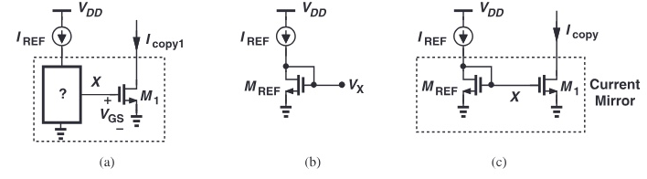

# 장말문제 9.53 — λ ≠ 0인 MOS 전류 거울에서 V_DS1 선택과 복사 오차

## 조건
- 회로: Fig 9.36(c) MOS 전류 거울
- 문제 글: "$M_1$과 $M_2$는 동일, 단 $\lambda \neq 0$" — 그림의 트랜지스터 라벨은 $M_{REF}$와 $M_1$이고 $M_2$는 없음, 복사 전류 라벨도 문제 글은 $I_{copy1}$, 그림은 "I_copy" (인쇄된 대로 적음)
- 해석: 두 트랜지스터($M_{REF}$, $M_1$)가 동일하고, $V_{DS1}$은 복사 트랜지스터 $M_1$의 드레인–소스 전압, $I_{copy1}$은 그림의 $I_{copy}$ (원문에 없음)
- 포화 영역 동작 (원문에 없음)

## 구할 것
- (a) $I_{copy1}$이 $I_{REF}$와 정확히 같으려면 $V_{DS1}$을 어떻게 정해야 하는가?
- (b) $V_{DS1} = V_{GS} - V_{TH}$일 때 ($M_1$이 포화 경계에 있을 때) $I_{REF}$에 대한 $I_{copy1}$의 오차

## 상속·참조
- 식 (9.127)–(9.128) (9.2.3절 481쪽, 문턱 전압은 같다고 가정; 채널 길이 변조 무시는 480쪽 식 9.125 뒤 본문): $I_{D,REF} = \dfrac{1}{2} \mu_n C_{ox} \left(\dfrac{W}{L}\right)_{REF} (V_X - V_{TH})^2$, $\quad I_{copy} = \dfrac{1}{2} \mu_n C_{ox} \left(\dfrac{W}{L}\right)_1 (V_X - V_{TH})^2$
- 채널 길이 변조를 넣은 포화 전류: $I_D = \dfrac{1}{2} \mu_n C_{ox} \dfrac{W}{L} (V_{GS} - V_{TH})^2 (1 + \lambda V_{DS})$ (원문에 없음)
- 다이오드 연결 $M_{REF}$는 $V_{DS,REF} = V_{GS}$ (원문에 없음)

## 회로 — Fig 9.36(c)
```spice
IREF  VDD  X
MREF  X    X  0  nmos
M1    out  X  0  nmos
```
- 단자: VDD = 전원, 값 미지정 (T 전원 기호, I_REF 위 한 곳) / out = M1 드레인, I_copy가 들어가는 단자 (선 끝)
- 표시: 노드 라벨 V_DD (T 기호 오른쪽), X (게이트 공통선 아래, 게이트 접속점과 M1 게이트 사이) / 소자 라벨 I_REF (전류원 왼쪽), M_REF (M_REF 왼쪽), M_1 (M1 오른쪽), 점선 상자 라벨 "Current Mirror" (상자 오른쪽 바깥, 두 줄) / 부호 없음 / 화살표 "I_copy": out, 아래 방향(M1 드레인으로 들어감), 도선 위, 글자는 화살표 오른쪽 / 수치·면적 라벨 없음
- 배치: 왼쪽 세로줄 위→아래 V_DD T 기호, I_REF 전류원(화살표 아래), 드레인 접속점, M_REF, 접지 / M_REF 좌우 반전(게이트가 오른쪽, 드레인·소스 인출선 왼쪽) / 다이오드 연결: 드레인 접속점에서 가로선이 오른쪽으로 가 모서리에서 아래로 꺾여 M_REF 게이트 오른쪽 게이트 접속점 / 게이트 공통선: 게이트 접속점에서 게이트 높이로 오른쪽 M1 게이트까지 한 직선 / M1 보통 방향(게이트 왼쪽), 드레인에서 긴 세로선이 위로 점선 상자를 뚫고 I_copy 화살표를 지나 선 끝(V_DD 높이 근처), 소스 아래 접지 (두 접지 같은 높이) / 점선 사각형이 M_REF, M1, 게이트 공통선, 두 접지를 둘러쌈 (I_REF와 V_DD는 상자 위 바깥, I_REF 선과 M1 드레인 선이 상자 윗변을 지남) / 접속점 (세 갈래 이상, 2곳): 드레인 접속점 = 위 I_REF + 아래 M_REF 드레인 + 오른쪽 다이오드 연결 선 (점), 게이트 접속점 = 왼쪽 M_REF 게이트 + 위 다이오드 연결 선 + 오른쪽 게이트 공통선 (점) / 교차: 없음 (점선 상자 경계는 도선이 아님)


> 참고: 크롭 이미지 왼쪽의 (a)(블랙박스 "?"로 된 개념도)와 가운데 (b)(다이오드 연결 M_REF와 V_X)는 본문 그림이라 이 문제와 무관. Fig 9.36은 본문 그림(교재 480쪽, PDF p.17)
