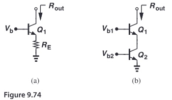

# 장말문제 9.54 — 축퇴 전류원과 캐스코드 전류원의 출력 임피던스 비교

## 원문
Assuming a bias current of $1\ \text{mA}$, design the degenerated current source of Fig. 9.74(a) such that $R_E$ sustains a voltage approximately equal to the minimum required collector-emitter voltage of $Q_2$ in Fig. 9.74(b) ($\approx 0.5\ \text{V}$). Compare the output impedances of the two circuits.

## 조건
- 설계 대상: Fig 9.74(a)의 이미터 축퇴(degenerated) 전류원
- 바이어스 전류 $1\ \text{mA}$
- $R_E$에 걸리는 전압을 Fig 9.74(b)에서 $Q_2$에 필요한 최소 컬렉터-이미터 전압($\approx 0.5\ \text{V}$)과 거의 같게 맞춤
- Fig 9.74(b)도 같은 바이어스 전류 $1\ \text{mA}$로 비교하는 것으로 봄 (원문에 없음)
- 공통 가정: $I_{S,n} = 6 \times 10^{-16}\ \text{A}$, $V_{A,n} = 5\ \text{V}$, $\beta_n = 100$ (원문의 Design Problems 머리말)

## 구할 것
- Fig 9.74(a) 회로 설계 (정할 값: $R_E$, $V_b$) (원문에 없음, 원문은 "설계하라"만 적음)
- 두 회로 (a), (b)의 출력 임피던스 비교

## 상속·참조
- Design Problems 공통 가정 (문제에 따로 적힌 값이 우선):
  - $I_{S,n} = I_{S,p} = 6 \times 10^{-16}\ \text{A}$
  - $V_{A,n} = V_{A,p} = 5\ \text{V}$
  - $\beta_n = 100$, $\beta_p = 50$
  - $\mu_n C_{ox} = 100\ \mu\text{A/V}^2$, $\mu_p C_{ox} = 50\ \mu\text{A/V}^2$
  - $V_{TH,n} = 0.4\ \text{V}$, $V_{TH,p} = -0.5\ \text{V}$
  - 첨자 n은 npn/NMOS, p는 pnp/PMOS

## 회로 — Fig 9.74(a)
```spice
Q1  out  Vb  n1  npn
RE  n1   0   {R_E}
```
- 단자: Vb = 이상적 DC 바이어스, 값 미지정 (점 단자) / out = Q1 컬렉터, R_out 측정 단자 (개방 원)
- 표시: 노드 라벨 V_b (점 단자 왼쪽) / 소자 라벨 Q1 (트랜지스터 오른쪽, 이미터 옆), R_E (저항 오른쪽) / 부호 없음 / 화살표 "R_out": out 노드를 회로 쪽(아래)으로 들여다봄, 아래 방향, 도선 옆 별도 화살표 (┌ 꺾임: out 도선 오른쪽에 세로선, 위 끝에서 짧은 가로선이 오른쪽 R_out 글자 쪽으로, 화살촉은 아래 끝, Q1 컬렉터 바로 위 높이) / 수치·면적 라벨 없음
- 배치: 한 세로줄 위→아래 out 원, Q1, 세로 저항 R_E, 접지 / Q1 npn 보통 방향(베이스 막대 왼쪽, 컬렉터 위, 이미터 아래·화살표 바깥) / V_b 점 단자 → 가로선 → Q1 베이스 / Q1 컬렉터 → 세로선 위로 out 원 / Q1 이미터 → R_E (n1, 라벨 없음) → 접지 / 접속점: 없음 / 교차: 없음

## 회로 — Fig 9.74(b)
```spice
Q1  out  Vb1  n1  npn
Q2  n1   Vb2  0   npn
```
- 단자: Vb1, Vb2 = 이상적 DC 바이어스, 값 미지정 (점 단자) / out = Q1 컬렉터, R_out 측정 단자 (개방 원)
- 표시: 노드 라벨 V_b1, V_b2 (각 점 단자 왼쪽) / 소자 라벨 Q1, Q2 (각 트랜지스터 오른쪽, 이미터 옆) / 부호 없음 / 화살표 "R_out": out 노드를 회로 쪽(아래)으로 들여다봄, 아래 방향, 도선 옆 별도 화살표 (┌ 꺾임: out 도선 오른쪽에 세로선, 위 끝에서 짧은 가로선이 오른쪽 R_out 글자 쪽으로, 화살촉은 아래 끝, Q1 컬렉터 바로 위 높이) / 수치·면적 라벨 없음
- 배치: 한 세로줄 위→아래 out 원, Q1, Q2, 접지 / Q1, Q2 모두 npn 보통 방향(베이스 막대 왼쪽, 컬렉터 위, 이미터 아래·화살표 바깥) / V_b1, V_b2 점 단자 → 가로선 → 각 베이스 / Q1 컬렉터 → 세로선 위로 out 원 / Q1 이미터에서 곧은 세로선이 Q2 컬렉터로 (n1, 라벨 없음) / Q2 이미터 아래 접지 / 접속점: 없음 / 교차: 없음


