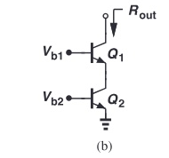

# 장말문제 9.55 — 출력 임피던스 50 kΩ 바이폴라 캐스코드 전류원 설계

## 원문
Design the cascode current source of Fig. 9.74(b) for an output impedance of $50\ \text{k}\Omega$. Select $V_{b1}$ such that $Q_2$ experiences a base-collector forward bias of only $100\ \text{mV}$. Assume a bias current of $1\ \text{mA}$.

## 조건
- 설계 대상: Fig 9.74(b)의 캐스코드 전류원
- 목표 출력 임피던스 $50\ \text{k}\Omega$
- $50\ \text{k}\Omega$을 최솟값으로 본다 (공통 가정에서는 $R_{out}$이 약 $329\ \text{k}\Omega$로 정해져 정확히 맞출 변수가 없음) (원문에 없음)
- $V_{b1}$은 $Q_2$의 베이스-컬렉터 순방향 바이어스가 $100\ \text{mV}$에 그치도록 선택
- 바이어스 전류 $1\ \text{mA}$
- 공통 가정: $I_{S,n} = 6 \times 10^{-16}\ \text{A}$, $V_{A,n} = 5\ \text{V}$, $\beta_n = 100$ (원문의 Design Problems 머리말)

## 구할 것
- Fig 9.74(b) 회로 설계 (정할 값: $V_{b1}$, $V_{b2}$ 등) (원문에 없음, 원문은 "설계하라"와 "$V_{b1}$을 선택하라"만 적음)

## 상속·참조
- Design Problems 공통 가정 (문제에 따로 적힌 값이 우선):
  - $I_{S,n} = I_{S,p} = 6 \times 10^{-16}\ \text{A}$
  - $V_{A,n} = V_{A,p} = 5\ \text{V}$
  - $\beta_n = 100$, $\beta_p = 50$
  - $\mu_n C_{ox} = 100\ \mu\text{A/V}^2$, $\mu_p C_{ox} = 50\ \mu\text{A/V}^2$
  - $V_{TH,n} = 0.4\ \text{V}$, $V_{TH,p} = -0.5\ \text{V}$
  - 첨자 n은 npn/NMOS, p는 pnp/PMOS

## 회로 — Fig 9.74(b)
```spice
Q1  out  Vb1  n1  npn
Q2  n1   Vb2  0   npn
```
- 단자: Vb1, Vb2 = 이상적 DC 바이어스, 값 미지정 (점 단자) / out = Q1 컬렉터, R_out 측정 단자 (개방 원)
- 표시: 노드 라벨 V_b1, V_b2 (각 점 단자 왼쪽) / 소자 라벨 Q1, Q2 (각 트랜지스터 오른쪽, 이미터 옆) / 부호 없음 / 화살표 "R_out": out 노드를 회로 쪽(아래)으로 들여다봄, 아래 방향, 도선 옆 별도 화살표 (┌ 꺾임: out 도선 오른쪽에 세로선, 위 끝에서 짧은 가로선이 오른쪽 R_out 글자 쪽으로, 화살촉은 아래 끝, Q1 컬렉터 바로 위 높이) / 수치·면적 라벨 없음
- 배치: 한 세로줄 위→아래 out 원, Q1, Q2, 접지 / Q1, Q2 모두 npn 보통 방향(베이스 막대 왼쪽, 컬렉터 위, 이미터 아래·화살표 바깥) / V_b1, V_b2 점 단자 → 가로선 → 각 베이스 / Q1 컬렉터 → 세로선 위로 out 원 / Q1 이미터에서 곧은 세로선이 Q2 컬렉터로 (n1, 라벨 없음) / Q2 이미터 아래 접지 / 접속점: 없음 / 교차: 없음



## 풀이
### 출력 임피던스
- $g_m = 1\ \text{mA}/26\ \text{mV} = 38.5\ \text{mS}$ ($V_T = 26\ \text{mV}$), $r_O = V_A/I_C = 5.00\ \text{k}\Omega$, $r_\pi = \beta/g_m = 2.60\ \text{k}\Omega$
- $R_{out} \approx g_m r_O (r_O \parallel r_\pi) = 38.5\ \text{mS} \cdot 5.00\ \text{k}\Omega \cdot 1.71\ \text{k}\Omega = 329\ \text{k}\Omega$ ($g_m (r_O \parallel r_\pi) = 65.8 \gg 1$)
- 참고: 정확히 $50\ \text{k}\Omega$이 되려면 $V_A \approx 1.42\ \text{V}$
### $V_{b2}$
- 두 소자 모두 약 $1\ \text{mA}$ (베이스 전류 무시): $V_{b2} = V_{BE} = V_T \ln(1\ \text{mA}/6 \times 10^{-16}\ \text{A}) = 0.732\ \text{V}$
### $V_{b1}$
- $Q_2$ 베이스–컬렉터 순방향 $100\ \text{mV}$: $Q_2$ 컬렉터 $= V_{b2} - 0.1\ \text{V} = 0.632\ \text{V}$
- $V_{b1} = 0.632\ \text{V} + V_{BE} = 1.36\ \text{V}$
### 답
- $V_{b2} = 0.732\ \text{V}$, $V_{b1} = 1.36\ \text{V}$ ($Q_2$ 컬렉터 $0.632\ \text{V}$)
- 이때 $R_{out} \approx 329\ \text{k}\Omega$로 $50\ \text{k}\Omega$ 이상이다
