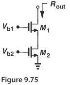

# 장말문제 9.56 — 출력 임피던스 200 kΩ MOS 캐스코드 설계

## 원문
We wish to design the MOS cascode of Fig. 9.75 for an output impedance of $200\ \text{k}\Omega$ and a bias current of $0.5\ \text{mA}$.

(a) Determine $(W/L)_1 = (W/L)_2$ if $\lambda = 0.1\ \text{V}^{-1}$.

(b) Calculate the required value of $V_{b2}$.

## 조건
- 설계 대상: Fig 9.75의 MOS 캐스코드
- 목표 출력 임피던스 $200\ \text{k}\Omega$, 바이어스 전류 $0.5\ \text{mA}$
- (a)에서 $\lambda = 0.1\ \text{V}^{-1}$, $(W/L)_1 = (W/L)_2$

## 구할 것
- (a) $\lambda = 0.1\ \text{V}^{-1}$일 때 $(W/L)_1 = (W/L)_2$
- (b) 필요한 $V_{b2}$ 값

## 상속·참조
- Design Problems 공통 가정 (문제에 따로 적힌 값이 우선):
  - $I_{S,n} = I_{S,p} = 6 \times 10^{-16}\ \text{A}$
  - $V_{A,n} = V_{A,p} = 5\ \text{V}$
  - $\beta_n = 100$, $\beta_p = 50$
  - $\mu_n C_{ox} = 100\ \mu\text{A/V}^2$, $\mu_p C_{ox} = 50\ \mu\text{A/V}^2$
  - $V_{TH,n} = 0.4\ \text{V}$, $V_{TH,p} = -0.5\ \text{V}$
  - 첨자 n은 npn/NMOS, p는 pnp/PMOS

## 회로 — Fig 9.75
```spice
M1  out  Vb1  n1  nmos
M2  n1   Vb2  0   nmos
```
- 단자: Vb1, Vb2 = 이상적 DC 바이어스, 값 미지정 (점 단자) / out = M1 드레인, R_out 측정 단자 (개방 원)
- 표시: 노드 라벨 V_b1, V_b2 (각 점 단자 왼쪽) / 소자 라벨 M1, M2 (각 트랜지스터 오른쪽, 소스 옆) / 부호 없음 / 화살표 "R_out": out 노드를 회로 쪽(아래)으로 들여다봄, 아래 방향, 도선 옆 별도 화살표 (┌ 꺾임: out 도선 오른쪽에 세로선, 위 끝에서 짧은 가로선이 오른쪽 R_out 글자 쪽으로, 화살촉은 아래 끝, M1 드레인 바로 위 높이) / 수치·면적 라벨 없음
- 배치: 한 세로줄 위→아래 out 원, M1, M2, 접지 / M1, M2 모두 NMOS 보통 방향(게이트 왼쪽, 드레인 위, 소스 아래·소스 화살표 바깥) / V_b1, V_b2 점 단자 → 가로선 → 각 게이트 / M1 드레인 → 세로선 위로 out 원 / M1 소스에서 곧은 세로선이 M2 드레인으로 (n1, 라벨 없음) / M2 소스 아래 접지 / 접속점: 없음 / 교차: 없음


