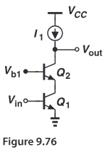

# 장말문제 9.57 — 이득 500 바이폴라 캐스코드 증폭기 설계

## 원문
The bipolar cascode amplifier of Fig. 9.76 must be designed for a voltage gain of 500. Use Eq. (9.53) and assume $\beta = 100$.

(a) What is the minimum required value of $V_A$?

(b) For a bias current of $0.5\ \text{mA}$, calculate the required bias component in $V_{in}$.

(c) Compute the value of $V_{b1}$ such that $Q_1$ sustains a collector-emitter voltage of $500\ \text{mV}$.

## 조건
- 설계 대상: Fig 9.76의 바이폴라 캐스코드 증폭기
- 목표 전압 이득 500
- 식 (9.53)을 사용하고 $\beta = 100$으로 가정
- 식 (9.53): $Q_1$, $Q_2$가 같은 바이어스 전류를 흘려 $g_{m1} \approx g_{m2}$, $r_{O1} \approx r_{O2}$일 때 $A_v \approx -g_{m1} r_{O1}\, g_{m1} (r_{O1} \parallel r_{\pi 2})$ (본문 식, 원문에 없음)
- 소신호 파라미터: $g_m = I_C/V_T$, $r_O = V_A/I_C$, $r_\pi = \beta/g_m$ (원문에 없음)
- (b)에서 바이어스 전류 $0.5\ \text{mA}$
- (c)에서 $Q_1$의 컬렉터-이미터 전압 $500\ \text{mV}$
- 부하 $I_1$은 이상적인 전류원 (원문에 없음)
- 공통 가정: $I_{S,n} = 6 \times 10^{-16}\ \text{A}$ ($\beta$는 문제의 값, $V_A$는 (a)에서 구함) (원문의 Design Problems 머리말)

## 구할 것
- (a) 필요한 $V_A$의 최솟값
- (b) 바이어스 전류가 $0.5\ \text{mA}$일 때 $V_{in}$에 필요한 바이어스(DC) 성분
- (c) $Q_1$이 $500\ \text{mV}$의 컬렉터-이미터 전압을 유지하도록 하는 $V_{b1}$ 값

## 상속·참조
- Design Problems 공통 가정 (문제에 따로 적힌 값이 우선):
  - $I_{S,n} = I_{S,p} = 6 \times 10^{-16}\ \text{A}$
  - $V_{A,n} = V_{A,p} = 5\ \text{V}$
  - $\beta_n = 100$, $\beta_p = 50$
  - $\mu_n C_{ox} = 100\ \mu\text{A/V}^2$, $\mu_p C_{ox} = 50\ \mu\text{A/V}^2$
  - $V_{TH,n} = 0.4\ \text{V}$, $V_{TH,p} = -0.5\ \text{V}$
  - 첨자 n은 npn/NMOS, p는 pnp/PMOS
- 식 (9.53) (교재 462쪽, 회로는 본문 Fig 9.16(b)로 Fig 9.76과 같은 구조): $Q_1$, $Q_2$가 같은 바이어스 전류를 흘려 $g_{m1} \approx g_{m2}$, $r_{O1} \approx r_{O2}$일 때 $A_v \approx -g_{m1} r_{O1}\, g_{m1} (r_{O1} \parallel r_{\pi 2})$
- 소신호 파라미터: $g_m = I_C/V_T$, $r_O = V_A/I_C$, $r_\pi = \beta/g_m$ (원문에 없음)

## 회로 — Fig 9.76
```spice
I1  VCC   Vout
Q2  Vout  Vb1  n1  npn
Q1  n1    Vin  0   npn
```
- 단자: VCC = 전원, 값 미지정 (T 전원 기호) / Vb1 = 이상적 DC 바이어스, 구할 값 (점 단자) / Vin = 신호 입력 (개방 원) / Vout = 출력 (개방 원)
- 표시: 노드 라벨 V_CC (T 기호 오른쪽), V_out (출력 원 오른쪽), V_b1 (점 단자 왼쪽), V_in (입력 원 왼쪽) / 소자 라벨 I_1 (전류원 왼쪽), Q2, Q1 (각 트랜지스터 오른쪽, 이미터 옆) / 부호 없음 / 화살표 없음 / 수치·면적 라벨 없음
- 배치: 한 세로줄 위→아래 V_CC T 기호, I_1 전류원(원 안 화살표 아래), Vout 접속점, Q2, Q1, 접지 / Q2, Q1 모두 npn 보통 방향(베이스 막대 왼쪽, 컬렉터 위, 이미터 아래·화살표 바깥) / Vout 접속점에서 가로선이 오른쪽으로 V_out 원 / V_b1 점 단자 → 가로선 → Q2 베이스, V_in 원 → 가로선 → Q1 베이스 / Q2 이미터에서 곧은 세로선이 Q1 컬렉터로 (n1, 라벨 없음) / Q1 이미터 아래 접지 / 접속점 (세 갈래 이상, 1곳): Vout = 위 I_1 + 아래 Q2 컬렉터 + 오른쪽 V_out 선 (점) / 교차: 없음



## 풀이
### (a) 이득 식
- 소신호 파라미터 $g_m = I_C/V_T$, $r_O = V_A/I_C$, $r_\pi = \beta/g_m$를 넣으면 $g_m r_O = V_A/V_T$, $g_m r_\pi = \beta$
- 식 (9.53) $|A_v| \approx g_{m1} r_{O1}\, g_{m1}(r_{O1} \parallel r_{\pi 2})$에서 $x = V_A/V_T$로 두면 $|A_v| = x \cdot \dfrac{x \beta}{x + \beta}$
### (a) 최소 $V_A$
- $x^2 \beta = 500(x + \beta)$, $\beta = 100$: $x^2 - 5x - 500 = 0$ → $x = 25.0$
- $V_A = 25.0\, V_T = 0.650\ \text{V}$ ($V_T = 26\ \text{mV}$). 이득이 바이어스 전류와 무관하다
### (b) 입력 바이어스
- $V_{in} = V_{BE1} = V_T \ln \dfrac{0.5\ \text{mA}}{6 \times 10^{-16}\ \text{A}} = 0.714\ \text{V}$ (DC 바이어스에서는 Early 효과 무시)
### (c) $V_{b1}$
- $Q_2$도 약 $0.5\ \text{mA}$ (베이스 전류 무시)라 $V_{BE2} = 0.714\ \text{V}$
- $V_{b1} = V_{CE1} + V_{BE2} = 0.5\ \text{V} + 0.714\ \text{V} = 1.21\ \text{V}$
### 답
- (a) $V_A \geq 0.650\ \text{V}$
- (b) $V_{in}$의 DC 성분 $0.714\ \text{V}$
- (c) $V_{b1} = 1.21\ \text{V}$
