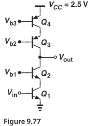

# 장말문제 9.58 — 전력 2 mW 바이폴라 캐스코드 증폭기(pnp 캐스코드 부하) 설계

## 원문
Design the cascode amplifier shown in Fig. 9.77 for a power budget of $2\ \text{mW}$. Select $V_{b1}$ and $V_{b2}$ such that $Q_1$ and $Q_4$ sustain a base-collector forward bias of $200\ \text{mV}$. What voltage gain is achieved?

## 조건
- 설계 대상: Fig 9.77의 캐스코드 증폭기
- 전력 예산 $2\ \text{mW}$, $V_{CC} = 2.5\ \text{V}$ (그림에 표시)
- $V_{b1}$, $V_{b2}$는 $Q_1$과 $Q_4$의 베이스-컬렉터 순방향 바이어스가 $200\ \text{mV}$가 되도록 선택

## 구할 것
- 회로 설계 (필요한 $V_{b1}$, $V_{b2}$ 선택)
- 얻어지는 전압 이득

## 상속·참조
- Design Problems 공통 가정 (문제에 따로 적힌 값이 우선):
  - $I_{S,n} = I_{S,p} = 6 \times 10^{-16}\ \text{A}$
  - $V_{A,n} = V_{A,p} = 5\ \text{V}$
  - $\beta_n = 100$, $\beta_p = 50$
  - $\mu_n C_{ox} = 100\ \mu\text{A/V}^2$, $\mu_p C_{ox} = 50\ \mu\text{A/V}^2$
  - $V_{TH,n} = 0.4\ \text{V}$, $V_{TH,p} = -0.5\ \text{V}$
  - 첨자 n은 npn/NMOS, p는 pnp/PMOS

## 회로 — Fig 9.77
```spice
Q4  n2    Vb3  VCC  pnp
Q3  Vout  Vb2  n2   pnp
Q2  Vout  Vb1  n1   npn
Q1  n1    Vin  0    npn
```
- 단자: VCC = 2.5 V 전원 (T 전원 기호) / Vb3, Vb2, Vb1 = 이상적 DC 바이어스 (점 단자) / Vin = 신호 입력 (개방 원) / Vout = 출력 (개방 원)
- 표시: 노드 라벨 "V_CC = 2.5 V" (T 기호 오른쪽), V_b3, V_b2, V_b1 (각 점 단자 왼쪽), V_in (입력 원 왼쪽), V_out (출력 원 오른쪽) / 소자 라벨 Q4, Q3, Q2, Q1 (각 트랜지스터 오른쪽) / 부호 없음 / 화살표 없음 / 수치·면적 라벨 "V_CC = 2.5 V"의 2.5 V (T 기호 오른쪽)
- 배치: 한 세로줄 위→아래 V_CC T 기호, Q4, Q3, Vout 접속점, Q2, Q1, 접지 / Q4, Q3 pnp 보통 방향(베이스 막대 왼쪽, 이미터 위·화살표가 막대 쪽으로 들어감, 컬렉터 아래) / Q2, Q1 npn 보통 방향(베이스 막대 왼쪽, 컬렉터 위, 이미터 아래·화살표 바깥) / Q4 이미터 → 세로선 위로 V_CC / Q4 컬렉터 → 곧은 세로선 → Q3 이미터 (n2, 라벨 없음) / Q3 컬렉터 → Vout 접속점 → Q2 컬렉터 / Vout 접속점에서 가로선이 오른쪽으로 V_out 원 / Q2 이미터 → 곧은 세로선 → Q1 컬렉터 (n1, 라벨 없음) / Q1 이미터 아래 접지 / V_b3, V_b2, V_b1 점 단자와 V_in 원 → 각 가로선 → 각 베이스 / 접속점 (세 갈래 이상, 1곳): Vout = 위 Q3 컬렉터 + 아래 Q2 컬렉터 + 오른쪽 V_out 선 (점) / 교차: 없음


