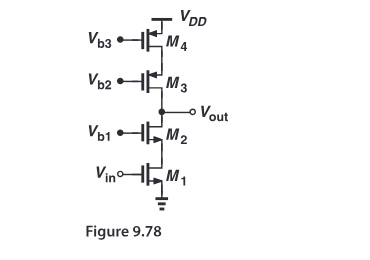

# 장말문제 9.59 — CMOS 캐스코드 증폭기 설계

## 조건
- 설계 대상: Fig 9.78의 CMOS 캐스코드 증폭기
- 목표 전압 이득 200, 전력 예산 2 mW, $V_{DD} = 1.8\ \text{V}$
- $(W/L)_1 = (W/L)_2 = (W/L)_3 = (W/L)_4 = 20/0.18$
- $\lambda_p = 2\lambda_n = 0.2\ \text{V}^{-1}$ (즉 $\lambda_n = 0.1\ \text{V}^{-1}$)
- 단순화를 위해 $V_{b1} = V_{b2} = 0.9\ \text{V}$

## 구할 것
- 필요한 $V_{in}$의 DC 레벨
- 필요한 $V_{b3}$

## 상속·참조
- Design Problems 공통 가정 (문제에 따로 적힌 값이 우선):
  - $I_{S,n} = I_{S,p} = 6 \times 10^{-16}\ \text{A}$
  - $V_{A,n} = V_{A,p} = 5\ \text{V}$
  - $\beta_n = 100$, $\beta_p = 50$
  - $\mu_n C_{ox} = 100\ \mu\text{A/V}^2$, $\mu_p C_{ox} = 50\ \mu\text{A/V}^2$
  - $V_{TH,n} = 0.4\ \text{V}$, $V_{TH,p} = -0.5\ \text{V}$
  - 첨자 n은 npn/NMOS, p는 pnp/PMOS

## 회로 — Fig 9.78
```spice
M4  n3    Vb3  VDD  pmos  W/L=20/0.18
M3  Vout  Vb2  n3   pmos  W/L=20/0.18
M2  Vout  Vb1  n2   nmos  W/L=20/0.18
M1  n2    Vin  0    nmos  W/L=20/0.18
```
- 단자: VDD = 1.8 V 전원, 그림에는 값 없이 VDD 라벨만 (T 전원 기호) / Vb1, Vb2, Vb3 = 이상적 DC 바이어스 (점 단자) / Vin = 신호 입력 (개방 원) / Vout = 출력 (개방 원)
- 표시: 노드 라벨 VDD (T 기호 오른쪽), Vb3, Vb2, Vb1 (각 점 단자 왼쪽), Vin (개방 원 왼쪽), Vout (개방 원 오른쪽) / 소자 라벨 M4, M3, M2, M1 (각 트랜지스터 오른쪽) / 화살표 없음 (소스 화살표는 소자 기호의 일부: M4·M3 PMOS는 소스에서 채널 쪽을 향함, M2·M1 NMOS는 채널에서 소스 쪽(오른쪽)을 향함) / 수치·면적 라벨 없음 (W/L 값은 문제 글에만 있음)
- 배치: 한 세로줄 위→아래 VDD T 기호, M4, M3, Vout 접속점(점), M2, M1, 접지 / 네 트랜지스터 모두 바디 단자 없는 3단자 기호, 보통 방향(게이트 왼쪽, 드레인·소스 오른쪽) / 게이트마다 가로선이 왼쪽으로 뻗어 단자(Vb3, Vb2, Vb1 점 단자, Vin 개방 원) / M4 소스(위) → VDD, M4 드레인 → M3 소스, M3 드레인 → Vout 접속점(점) → M2 드레인, M2 소스 → M1 드레인, M1 소스 → 접지 / Vout 접속점에서 가로선이 오른쪽으로 뻗어 개방 원 Vout / 교차: 없음


