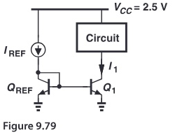

# 장말문제 9.60 — 전력 2 mW에서 0.5 mA를 공급하는 전류 거울 설계

## 원문
The current mirror shown in Fig. 9.79 must deliver $I_1 = 0.5\ \text{mA}$ to a circuit with a total power budget of $2\ \text{mW}$. Assuming $V_A = \infty$ and $\beta \gg 1$, determine the required value of $I_{REF}$ and the relative sizes of $Q_{REF}$ and $Q_1$.

## 조건
- 회로: Fig 9.79의 전류 거울, $Q_1$이 "Circuit"에 $I_1 = 0.5\ \text{mA}$를 공급해야 함
- 전체 전력 예산 $2\ \text{mW}$, $V_{CC} = 2.5\ \text{V}$ (그림에 표시)
- $V_A = \infty$, $\beta \gg 1$
- 전체 전력에는 $I_{REF}$ 가지와 $I_1$ 가지의 전류가 모두 들어가는 것으로 봄 (원문에 없음)
- 공통 가정: $I_{S,n} = 6 \times 10^{-16}\ \text{A}$ ($V_A$, $\beta$는 문제의 가정을 따름) (원문의 Design Problems 머리말)

## 구할 것
- 필요한 $I_{REF}$ 값
- $Q_{REF}$와 $Q_1$의 상대 크기(이미터 면적 비)

## 상속·참조
- Design Problems 공통 가정 (문제에 따로 적힌 값이 우선):
  - $I_{S,n} = I_{S,p} = 6 \times 10^{-16}\ \text{A}$
  - $V_{A,n} = V_{A,p} = 5\ \text{V}$
  - $\beta_n = 100$, $\beta_p = 50$
  - $\mu_n C_{ox} = 100\ \mu\text{A/V}^2$, $\mu_p C_{ox} = 50\ \mu\text{A/V}^2$
  - $V_{TH,n} = 0.4\ \text{V}$, $V_{TH,p} = -0.5\ \text{V}$
  - 첨자 n은 npn/NMOS, p는 pnp/PMOS

## 회로 — Fig 9.79
```spice
IREF  VCC  n1
QREF  n1   n1  0  npn
Q1    n2   n1  0  npn
X1    VCC  n2  box "Circuit"
```
- 단자: VCC = 2.5 V 전원 (가로 레일)
- 표시: 노드 라벨 "V_CC = 2.5 V" (레일 오른쪽 끝) / 소자 라벨 I_REF (전류원 왼쪽), Q_REF (Q_REF 왼쪽), Q1 (Q1 오른쪽, 이미터 옆), 상자 안 글자 "Circuit" / 부호 없음 / 화살표 "I_1": Circuit 상자 아래 변에서 Q1 컬렉터로 내려가는 세로 도선, 아래 방향(Q1 컬렉터로 들어감), 도선 위, 글자는 화살표 오른쪽 / 수치·면적 라벨 "V_CC = 2.5 V"의 2.5 V (레일 오른쪽 끝)
- 배치: 맨 위 굵은 가로 레일 V_CC가 I_REF 윗선보다 조금 왼쪽에서 Circuit 상자 윗선보다 조금 오른쪽까지 뻗음, 왼쪽 끝 근처에 I_REF, 오른쪽 끝 근처에 Circuit 상자 윗선이 매달림 / 왼쪽 세로줄 위→아래 레일, I_REF 전류원(원 안 화살표 아래), n1 접속점, Q_REF, 접지 / Q_REF npn 좌우 반전(베이스 막대 오른쪽, 컬렉터는 막대 왼쪽 위에서 n1으로, 이미터는 막대 왼쪽 아래에서 왼쪽 아래로 나가 접지) / 다이오드 연결: n1 접속점에서 가로선이 오른쪽으로 가 모서리에서 아래로 꺾여 베이스 접속점 / 베이스 공통선: Q_REF 베이스에서 베이스 접속점을 지나 오른쪽 Q1 베이스까지 한 직선 / Q1 npn 보통 방향(베이스 막대 왼쪽, 컬렉터 위, 이미터 아래·화살표 바깥), 이미터 아래 접지 (Q_REF 접지와 같은 높이) / 오른쪽 세로줄 위→아래 레일, Circuit 상자(블랙박스), I_1 화살표, Q1, 접지 / Q1 컬렉터 → 세로선 위로 상자 아래 변 (n2, 라벨 없음) / 접속점 (세 갈래 이상, 2곳): n1 = 위 I_REF + 아래 Q_REF 컬렉터 + 오른쪽 다이오드 연결 선 (점), 베이스 접속점 = 왼쪽 Q_REF 베이스 + 위 다이오드 연결 선 + 오른쪽 Q1 베이스로 가는 선 (점) / 교차: 없음



## 풀이
### 전체 전류
- 전력은 $V_{CC}$에서 나가는 두 가지 전류의 합이 쓴다: $I_{REF} + I_1 = 2\ \text{mW}/2.5\ \text{V} = 0.800\ \text{mA}$
### $I_{REF}$
- $I_{REF} = 0.800\ \text{mA} - 0.5\ \text{mA} = 0.300\ \text{mA}$
### 면적 비
- $V_A = \infty$, $\beta \gg 1$이면 같은 $V_{BE}$에서 전류는 이미터 면적에 비례한다: $A_{E1}/A_{E,REF} = I_1/I_{REF} = 0.5/0.3 = 5/3$
- 예: $Q_{REF}$의 $I_S = 6 \times 10^{-16}\ \text{A}$이면 $Q_1$은 $1.00 \times 10^{-15}\ \text{A}$, $V_{BE} = V_T \ln(I_{REF}/I_{S,REF}) = 0.700\ \text{V}$ ($V_T = 26\ \text{mV}$)
### 답
- $I_{REF} = 0.300\ \text{mA}$
- $Q_{REF} : Q_1 = 3 : 5$ ($Q_1$이 $Q_{REF}$의 $5/3$배)
