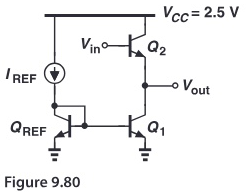

# 장말문제 9.61 — 전류 거울로 바이어스한 이미터 폴로어 설계

## 조건
- 회로: Fig 9.80, $Q_2$는 이미터 폴로어로 동작 ($Q_1$–$Q_{REF}$ 거울이 $Q_2$의 바이어스 전류를 공급)
- 전력 예산 $3\ \text{mW}$, $V_{CC} = 2.5\ \text{V}$ (그림에 표시)
- 목표 출력 임피던스 $50\ \Omega$
- $V_A = \infty$, $\beta \gg 1$

## 구할 것
- 회로 설계 (정할 값 예: $I_{REF}$, $Q_{REF}$ 대비 $Q_1$ 면적 비, $Q_2$ 바이어스 전류) (원문에 없음, 원문은 "설계하라"만 적음)

## 상속·참조
- Design Problems 공통 가정 (문제에 따로 적힌 값이 우선):
  - $I_{S,n} = I_{S,p} = 6 \times 10^{-16}\ \text{A}$
  - $V_{A,n} = V_{A,p} = 5\ \text{V}$
  - $\beta_n = 100$, $\beta_p = 50$
  - $\mu_n C_{ox} = 100\ \mu\text{A/V}^2$, $\mu_p C_{ox} = 50\ \mu\text{A/V}^2$
  - $V_{TH,n} = 0.4\ \text{V}$, $V_{TH,p} = -0.5\ \text{V}$
  - 첨자 n은 npn/NMOS, p는 pnp/PMOS

## 회로 — Fig 9.80
```spice
IREF  VCC   n1
QREF  n1    n1   0     npn
Q1    Vout  n1   0     npn
Q2    VCC   Vin  Vout  npn
```
- 단자: VCC = 2.5 V 전원 (가로 레일) / Vin = 신호 입력 (개방 원) / Vout = 출력 (개방 원)
- 표시: 노드 라벨 "V_CC = 2.5 V" (레일 오른쪽 끝), V_in (입력 원 왼쪽), V_out (출력 원 오른쪽) / 소자 라벨 I_REF (전류원 왼쪽), Q_REF (Q_REF 왼쪽), Q2 (Q2 오른쪽), Q1 (Q1 오른쪽, 이미터 옆) / 부호 없음 / 화살표 없음 / 수치·면적 라벨 "V_CC = 2.5 V"의 2.5 V (레일 오른쪽 끝)
- 배치: 맨 위 굵은 가로 레일 V_CC가 I_REF 윗선보다 조금 왼쪽에서 Q2 컬렉터 선보다 조금 오른쪽까지 뻗음, 왼쪽 끝 근처에 I_REF, 오른쪽 끝 근처에 Q2 컬렉터 선이 매달림 / 왼쪽 세로줄 위→아래 레일, I_REF 전류원(원 안 화살표 아래), n1 접속점, Q_REF, 접지 / Q_REF npn 좌우 반전(베이스 막대 오른쪽, 컬렉터는 막대 왼쪽 위에서 n1으로, 이미터는 막대 왼쪽 아래에서 왼쪽 아래로 나가 접지) / 다이오드 연결: n1 접속점에서 가로선이 오른쪽으로 가 모서리에서 아래로 꺾여 베이스 접속점 / 베이스 공통선: Q_REF 베이스에서 베이스 접속점을 지나 오른쪽 Q1 베이스까지 한 직선 / Q1 npn 보통 방향(베이스 막대 왼쪽, 컬렉터 위, 이미터 아래·화살표 바깥), 이미터 아래 접지 (Q_REF 접지와 같은 높이) / 오른쪽 세로줄 위→아래 레일, Q2, Vout 접속점, Q1, 접지 / Q2 npn 보통 방향(베이스 막대 왼쪽, 컬렉터 위 → 레일, 이미터 아래·화살표 바깥), 레일 바로 아래 / V_in 원 → 가로선 → Q2 베이스 / Q2 이미터 → Vout 접속점 → Q1 컬렉터 / Vout 접속점에서 가로선이 오른쪽으로 V_out 원 / 접속점 (세 갈래 이상, 3곳): n1 = 위 I_REF + 아래 Q_REF 컬렉터 + 오른쪽 다이오드 연결 선 (점), 베이스 접속점 = 왼쪽 Q_REF 베이스 + 위 다이오드 연결 선 + 오른쪽 Q1 베이스로 가는 선 (점), Vout = 위 Q2 이미터 + 아래 Q1 컬렉터 + 오른쪽 V_out 선 (점) / 교차: 없음


