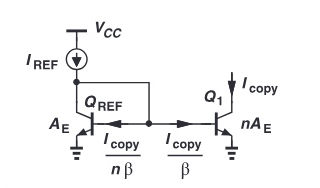

# 장말문제 9.63 — 오차 1% 미만의 0.5 mA 바이폴라 전류 거울 설계

## 원문
Design the circuit of Fig. 9.31 for $I_{copy} = 0.5\ \text{mA}$ and an error of less than 1% with respect to the nominal value. Explain the trade-off between accuracy and power dissipation in this circuit. Assume $V_{CC} = 2.5\ \text{V}$.

## 조건
- 설계 대상: Fig 9.31 회로 (베이스 전류 오차를 보이는 바이폴라 전류 거울, $Q_{REF}$ 이미터 면적 $A_E$, $Q_1$ 이미터 면적 $nA_E$)
- $I_{copy} = 0.5\ \text{mA}$
- 공칭값에 대한 $I_{copy}$의 오차 1% 미만
- $V_{CC} = 2.5\ \text{V}$ (그림에는 값 없이 V_CC 라벨만)

## 구할 것
- 회로 설계 (정할 값 예: $n$, $I_{REF}$) (원문에 없음, 원문은 "설계하라"만 적음)
- 이 회로에서 정확도와 전력 소모 사이의 절충(trade-off) 설명

## 상속·참조
- Design Problems 공통 가정 (문제에 따로 적힌 값이 우선):
  - $I_{S,n} = I_{S,p} = 6 \times 10^{-16}\ \text{A}$
  - $V_{A,n} = V_{A,p} = 5\ \text{V}$
  - $\beta_n = 100$, $\beta_p = 50$
  - $\mu_n C_{ox} = 100\ \mu\text{A/V}^2$, $\mu_p C_{ox} = 50\ \mu\text{A/V}^2$
  - $V_{TH,n} = 0.4\ \text{V}$, $V_{TH,p} = -0.5\ \text{V}$
  - 첨자 n은 npn/NMOS, p는 pnp/PMOS
- 식 (9.101) (교재 475쪽, Fig 9.31의 X 노드 KCL로 얻은 결과): $I_{copy} = \dfrac{n I_{REF}}{1 + \dfrac{1}{\beta}(n + 1)}$, $\beta$가 크면 $I_{copy} \approx n I_{REF}$ (원문에 없음, 문제 글은 식을 지정하지 않음)

## 회로 — Fig 9.31
```spice
IREF  VCC  n1
QREF  n1   n1  0  npn  area=1
Q1    out  n1  0  npn  area={n}
```
- 단자: VCC = 전원, 그림에는 값 없이 V_CC 라벨만 (T 전원 기호) / out = Q1 컬렉터, I_copy가 들어가는 단자 (선 끝)
- 표시: 노드 라벨 V_CC (T 기호 오른쪽) / 소자 라벨 I_REF (전류원 왼쪽), Q_REF (Q_REF 오른쪽 위, 베이스 공통선 위), Q1 (Q1 컬렉터 왼쪽 위) / 부호 없음 / 화살표 "I_copy": out, 아래 방향(Q1 컬렉터로 들어감), 도선 위, 글자는 화살표 오른쪽; "I_copy/(nβ)": 베이스 공통선에서 베이스 접속점과 Q_REF 베이스 사이, 왼쪽 방향(Q_REF 베이스로 들어감), 도선 위, 분수 글자 I_copy / nβ는 화살표 아래; "I_copy/β": 베이스 공통선에서 베이스 접속점과 Q1 베이스 사이, 오른쪽 방향(Q1 베이스로 들어감), 도선 위, 분수 글자 I_copy / β는 화살표 아래 / 수치·면적 라벨 "A_E" (Q_REF 왼쪽), "nA_E" (Q1 오른쪽)
- 배치: 왼쪽 세로줄 위→아래 V_CC T 기호, I_REF 전류원(원 안 화살표 아래), n1 접속점, Q_REF, 접지 / Q_REF npn 좌우 반전(베이스 막대 오른쪽, 컬렉터는 막대 왼쪽 위에서 n1으로, 이미터는 막대 왼쪽 아래에서 왼쪽 아래로 나가 접지) / 다이오드 연결: n1 접속점에서 가로선이 오른쪽으로 길게 가 모서리에서 아래로 꺾여 베이스 접속점 (Q_REF와 Q1 사이 가운데쯤) / 베이스 공통선: Q_REF 베이스에서 두 전류 화살표와 베이스 접속점을 지나 오른쪽 Q1 베이스까지 한 직선 / Q1 npn 보통 방향(베이스 막대 왼쪽), 컬렉터에서 세로선이 위로 I_copy 화살표를 지나 선 끝, 이미터 아래 접지 (Q_REF 접지와 같은 높이) / 접속점 (세 갈래 이상, 2곳): n1 = 위 I_REF + 아래 Q_REF 컬렉터 + 오른쪽 다이오드 연결 선 (점), 베이스 접속점 = 왼쪽 Q_REF 베이스로 가는 선 + 위 다이오드 연결 선 + 오른쪽 Q1 베이스로 가는 선 (점) / 교차: 없음


> 참고: Fig 9.31은 본문 그림(교재 475쪽, PDF p.14). 베이스 전류 화살표와 분수 라벨은 본문 해석용 표시
