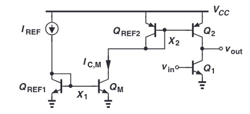

# 장말문제 9.64 — npn·pnp 거울 조합 회로를 오차 10% 미만으로 설계

## 원문
Design the circuit of Fig. 9.35 such that the bias current of $Q_2$ is $1\ \text{mA}$ and the error in $I_{C1}$ with respect to its nominal value is less than 10%. Is the solution unique?

## 조건
- 설계 대상: Fig 9.35 회로 (npn 거울 $Q_{REF1}$–$Q_M$과 pnp 거울 $Q_{REF2}$–$Q_2$를 이어 $Q_2$, $Q_1$을 바이어스)
- $Q_2$의 바이어스 전류 $1\ \text{mA}$
- 공칭값에 대한 $I_{C1}$의 오차 10% 미만

## 구할 것
- 회로 설계 (정할 값 예: $I_{REF}$, 두 거울의 이미터 면적 비) (원문에 없음, 원문은 "설계하라"만 적음)
- 해가 유일한가?

## 상속·참조
- Design Problems 공통 가정 (문제에 따로 적힌 값이 우선):
  - $I_{S,n} = I_{S,p} = 6 \times 10^{-16}\ \text{A}$
  - $V_{A,n} = V_{A,p} = 5\ \text{V}$
  - $\beta_n = 100$, $\beta_p = 50$
  - $\mu_n C_{ox} = 100\ \mu\text{A/V}^2$, $\mu_p C_{ox} = 50\ \mu\text{A/V}^2$
  - $V_{TH,n} = 0.4\ \text{V}$, $V_{TH,p} = -0.5\ \text{V}$
  - 첨자 n은 npn/NMOS, p는 pnp/PMOS
- 본문 (교재 478–479쪽): Fig 9.35에서 $Q_M$이 $Q_{REF2}$로부터 복사 전류를 끌어내고, 그 전류가 다시 $Q_2$로 복사되어 $Q_1$을 바이어스함. $Q_{REF1}$–$Q_M$, $Q_{REF2}$–$Q_2$ 사이 이미터 면적 비가 전류 비를 정하며, 복사를 거칠 때마다 베이스 전류 오차가 누적됨

## 회로 — Fig 9.35
```spice
IREF   VCC   X1
QREF1  X1    X1   0    npn
QM     X2    X1   0    npn
QREF2  X2    X2   VCC  pnp
Q2     vout  X2   VCC  pnp
Q1     vout  vin  0    npn
```
- 단자: VCC = 전원, 값 미지정 (가로 레일) / vin = 소신호 입력 (개방 원) / vout = 출력 (개방 원)
- 표시: 노드 라벨 VCC (레일 오른쪽 끝), X1 (아래 베이스 공통선 아래, X1 접속점 오른쪽), X2 (위 베이스 공통선 아래, X2 접속점 오른쪽 아래), v_in (입력 원 왼쪽), v_out (출력 원 오른쪽) / 소자 라벨 I_REF (전류원 왼쪽), Q_REF1 (Q_REF1 왼쪽), Q_M (Q_M 오른쪽, 이미터 옆), Q_REF2 (Q_REF2 왼쪽), Q2 (Q2 오른쪽), Q1 (Q1 오른쪽, 이미터 옆) / 부호 없음 / 화살표 "I_C,M": Q_M 컬렉터에서 위로 올라가는 세로 도선, 아래 방향(Q_M 컬렉터로 들어감), 도선 위, 글자는 화살표 왼쪽 / 수치·면적 라벨 없음
- 배치: 맨 위 굵은 가로 레일 VCC가 I_REF 윗선보다 조금 왼쪽에서 Q2 이미터 선보다 조금 오른쪽까지 뻗음, 왼쪽 끝 근처에 I_REF, 오른쪽 부분에 Q_REF2 이미터 선과 Q2 이미터 선이 매달림 / 왼쪽 세로줄: 레일 바로 아래 I_REF 전류원(화살표 아래)에서 긴 세로선이 그림 아래쪽까지 내려와 Q_REF1 컬렉터 접속점 / Q_REF1: npn 좌우 반전(베이스 막대 오른쪽, 컬렉터는 접속점에서 수직으로 내려와 비스듬히 막대 위쪽, 이미터는 막대 아래쪽에서 왼쪽 아래로 나가 접지) / 다이오드 연결 1: Q_REF1 컬렉터 접속점에서 가로선이 오른쪽으로 가다 아래로 꺾여 X1 접속점 / 아래 베이스 공통선: Q_REF1 베이스 → X1 접속점 → 오른쪽 Q_M 베이스 한 직선 / Q_M: npn 보통 방향(베이스 왼쪽), 이미터 아래 접지 (Q_REF1 접지와 같은 높이), 컬렉터에서 세로선이 위로 올라가(I_C,M 화살표) Q_REF2 컬렉터 접속점 높이에서 오른쪽으로 꺾여 그 접속점 / Q_REF2: pnp 좌우 반전(베이스 막대 오른쪽, 이미터는 막대 위쪽에서 왼쪽 위로 레일, 화살표 막대 쪽으로 들어감, 컬렉터는 막대 아래쪽에서 왼쪽 아래로 내려가 접속점) / 다이오드 연결 2: Q_REF2 컬렉터 접속점에서 가로선이 오른쪽으로 가다 위로 꺾여 X2 접속점 / 위 베이스 공통선(레일 바로 아래 높이): Q_REF2 베이스 → X2 접속점 → Q2 베이스 한 직선 / 오른쪽 세로줄: Q2(pnp 보통 방향, 이미터 레일) 컬렉터 → vout 접속점 → Q1(npn 보통 방향) 컬렉터, Q1 이미터 아래 접지, vout 접속점에서 가로선이 오른쪽 v_out 원, v_in 원 → 가로선 → Q1 베이스 / 접속점 (세 갈래 이상, 5곳): ① Q_REF1 컬렉터 = 위 I_REF 선 + 아래 Q_REF1 컬렉터 + 오른쪽 다이오드 연결 선 (점) ② X1 = 왼쪽 Q_REF1 베이스 + 위 다이오드 연결 선 + 오른쪽 Q_M 베이스로 가는 선 (점) ③ Q_REF2 컬렉터 = 위 Q_REF2 컬렉터 + 왼쪽 Q_M 컬렉터 선 + 오른쪽 다이오드 연결 선 (점) ④ X2 = 왼쪽 Q_REF2 베이스 + 아래 다이오드 연결 선 + 오른쪽 Q2 베이스로 가는 선 (점) ⑤ vout = 위 Q2 컬렉터 + 아래 Q1 컬렉터 + 오른쪽 v_out 선 (점) / 교차: 없음


> 참고: Fig 9.35는 본문 그림(교재 478쪽, PDF p.16, 예제 9.18)
