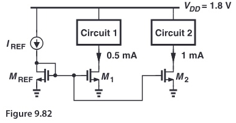

# 장말문제 9.65 — 두 회로에 전류를 공급하는 MOS 전류 거울 설계

## 원문
Figure 9.82 shows an arrangement where $M_1$ and $M_2$ serve as current sources for circuits 1 and 2. Design the circuit for a power budget of $3\ \text{mW}$.

## 조건
- 회로: Fig 9.82, $M_1$과 $M_2$가 Circuit 1과 Circuit 2의 전류원으로 동작
- Circuit 1 전류 $0.5\ \text{mA}$, Circuit 2 전류 $1\ \text{mA}$ (그림에 표시)
- 전력 예산 $3\ \text{mW}$, $V_{DD} = 1.8\ \text{V}$ (그림에 표시)
- 공통 가정: $\mu_n C_{ox} = 100\ \mu\text{A/V}^2$, $V_{TH,n} = 0.4\ \text{V}$ (원문의 Design Problems 머리말)

## 구할 것
- 회로 설계 (정할 값 예: $I_{REF}$, $M_{REF}$ 대비 $M_1$, $M_2$의 $W/L$ 비) (원문에 없음, 원문은 "설계하라"만 적음)

## 상속·참조
- Design Problems 공통 가정 (문제에 따로 적힌 값이 우선):
  - $I_{S,n} = I_{S,p} = 6 \times 10^{-16}\ \text{A}$
  - $V_{A,n} = V_{A,p} = 5\ \text{V}$
  - $\beta_n = 100$, $\beta_p = 50$
  - $\mu_n C_{ox} = 100\ \mu\text{A/V}^2$, $\mu_p C_{ox} = 50\ \mu\text{A/V}^2$
  - $V_{TH,n} = 0.4\ \text{V}$, $V_{TH,p} = -0.5\ \text{V}$
  - 첨자 n은 npn/NMOS, p는 pnp/PMOS

## 회로 — Fig 9.82
```spice
IREF  VDD  n1
MREF  n1   n1  0  nmos
M1    n2   n1  0  nmos
M2    n3   n1  0  nmos
X1    VDD  n2  box "Circuit 1"
X2    VDD  n3  box "Circuit 2"
```
- 단자: VDD = 1.8 V 전원 (가로 레일)
- 표시: 노드 라벨 "V_DD = 1.8 V" (레일 오른쪽 끝) / 소자 라벨 I_REF (전류원 왼쪽), M_REF (M_REF 왼쪽), M1, M2 (각 트랜지스터 오른쪽, 소스 옆), 상자 안 글자 "Circuit 1", "Circuit 2" / 부호 없음 / 화살표 M1 드레인 전류 (라벨 없음, 수치 "0.5 mA"만 옆에 있음): Circuit 1 상자 아래 변에서 M1 드레인으로 내려가는 세로 도선, 아래 방향, 도선 위; M2 드레인 전류 (라벨 없음, 수치 "1 mA"만 옆에 있음): Circuit 2 상자 아래 변에서 M2 드레인으로 내려가는 세로 도선, 아래 방향, 도선 위 / 수치·면적 라벨 "V_DD = 1.8 V"의 1.8 V (레일 오른쪽 끝), "0.5 mA" (Circuit 1 아래 화살표 오른쪽), "1 mA" (Circuit 2 아래 화살표 오른쪽)
- 배치: 맨 위 굵은 가로 레일 V_DD가 I_REF 윗선보다 조금 왼쪽에서 Circuit 2 윗선보다 조금 오른쪽까지 뻗음, 왼쪽 끝 근처에 I_REF, 가운데에 Circuit 1 윗선, 오른쪽 끝 근처에 Circuit 2 윗선이 매달림 / 왼쪽 세로줄 위→아래 레일, I_REF 전류원(원 안 화살표 아래), n1 접속점, M_REF, 접지 / M_REF NMOS 좌우 반전(게이트 오른쪽, 드레인 왼쪽 위, 소스 왼쪽 아래·소스 화살표 바깥(왼쪽)) / 다이오드 연결: n1 접속점에서 가로선이 오른쪽으로 가 모서리에서 아래로 꺾여 M_REF 게이트 오른쪽 접속점 / 게이트 공통선: M_REF 게이트 접속점에서 게이트 높이로 오른쪽으로 가다 둘째 접속점을 지나 M1 게이트까지 한 직선 / M2 게이트 경로: 둘째 접속점에서 세로선이 아래로 내려가 접지 기호들보다 아래 높이에서 오른쪽으로 꺾여 M1 아래를 지나고, M2 왼쪽에서 위로 꺾여 게이트 높이에서 오른쪽으로 꺾여 M2 게이트 / M1, M2 NMOS 보통 방향(게이트 왼쪽), 드레인 → 세로선 위로 각 화살표를 지나 각 Circuit 상자 아래 변, 소스 아래 접지 (세 접지 같은 높이) / 접속점 (세 갈래 이상, 3곳): ① n1 = 위 I_REF + 아래 M_REF 드레인 + 오른쪽 다이오드 연결 선 (점) ② M_REF 게이트 = 왼쪽 M_REF 게이트 + 위 다이오드 연결 선 + 오른쪽 게이트 공통선 (점) ③ 둘째 접속점 = 왼쪽 게이트 공통선 + 오른쪽 M1 게이트 + 아래 M2로 가는 우회선 (점) / 교차: 없음 (M2 게이트 우회선은 M1 접지 기호 아래를 지나므로 닿지 않음)



## 풀이
### $I_{REF}$
- 전체 전류 $3\ \text{mW}/1.8\ \text{V} = 1.67\ \text{mA}$에서 두 회로 전류를 빼면 $I_{REF} = 1.67 - 0.5 - 1 = 0.167\ \text{mA}$
### $W/L$ 비
- $\lambda$가 주어지지 않아 0으로 보면 같은 $V_{GS}$에서 $I_D \propto W/L$
- $(W/L)_1/(W/L)_{REF} = 0.5/0.167 = 3$, $(W/L)_2/(W/L)_{REF} = 1/0.167 = 6$
### 절대 크기
- 오버드라이브를 $0.3\ \text{V}$로 잡으면 $(W/L)_{REF} = 2I_{REF}/(\mu_n C_{ox} V_{ov}^2) = 2 \cdot 0.167\ \text{mA}/(100\ \mu\text{A/V}^2 \cdot 0.09\ \text{V}^2) = 37.0$
- $(W/L)_1 = 111$, $(W/L)_2 = 222$, $V_{GS} = 0.4 + 0.3 = 0.7\ \text{V}$
- $M_1$, $M_2$ 드레인은 $0.3\ \text{V}$ 이상이어야 포화를 유지한다
### 답
- $I_{REF} = 0.167\ \text{mA}$, $(W/L)_{REF} : (W/L)_1 : (W/L)_2 = 1 : 3 : 6$
- 예: $(W/L)_{REF} = 37.0$, $(W/L)_1 = 111$, $(W/L)_2 = 222$ ($V_{GS} = 0.7\ \text{V}$)
