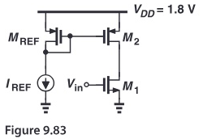

# 장말문제 9.66 — PMOS 전류원 부하 공통 소스 단 설계

## 원문
The common-source stage depicted in Fig. 9.83 must be designed for a voltage gain of 20 and a power budget of $2\ \text{mW}$. Assuming $(W/L)_1 = 20/0.18$, $\lambda_n = 0.1\ \text{V}^{-1}$, and $\lambda_p = 0.2\ \text{V}^{-1}$, design the circuit.

## 조건
- 설계 대상: Fig 9.83의 공통 소스 단 ($M_1$ 입력, $M_{REF}$–$M_2$ PMOS 거울이 전류원 부하)
- 목표 전압 이득 20, 전력 예산 $2\ \text{mW}$, $V_{DD} = 1.8\ \text{V}$ (그림에 표시)
- $(W/L)_1 = 20/0.18$
- $\lambda_n = 0.1\ \text{V}^{-1}$, $\lambda_p = 0.2\ \text{V}^{-1}$
- 출력은 $M_2$ 드레인–$M_1$ 드레인 노드 (그림에 출력 단자가 따로 그려져 있지 않음) (원문에 없음)
- 공통 가정: $\mu_n C_{ox} = 100\ \mu\text{A/V}^2$, $\mu_p C_{ox} = 50\ \mu\text{A/V}^2$, $V_{TH,n} = 0.4\ \text{V}$, $V_{TH,p} = -0.5\ \text{V}$ (원문의 Design Problems 머리말)

## 구할 것
- 회로 설계 (정할 값 예: $I_{REF}$, $(W/L)_{REF}$, $(W/L)_2$, $V_{in}$ DC 레벨) (원문에 없음, 원문은 "설계하라"만 적음)

## 상속·참조
- Design Problems 공통 가정 (문제에 따로 적힌 값이 우선):
  - $I_{S,n} = I_{S,p} = 6 \times 10^{-16}\ \text{A}$
  - $V_{A,n} = V_{A,p} = 5\ \text{V}$
  - $\beta_n = 100$, $\beta_p = 50$
  - $\mu_n C_{ox} = 100\ \mu\text{A/V}^2$, $\mu_p C_{ox} = 50\ \mu\text{A/V}^2$
  - $V_{TH,n} = 0.4\ \text{V}$, $V_{TH,p} = -0.5\ \text{V}$
  - 첨자 n은 npn/NMOS, p는 pnp/PMOS

## 회로 — Fig 9.83
```spice
MREF  n1  n1   VDD  pmos
M2    n2  n1   VDD  pmos
M1    n2  Vin  0    nmos  W/L=20/0.18
IREF  n1  0
```
- 단자: VDD = 1.8 V 전원 (가로 레일) / Vin = 신호 입력 (개방 원)
- 표시: 노드 라벨 "V_DD = 1.8 V" (레일 오른쪽 끝), V_in (입력 원 왼쪽) / 소자 라벨 M_REF (M_REF 왼쪽), M2, M1 (각 트랜지스터 오른쪽), I_REF (전류원 왼쪽) / 부호 없음 / 화살표 없음 / 수치·면적 라벨 "V_DD = 1.8 V"의 1.8 V (레일 오른쪽 끝) (W/L 값은 문제 글에만 있음)
- 배치: 맨 위 굵은 가로 레일 V_DD가 M_REF 소스 선보다 조금 왼쪽에서 M2 소스 선보다 조금 오른쪽까지 뻗음 / 왼쪽 세로줄 위→아래 레일, M_REF, n1 접속점, I_REF 전류원(원 안 화살표 아래), 접지 / M_REF PMOS 좌우 반전(게이트 오른쪽, 소스 왼쪽 위 → 레일·소스 화살표가 채널 쪽으로 들어감, 드레인 왼쪽 아래 → n1) / 다이오드 연결: n1 접속점에서 가로선이 오른쪽으로 가 모서리에서 위로 꺾여 M_REF 게이트 오른쪽 접속점 / 게이트 공통선: M_REF 게이트 접속점에서 게이트 높이로 오른쪽 M2 게이트까지 한 직선 / 오른쪽 세로줄 위→아래 레일, M2, M1, 접지 / M2 PMOS 보통 방향(게이트 왼쪽, 소스 위 → 레일·소스 화살표가 채널 쪽으로 들어감), M2 드레인에서 곧은 세로선이 M1 드레인으로 (n2, 라벨 없음, 출력 단자 없음) / M1 NMOS 보통 방향(게이트 왼쪽, 소스 화살표 바깥), V_in 원 → 가로선 → M1 게이트, 소스 아래 접지 (I_REF 아래 접지와 같은 높이) / 접속점 (세 갈래 이상, 2곳): n1 = 위 M_REF 드레인 + 아래 I_REF + 오른쪽 다이오드 연결 선 (점), M_REF 게이트 = 왼쪽 M_REF 게이트 + 아래 다이오드 연결 선 + 오른쪽 M2 게이트로 가는 선 (점) / 교차: 없음


