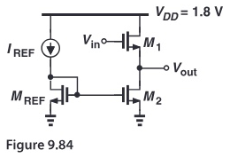

# 장말문제 9.67 — 이득 0.85, 출력 임피던스 100 Ω 소스 폴로어 설계

## 원문
The source follower of Fig. 9.84 must achieve a voltage gain of 0.85 and an output impedance of $100\ \Omega$. Assuming $(W/L)_2 = 10/0.18$, $\lambda_n = 0.1\ \text{V}^{-1}$, and $\lambda_p = 0.2\ \text{V}^{-1}$, design the circuit.

## 조건
- 설계 대상: Fig 9.84의 소스 폴로어 ($M_1$ 폴로어, $M_{REF}$–$M_2$ 거울이 바이어스 전류원)
- 목표 전압 이득 0.85, 출력 임피던스 $100\ \Omega$, $V_{DD} = 1.8\ \text{V}$ (그림에 표시)
- $(W/L)_2 = 10/0.18$
- $\lambda_n = 0.1\ \text{V}^{-1}$, $\lambda_p = 0.2\ \text{V}^{-1}$
- 공통 가정: $\mu_n C_{ox} = 100\ \mu\text{A/V}^2$, $V_{TH,n} = 0.4\ \text{V}$ (원문의 Design Problems 머리말)
- 원문 사양 충돌: 두 사양에서 $g_{m1} = 8.5\ \text{mS}$, $r_{O1} \parallel r_{O2} \approx 667\ \Omega$, 곧 $I \approx 7.5\ \text{mA}$가 나오는데, 이 전류로는 $V_{DD} = 1.8\ \text{V}$에서 $M_1$, $M_2$가 포화에 들 헤드룸이 없음. 여기서는 두 사양으로 전류와 $(W/L)_1$ 등 소신호 설계만 하고 헤드룸은 따지지 않음 (원문에 없음)
- 이 회로는 모두 NMOS라 $\lambda_p$는 쓰이지 않음 (원문에 없음)

## 구할 것
- 회로 설계 (정할 값 예: $(W/L)_1$, 바이어스 전류, $I_{REF}$와 $(W/L)_{REF}$) (원문에 없음, 원문은 "설계하라"만 적음)

## 상속·참조
- Design Problems 공통 가정 (문제에 따로 적힌 값이 우선):
  - $I_{S,n} = I_{S,p} = 6 \times 10^{-16}\ \text{A}$
  - $V_{A,n} = V_{A,p} = 5\ \text{V}$
  - $\beta_n = 100$, $\beta_p = 50$
  - $\mu_n C_{ox} = 100\ \mu\text{A/V}^2$, $\mu_p C_{ox} = 50\ \mu\text{A/V}^2$
  - $V_{TH,n} = 0.4\ \text{V}$, $V_{TH,p} = -0.5\ \text{V}$
  - 첨자 n은 npn/NMOS, p는 pnp/PMOS

## 회로 — Fig 9.84
```spice
IREF  VDD   n1
MREF  n1    n1   0     nmos
M2    Vout  n1   0     nmos  W/L=10/0.18
M1    VDD   Vin  Vout  nmos
```
- 단자: VDD = 1.8 V 전원 (가로 레일) / Vin = 신호 입력 (개방 원) / Vout = 출력 (개방 원)
- 표시: 노드 라벨 "V_DD = 1.8 V" (레일 오른쪽 끝), V_in (입력 원 왼쪽), V_out (출력 원 오른쪽) / 소자 라벨 I_REF (전류원 왼쪽), M_REF (M_REF 왼쪽), M1, M2 (각 트랜지스터 오른쪽, 소스 옆) / 부호 없음 / 화살표 없음 / 수치·면적 라벨 "V_DD = 1.8 V"의 1.8 V (레일 오른쪽 끝) (W/L 값은 문제 글에만 있음)
- 배치: 맨 위 굵은 가로 레일 V_DD가 I_REF 윗선보다 조금 왼쪽에서 M1 드레인 선보다 조금 오른쪽까지 뻗음, 왼쪽 끝 근처에 I_REF, 오른쪽 끝 근처에 M1 드레인 선이 매달림 / 왼쪽 세로줄 위→아래 레일, I_REF 전류원(원 안 화살표 아래), n1 접속점, M_REF, 접지 / M_REF NMOS 좌우 반전(게이트 오른쪽, 드레인 왼쪽 위, 소스 왼쪽 아래·소스 화살표 바깥(왼쪽)) / 다이오드 연결: n1 접속점에서 가로선이 오른쪽으로 가 모서리에서 아래로 꺾여 M_REF 게이트 오른쪽 접속점 / 게이트 공통선: M_REF 게이트 접속점에서 게이트 높이로 오른쪽 M2 게이트까지 한 직선 / 오른쪽 세로줄 위→아래 레일, M1, Vout 접속점, M2, 접지 / M1, M2 NMOS 보통 방향(게이트 왼쪽, 드레인 위, 소스 아래·소스 화살표 바깥) / V_in 원 → 가로선 → M1 게이트, M1 드레인 → 세로선 위로 레일 / M1 소스 → Vout 접속점 → M2 드레인 / Vout 접속점에서 가로선이 오른쪽으로 V_out 원 / M2 소스 아래 접지 (M_REF 접지와 같은 높이) / 접속점 (세 갈래 이상, 3곳): n1 = 위 I_REF + 아래 M_REF 드레인 + 오른쪽 다이오드 연결 선 (점), M_REF 게이트 = 왼쪽 M_REF 게이트 + 위 다이오드 연결 선 + 오른쪽 M2 게이트로 가는 선 (점), Vout = 위 M1 소스 + 아래 M2 드레인 + 오른쪽 V_out 선 (점) / 교차: 없음



## 힌트
### 두 사양으로 $g_{m1}$과 $r_O$ 병렬 풀기
- 체 효과를 무시하면 이득과 출력 임피던스 모두 $g_{m1}$과 출력 노드에서 AC 접지로 보이는 $r_{O1} \parallel r_{O2}$만으로 쓰인다(출력 컨덕턴스로 쓰면 둘 다 $g_{m1}$과 이 저항의 역수로 된 간단한 식)
- 둘을 연립하면 $g_{m1}$과 이 저항이 함께 정해지고, 이 저항은 $\lambda$와 바이어스 전류로만 정해지므로 전류가 먼저 나온다
