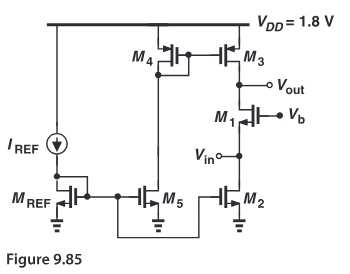

# 장말문제 9.68 — 전류원 부하 공통 게이트 단 설계

## 원문
The common-gate stage of Fig. 9.85 employs the current source $M_3$ as the load to achieve a high voltage gain. For simplicity, neglect channel-length modulation in $M_1$. Assuming $(W/L)_3 = 40/0.18$, $\lambda_n = 0.1\ \text{V}^{-1}$, and $\lambda_p = 0.2\ \text{V}^{-1}$, design the circuit for a voltage gain of 20, an input impedance of $50\ \Omega$, and a power budget of $13\ \text{mW}$. (You may not need all of the power budget.)

## 조건
- 설계 대상: Fig 9.85의 공통 게이트 단 ($M_1$ 공통 게이트, 높은 전압 이득을 얻으려고 전류원 $M_3$을 부하로 씀)
- $M_1$의 채널 길이 변조는 무시
- $(W/L)_3 = 40/0.18$
- $\lambda_n = 0.1\ \text{V}^{-1}$, $\lambda_p = 0.2\ \text{V}^{-1}$
- 목표 전압 이득 20, 입력 임피던스 $50\ \Omega$, 전력 예산 $13\ \text{mW}$ (전력 예산을 다 쓸 필요는 없을 수 있음), $V_{DD} = 1.8\ \text{V}$ (그림에 표시)
- 문제 글은 교재 494쪽(PDF p.29) 오른쪽 단 끝에서 495쪽(PDF p.30) 왼쪽 단으로 이어짐
- 공통 가정: $\mu_n C_{ox} = 100\ \mu\text{A/V}^2$, $\mu_p C_{ox} = 50\ \mu\text{A/V}^2$, $V_{TH,n} = 0.4\ \text{V}$, $V_{TH,p} = -0.5\ \text{V}$ (원문의 Design Problems 머리말)

## 구할 것
- 회로 설계 (정할 값 예: $M_1$ 바이어스 전류와 $(W/L)_1$, $M_2$·$M_4$·$M_5$·$M_{REF}$ 크기, $I_{REF}$, $V_b$) (원문에 없음, 원문은 "설계하라"만 적음)

## 상속·참조
- Design Problems 공통 가정 (문제에 따로 적힌 값이 우선):
  - $I_{S,n} = I_{S,p} = 6 \times 10^{-16}\ \text{A}$
  - $V_{A,n} = V_{A,p} = 5\ \text{V}$
  - $\beta_n = 100$, $\beta_p = 50$
  - $\mu_n C_{ox} = 100\ \mu\text{A/V}^2$, $\mu_p C_{ox} = 50\ \mu\text{A/V}^2$
  - $V_{TH,n} = 0.4\ \text{V}$, $V_{TH,p} = -0.5\ \text{V}$
  - 첨자 n은 npn/NMOS, p는 pnp/PMOS

## 회로 — Fig 9.85
```spice
IREF  VDD   n1
MREF  n1    n1   0    nmos
M5    n2    n1   0    nmos
M4    n2    n2   VDD  pmos
M3    Vout  n2   VDD  pmos  W/L=40/0.18
M1    Vout  Vb   Vin  nmos
M2    Vin   n1   0    nmos
```
- 단자: VDD = 1.8 V 전원 (가로 레일) / Vb = 이상적 DC 바이어스, 값 미지정 (점 단자) / Vin = 신호 입력 (개방 원) / Vout = 출력 (개방 원)
- 표시: 노드 라벨 "V_DD = 1.8 V" (레일 오른쪽 끝), V_out (출력 원 오른쪽), V_b (점 단자 오른쪽), V_in (입력 원 왼쪽) / 소자 라벨 I_REF (전류원 왼쪽), M_REF (M_REF 왼쪽), M5, M2 (각 트랜지스터 오른쪽, 소스 옆), M4 (M4 왼쪽), M3 (M3 오른쪽), M1 (M1 왼쪽) / 부호 없음 / 화살표 없음 / 수치·면적 라벨 "V_DD = 1.8 V"의 1.8 V (레일 오른쪽 끝) (W/L 값은 문제 글에만 있음)
- 배치: 맨 위 굵은 가로 레일 V_DD가 I_REF 윗선보다 조금 왼쪽에서 M3 소스 선보다 조금 오른쪽까지 뻗음, 왼쪽 끝 근처에 I_REF 윗선, 가운데에 M4 소스 선, 오른쪽 끝 근처에 M3 소스 선이 매달림 / 왼쪽 세로줄 위→아래 레일, 긴 세로선, I_REF 전류원(원 안 화살표 아래, 그림 아래쪽), n1 접속점, M_REF, 접지 / M_REF NMOS 좌우 반전(게이트 오른쪽, 소스 화살표 바깥(왼쪽)) / 다이오드 연결: n1 접속점에서 가로선이 오른쪽으로 가 모서리에서 아래로 꺾여 M_REF 게이트 오른쪽 접속점 / NMOS 게이트 공통선: M_REF 게이트 접속점에서 게이트 높이로 오른쪽으로 가다 둘째 접속점을 지나 M5 게이트까지 한 직선 / M2 게이트 경로: 둘째 접속점에서 세로선이 아래로 내려가 접지 기호들보다 아래 높이에서 오른쪽으로 꺾여 M5 아래를 지나고, M2 왼쪽에서 위로 꺾여 게이트 높이에서 오른쪽으로 꺾여 M2 게이트 / M5 NMOS 보통 방향(게이트 왼쪽), 소스 아래 접지, 드레인에서 긴 세로선이 위로 올라가 M4 드레인 접속점 (n2) / 위쪽 PMOS 거울: M4 PMOS 좌우 반전(게이트 오른쪽, 소스 위 → 레일·소스 화살표가 채널 쪽으로 들어감, 드레인 왼쪽 아래 → n2 접속점), M3 PMOS 보통 방향(게이트 왼쪽, 소스 위 → 레일) / M4 다이오드 연결: n2 접속점에서 가로선이 오른쪽으로 가 모서리에서 위로 꺾여 M4 게이트 오른쪽 접속점 / PMOS 게이트 공통선: M4 게이트 접속점에서 게이트 높이로 오른쪽 M3 게이트까지 한 직선 / 오른쪽 세로줄 위→아래 레일, M3, Vout 접속점, M1, Vin 접속점, M2, 접지 / Vout 접속점에서 가로선이 오른쪽으로 V_out 원 / M1 NMOS 좌우 반전(게이트 오른쪽, 드레인 위 → Vout, 소스 아래·소스 화살표 바깥(왼쪽) → Vin 접속점), 게이트에서 가로선이 오른쪽으로 V_b 점 단자 / V_in 원 → 가로선 → Vin 접속점 → 아래 M2 드레인 / M2 NMOS 보통 방향, 소스 아래 접지 (세 NMOS 접지 같은 높이) / 접속점 (세 갈래 이상, 7곳): ① n1 = 위 I_REF + 아래 M_REF 드레인 + 오른쪽 다이오드 연결 선 (점) ② M_REF 게이트 = 왼쪽 M_REF 게이트 + 위 다이오드 연결 선 + 오른쪽 게이트 공통선 (점) ③ 둘째 접속점 = 왼쪽 게이트 공통선 + 오른쪽 M5 게이트 + 아래 M2로 가는 우회선 (점) ④ n2 = 위 M4 드레인 + 아래 M5 드레인으로 가는 긴 세로선 + 오른쪽 M4 다이오드 연결 선 (점) ⑤ M4 게이트 = 왼쪽 M4 게이트 + 아래 다이오드 연결 선 + 오른쪽 M3 게이트로 가는 선 (점) ⑥ Vout = 위 M3 드레인 + 아래 M1 드레인 + 오른쪽 V_out 선 (점) ⑦ Vin = 위 M1 소스 + 아래 M2 드레인 + 왼쪽 V_in 선 (점) / 교차: 없음 (M2 게이트 우회선은 M5 접지 기호 아래를 지나므로 닿지 않음)


> 참고: Fig 9.85는 교재 495쪽(PDF p.30) 윗부분에 있음
