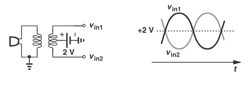

# 연습문제 10.2 — 증폭기 입력 바이어스 전류가 흐를 때 CM 레벨 변화 (예제 10.2 변형)

## 조건
- 예제 10.2의 풀이 회로(Fig 10.5): 가운데 탭을 $+2\ \text{V}$ 배터리로 올린 변압기, 출력 $v_{in1}$, $v_{in2}$
- 두 출력이 증폭기 입력에 연결되고, 그 입력에 바이어스 전류가 흐름
- 증폭기는 그림에 없음. $v_{in1}$, $v_{in2}$ 단자에 연결된 증폭기의 두 입력으로 해석 (원문에 없음)
- 바이어스 전류 값, 변압기 코일의 저항은 주어지지 않음 (원문에 없음)

## 구할 것
- 증폭기 입력에 바이어스 전류가 흐를 때 CM 레벨이 변하는지

## 상속·참조
- 예제 10.2 (E10.02): Fig 10.3(c)의 변압기에서 접지돼 있던 가운데 탭을 $+2\ \text{V}$에 묶어 출력 CM 레벨을 $+2\ \text{V}$로 만듦
- CM 레벨: 차동 신호가 없을 때 두 출력 노드가 접지에 대해 갖는 공통 dc 전위 (식 10.11–10.12의 $V_{CM}$)

## 회로 — Fig 10.5
```spice
XMIC  n1    0  box "마이크"   ; 그림은 D자 모양 마이크 기호, 글자 없음. 상자 라벨은 원문에 없음
LP    n1    0                  ; 변압기 1차 코일 (라벨·값 없음)
* LS1 + LS2 = 가운데 탭이 있는 2차 코일 하나 (그림은 코일 하나에서 가운데 탭을 인출). LP와 자기 결합 (결합은 SPICE K 문 대신 주석, 원문에 없음)
LS1   vin1  n2                 ; 2차 코일 위쪽 절반
LS2   n2    vin2               ; 2차 코일 아래쪽 절반
VB    n2    0   2V             ; 배터리, + 쪽이 가운데 탭
```
- 단자: vin1, vin2 = 변압기 2차 코일 양 끝의 출력 (개방 원) / 배터리 − 쪽은 접지 기호에 바로 연결
- 표시: 노드 라벨 v_in1 (위 출력 원 오른쪽), v_in2 (아래 출력 원 오른쪽) / 소자 라벨 없음 (마이크, 코일, 배터리 모두 라벨 없음) / 부호 + (배터리 왼쪽 판 왼쪽 위), 배터리 오른쪽(짧은) 판 오른쪽 위, 접지로 가는 짧은 가로 도선 위에 짧은 세로 획 하나 (− 표시로 보임) / 화살표 없음 / 수치·면적 라벨 "2 V" (배터리 아래)
- 배치: 왼쪽 마이크(D자, 평평한 쪽 왼쪽), 1차 코일(세로), 2차 코일(세로), 오른쪽 출력 원 두 개(위·아래) / 마이크 D자 오른쪽에 위·아래 두 짧은 가로 인출선(서로 떨어짐). 위 인출선 → 위로 → 오른쪽 → 1차 코일 위 끝, 아래 인출선 → 아래로 → 가로선 → 1차 코일 아래 끝, 가로선 가운데 접속점에서 아래로 접지 기호 / 2차 코일 위 끝 → 위로 → 오른쪽 가로선 → v_in1 원, 아래 끝 → 아래로 → 오른쪽 가로선 → v_in2 원 / 2차 코일 가운데 탭에서 가로선이 오른쪽으로 배터리 왼쪽(긴) 판, 배터리 오른쪽(짧은) 판에서 짧은 가로선 → 옆으로 누운 접지 기호(막대가 세로, 오른쪽을 향함) / 접속점 (세 갈래 이상, 1곳): 1차 쪽 아래 가로선 = 왼쪽 마이크 아래 도선 + 오른쪽 1차 코일 아래 끝 + 아래 접지 (점) / 교차: 없음


> 참고: 크롭 이미지 오른쪽은 같은 그림의 파형 — v_in1(검은 선)과 v_in2(회색 선)가 점선 "+2 V" 레벨을 중심으로 서로 반대 위상으로 흔들림, 가로축 t
