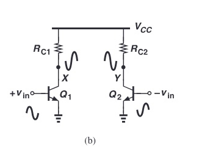

# 연습문제 10.3 — V_CC와 컬렉터 저항 사이에 R_1을 넣었을 때 출력 CM 레벨 (예제 10.3 변형)

## 원문
만일 $V_{CC}$와 $R_{C1}$, $R_{C2}$의 위쪽 단자 사이에 저항 $R_1$ 값이 있다면, 출력 CM 레벨은 얼마인가?

## 조건
- 예제 10.3의 회로 Fig 10.3(b)에서 $V_{CC}$와 $R_{C1}$, $R_{C2}$의 위쪽 단자 사이에 저항 $R_1$을 넣음
  - 즉 $R_{C1}$, $R_{C2}$의 위쪽 단자를 한 노드로 묶고 그 노드와 $V_{CC}$ 사이에 $R_1$ (원문에 없음)
- 나머지($R_{C1} = R_{C2} = R_C$, 각 트랜지스터 바이어스 전류 $I_C$)는 예제와 같음 (원문에 없음)

## 구할 것
- 출력 CM 레벨

## 상속·참조
- 예제 10.3 (E10.03): $R_1$이 없을 때 신호가 없으면 $V_X = V_Y = V_{CC} - R_C I_C$, 즉 $V_{CM} = V_{CC} - R_C I_C$ ($R_C = R_{C1} = R_{C2}$, $I_C$는 $Q_1$, $Q_2$ 각각의 바이어스 전류)

## 회로 — Fig 10.3(b)
```spice
RC1  VCC  X     {R_C1}
RC2  VCC  Y     {R_C2}
Q1   X    vinp  0  npn   ; vinp = 인쇄 라벨 +v_in
Q2   Y    vinm  0  npn   ; vinm = 인쇄 라벨 -v_in
```
- 단자: VCC = 전원, 값 미지정 (가로 레일) / vinp = 입력 +v_in (개방 원) / vinm = 입력 −v_in (개방 원)
- 표시: 노드 라벨 VCC (레일 오른쪽 끝), X (X 점 오른쪽 아래), Y (Y 점 왼쪽 아래), +v_in (왼쪽 입력 원 왼쪽), −v_in (오른쪽 입력 원 오른쪽) / 소자 라벨 R_C1 (왼쪽 저항 왼쪽), R_C2 (오른쪽 저항 오른쪽), Q1 (Q1 오른쪽), Q2 (Q2 왼쪽) / 부호 +, − (입력 라벨 +v_in, −v_in 앞에 붙은 부호) / 화살표 없음 / 수치·면적 라벨 없음
- 배치: 맨 위 굵은 가로 레일 VCC, 왼쪽 끝 근처에 R_C1, 오른쪽 끝 근처에 R_C2가 매달리고 레일은 R_C2 오른쪽으로 조금 더 뻗음 / 왼쪽 세로줄 위→아래 R_C1, X 점, Q1, 접지 / 오른쪽 세로줄 위→아래 R_C2, Y 점, Q2, 접지 / Q1 npn 보통 방향(베이스 왼쪽), Q2 npn 좌우 반전(베이스 오른쪽, 컬렉터 왼쪽 위, 이미터 왼쪽 아래) / +v_in 원 → 가로선 → Q1 베이스, −v_in 원 → 가로선 → Q2 베이스 / 각 이미터 아래 접지 기호 따로 / X, Y 점은 저항과 컬렉터 사이 두 갈래 도선 위에 찍힌 점 / 파형 기호(사인 한 주기 조각) 4개: X 점 오른쪽, Y 점 왼쪽, +v_in 원 아래, −v_in 원 아래(Q2 이미터 오른쪽). X와 Y 파형은 서로 뒤집힌 모양, 두 입력 파형도 서로 뒤집힌 모양 / 접속점: 없음 (세 갈래 이상 선이 만나는 곳 없음) / 교차: 없음


> 참고: 그림에는 $R_1$이 없음 (예제 10.3 원래 회로)

## 풀이
### $R_1$에 흐르는 전류
- $R_{C1}$, $R_{C2}$의 위쪽 단자가 한 노드이므로 두 컬렉터 전류가 모두 $R_1$을 지난다
- $R_1$의 전류 $= 2I_C$ ($R_{C1} = R_{C2} = R_C$, $I_C$는 $Q_1$, $Q_2$ 각각의 바이어스 전류)
- 위쪽 노드 전압 $= V_{CC} - 2R_1 I_C$
### 출력 CM 레벨
- 신호가 없으면 $V_X = V_Y = V_{CC} - 2R_1 I_C - R_C I_C$
- $V_{CM} = V_{CC} - (R_C + 2R_1) I_C$
- 차동 신호에서는 두 컬렉터 전류 변화가 상쇄되어 $R_1$의 전류가 변하지 않으므로 $R_1$은 CM 레벨만 낮춘다
### 답
- 출력 CM 레벨 $V_{CM} = V_{CC} - (R_C + 2R_1) I_C$
