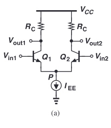
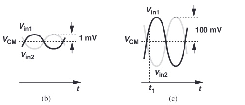

# 연습문제 10.9 — 테일 전류가 절반일 때 예제 10.9의 결과 (예제 10.9 변형)

## 원문
위의 결과에서 만약 테일 전류가 절반만 흐른다면 어떻게 되는가?

## 조건
- 예제 10.9의 바이폴라 차동쌍(Fig 10.16(a))과 입력 파형(Fig 10.16(b), (c))
- 바뀐 조건: 테일 전류가 절반만 흐름 ($I_{EE}/2$)
- 나머지(두 $R_C$, 입력 진폭 $1\ \text{mV}$, $100\ \text{mV}$, 순방향 활성 가정)는 예제와 같음 (원문에 없음)

## 구할 것
- 예제 10.9의 결과(두 입력에 대한 출력 파형)가 어떻게 바뀌는지

## 상속·참조
- 예제 10.9 (E10.09) 결과
  - (b) 입력(각 피크 $1\ \text{mV}$, 최대 차동 입력 $\pm 2\ \text{mV}$): 선형 동작, 출력은 피크 진폭 $1\ \text{mV} \times g_m R_C$인 사인파 (Fig 10.16(d))
  - (c) 입력(각 피크 $100\ \text{mV}$, 최대 차동 입력 $\pm 200\ \text{mV}$): 한쪽이 오프되어 출력이 $V_{CC}$와 $V_{CC} - R_C I_{EE}$ 사이에서 포화 (식 10.84–10.85), $|V_{in1} - V_{in2}|$가 $100\ \text{mV}$ 이하가 될 때까지 포화 유지 (Fig 10.16(e)). 중간 레벨 $V_{CC} - R_C I_{EE}/2$
- 소신호 이득 크기 $g_m R_C$, 각 트랜지스터 $g_m = \dfrac{I_{EE}/2}{V_T}$ (바이어스 전류 $I_C = I_{EE}/2$, 원문에 없음)

## 회로 — Fig 10.16(a)
```spice
RC1  VCC    Vout1  {R_C}   ; 두 저항 모두 R_C로 인쇄
RC2  VCC    Vout2  {R_C}
Q1   Vout1  Vin1   P  npn
Q2   Vout2  Vin2   P  npn
IEE  P      0      {I_EE}  ; 이 연습문제에서는 인쇄된 I_EE의 절반이 흐름
```
- 단자: VCC = 전원, 값 미지정 (가로 레일) / Vin1, Vin2 = 입력 (개방 원) / Vout1, Vout2 = 출력 (개방 원)
- 표시: 노드 라벨 VCC (레일 오른쪽 끝), V_out1 (왼쪽 출력 원 왼쪽), V_out2 (오른쪽 출력 원 오른쪽), V_in1 (왼쪽 입력 원 왼쪽), V_in2 (오른쪽 입력 원 오른쪽), P (P 점 왼쪽 아래) / 소자 라벨 R_C (왼쪽 저항 왼쪽), R_C (오른쪽 저항 오른쪽), Q1 (Q1 오른쪽), Q2 (Q2 왼쪽), I_EE (전류원 오른쪽) / 부호 없음 / 화살표 없음 / 수치·면적 라벨 없음
- 배치: 맨 위 굵은 가로 레일 VCC, 왼쪽 R_C보다 조금 왼쪽에서 오른쪽 R_C보다 조금 오른쪽까지 / 왼쪽 세로줄 위→아래 R_C, Vout1 접속점, Q1 / 오른쪽 세로줄 위→아래 R_C, Vout2 접속점, Q2 / Vout1 접속점에서 가로선이 왼쪽 Vout1 원, Vout2 접속점에서 가로선이 오른쪽 Vout2 원 / Q1 npn 보통 방향(베이스 왼쪽), Q2 npn 좌우 반전(베이스 오른쪽, 컬렉터 왼쪽 위, 이미터 왼쪽 아래) / V_in1 원 → 가로선 → Q1 베이스, V_in2 원 → 가로선 → Q2 베이스 / 두 이미터는 아래로 내려가 가로선으로 가운데 P 점에서 만남, P에서 아래로 I_EE 전류원(화살표 아래), 그 아래 접지 / 접속점 (세 갈래 이상, 3곳): ① Vout1 = 위 R_C + 아래 Q1 컬렉터 + 왼쪽 출력선 (점) ② Vout2 = 위 R_C + 아래 Q2 컬렉터 + 오른쪽 출력선 (점) ③ P = 왼쪽 Q1 이미터 선 + 오른쪽 Q2 이미터 선 + 아래 I_EE (점) / 교차: 없음



> 참고: (b), (c)는 입력 파형 그림. (b): V_in1(검은 굵은 선)과 V_in2(회색 선)가 점선 "V_CM" 레벨을 중심으로 반대 위상, 진폭 "1 mV". (c): 같은 모양에 "100 mV", 가로축 "t_1" 표시
