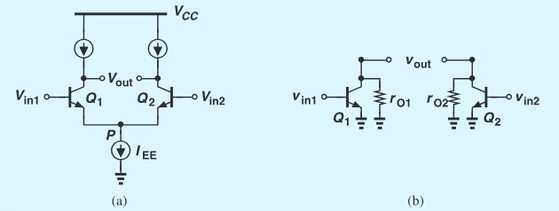

# 연습문제 10.10 — V_A = 5 V일 때 이상적 전류원 부하 차동쌍의 이득 (예제 10.10 변형)

## 조건
- 예제 10.10의 회로(Fig 10.18(a)): 이상적 전류원 부하를 가진 바이폴라 차동쌍
- $V_A = 5\ \text{V}$
- 바이어스 전류와 $V_T$ 값은 주어지지 않음 (원문에 없음)

## 구할 것
- 차동 전압 이득

## 상속·참조
- 예제 10.10 (E10.10): 이상적 전류원 부하이면 절반 회로의 부하는 $r_O$뿐 → $\dfrac{v_{out1} - v_{out2}}{v_{in1} - v_{in2}} = -g_m r_O$ (식 10.97)
- $g_m = I_C/V_T$, $r_O = V_A/I_C$ ($I_C$: 각 트랜지스터 바이어스 전류 $= I_{EE}/2$, 원문에 없음)

## 회로 — Fig 10.18(a)
```spice
I1   VCC   out1   ; 이상적 전류원 (라벨·값 없음)
I2   VCC   out2   ; 이상적 전류원 (라벨·값 없음)
Q1   out1  Vin1   P  npn
Q2   out2  Vin2   P  npn
IEE  P     0      {I_EE}
* out1, out2 = 두 출력 원. 원 사이에 V_out 라벨 하나 (차동 출력)
```
- 단자: VCC = 전원, 값 미지정 (가로 레일) / Vin1, Vin2 = 입력 (개방 원) / out1, out2 = 차동 출력 V_out의 두 단자 (개방 원, 각각에는 라벨 없음)
- 표시: 노드 라벨 VCC (레일 오른쪽 끝), V_out (두 출력 원 사이), V_in1 (왼쪽 입력 원 왼쪽), V_in2 (오른쪽 입력 원 오른쪽), P (P 점 왼쪽 아래) / 소자 라벨 Q1 (Q1 오른쪽), Q2 (Q2 왼쪽), I_EE (테일 전류원 오른쪽), 위쪽 전류원 두 개 (라벨 없음) / 부호 없음 / 화살표 없음 / 수치·면적 라벨 없음
- 배치: 맨 위 굵은 가로 레일 VCC, 왼쪽 전류원보다 조금 왼쪽에서 오른쪽 전류원보다 조금 오른쪽까지 / 왼쪽 세로줄 위→아래 전류원(화살표 아래), out1 접속점, Q1 / 오른쪽 세로줄 위→아래 전류원(화살표 아래), out2 접속점, Q2 / out1 접속점에서 가로선이 오른쪽 출력 원, out2 접속점에서 가로선이 왼쪽 출력 원 (두 원이 가운데에서 마주 보고 그 사이에 V_out) / Q1 npn 보통 방향(베이스 왼쪽), Q2 npn 좌우 반전(베이스 오른쪽, 컬렉터 왼쪽 위, 이미터 왼쪽 아래) / V_in1 원 → 가로선 → Q1 베이스, V_in2 원 → 가로선 → Q2 베이스 / 두 이미터는 아래로 내려가 가로선으로 가운데 P 점에서 만남, P에서 아래로 I_EE(화살표 아래), 그 아래 접지 / 접속점 (세 갈래 이상, 3곳): ① out1 = 위 전류원 + 아래 Q1 컬렉터 + 오른쪽 출력선 (점) ② out2 = 위 전류원 + 아래 Q2 컬렉터 + 왼쪽 출력선 (점) ③ P = 왼쪽 Q1 이미터 선 + 오른쪽 Q2 이미터 선 + 아래 I_EE (점) / 교차: 없음


> 참고: 크롭 이미지 오른쪽 (b)는 예제 풀이 그림(절반 회로)
