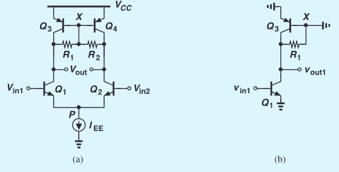

# 연습문제 10.13 — V_A = 4 V, R1 = R2 = 10 kΩ, I_EE = 1 mA일 때의 이득 (예제 10.13 변형)

## 조건
- 예제 10.13의 회로(Fig 10.22(a))
- 모든 트랜지스터에서 $V_A = 4\ \text{V}$
- $R_1 = R_2 = 10\ \text{k}\Omega$
- $I_{EE} = 1\ \text{mA}$
- $V_T$ 값은 주어지지 않음 (원문에 없음)

## 구할 것
- 차동 이득

## 상속·참조
- 예제 10.13 (E10.13): 작은 차동 신호에서 $V_X$ 일정 → 절반 회로(Fig 10.22(b))에서 $A_v = -g_{m1}(r_{O1} \| r_{O3} \| R_1)$ (식 10.101)
- 대칭이므로 각 트랜지스터 바이어스 전류 $I_C = I_{EE}/2$ (원문에 없음), $g_m = I_C/V_T$, $r_O = V_A/I_C$

## 회로 — Fig 10.22(a)
```spice
Q3   out1  X     VCC  pnp
Q4   out2  X     VCC  pnp
R1   out1  X     {R_1}
R2   X     out2  {R_2}
Q1   out1  Vin1  P    npn
Q2   out2  Vin2  P    npn
IEE  P     0     {I_EE}
* out1, out2 = 컬렉터 노드. 두 출력 원 사이에 V_out 라벨 하나 (차동 출력)
```
- 단자: VCC = 전원, 값 미지정 (가로 레일) / Vin1, Vin2 = 입력 (개방 원) / out1, out2 = 차동 출력 V_out의 두 단자 (개방 원, 각각에는 라벨 없음)
- 표시: 노드 라벨 VCC (레일 오른쪽 끝), X (X 점 위), V_out (두 출력 원 사이), V_in1 (왼쪽 입력 원 왼쪽), V_in2 (오른쪽 입력 원 오른쪽), P (P 점 왼쪽 아래) / 소자 라벨 Q3 (Q3 왼쪽), Q4 (Q4 오른쪽), R_1 (R1 아래), R_2 (R2 아래), Q1 (Q1 오른쪽), Q2 (Q2 왼쪽), I_EE (전류원 오른쪽) / 부호 없음 / 화살표 없음 / 수치·면적 라벨 없음
- 배치: 맨 위 굵은 가로 레일 VCC, Q3 이미터 선보다 조금 왼쪽에서 Q4 이미터 선보다 조금 오른쪽까지 / Q3 pnp 좌우 반전(베이스 막대 오른쪽, 이미터 왼쪽 위로 나가 수직으로 레일, 컬렉터 왼쪽 아래로 나가 수직으로 내려감), Q4 pnp 보통 방향(베이스 막대 왼쪽, 이미터 오른쪽 위 → 레일, 컬렉터 오른쪽 아래) / 두 베이스는 막대 가운데 높이의 가로선으로 이어지고 그 가운데 X 점 / X에서 세로선이 아래로 내려가 R1–R2 가운데 점 / 왼쪽 세로선: Q3 컬렉터 → R1 접속점 → 출력 접속점 → Q1 컬렉터, 오른쪽 세로선: Q4 컬렉터 → R2 접속점 → 출력 접속점 → Q2 컬렉터 / R1 접속점 높이에서 R1, R2가 가로로 직렬 (가운데 점에서 X로 올라가는 선과 만남) / 출력 접속점에서 가로선이 가운데 쪽으로 출력 원 (두 원이 마주 보고 그 사이에 V_out) / Q1 npn 보통 방향(베이스 왼쪽), Q2 npn 좌우 반전(베이스 오른쪽) / V_in1 원 → Q1 베이스, V_in2 원 → Q2 베이스 / 두 이미터는 아래로 내려가 가로선으로 가운데 P 점, P에서 아래로 I_EE(화살표 아래), 그 아래 접지 / 접속점 (세 갈래 이상, 7곳): ① X = 왼쪽 Q3 베이스 선 + 오른쪽 Q4 베이스 선 + 아래 세로선 (점) ② R1–R2 가운데 = 위 X 선 + 왼쪽 R1 + 오른쪽 R2 (점) ③ 왼쪽 R1 접속점 = 위 Q3 컬렉터 + 아래 세로선 + 오른쪽 R1 (점) ④ 오른쪽 R2 접속점 = 위 Q4 컬렉터 + 아래 세로선 + 왼쪽 R2 (점) ⑤ 왼쪽 출력 접속점 = 위 세로선 + 아래 Q1 컬렉터 + 오른쪽 출력선 (점) ⑥ 오른쪽 출력 접속점 = 위 세로선 + 아래 Q2 컬렉터 + 왼쪽 출력선 (점) ⑦ P = 왼쪽 Q1 이미터 선 + 오른쪽 Q2 이미터 선 + 아래 I_EE (점) / 교차: 없음


> 참고: 크롭 이미지 오른쪽 (b)는 예제 풀이 그림(절반 회로)
